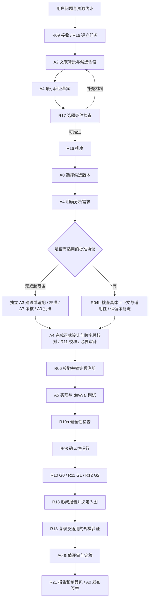
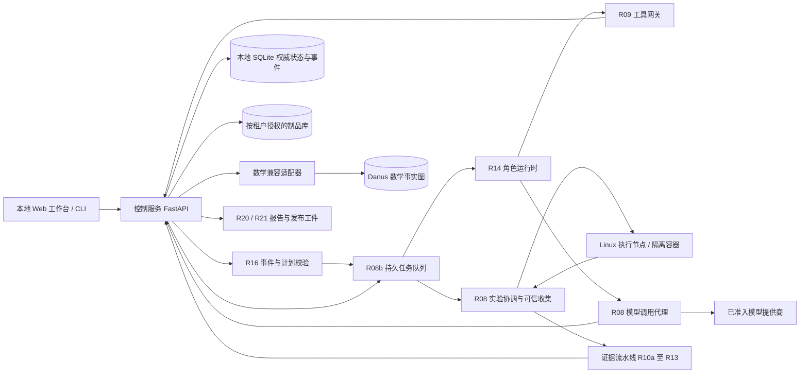
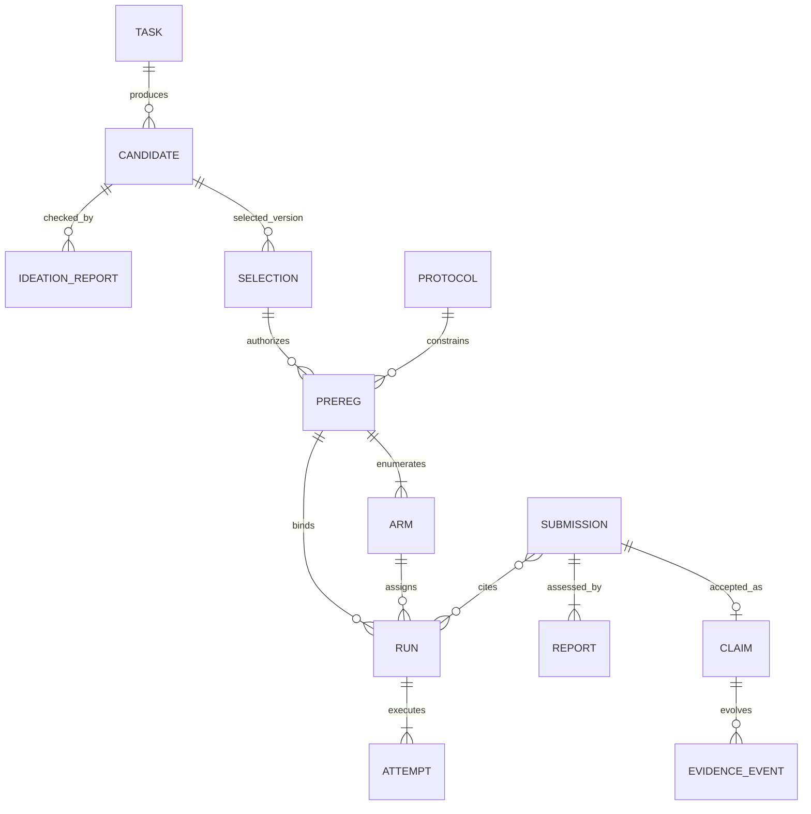
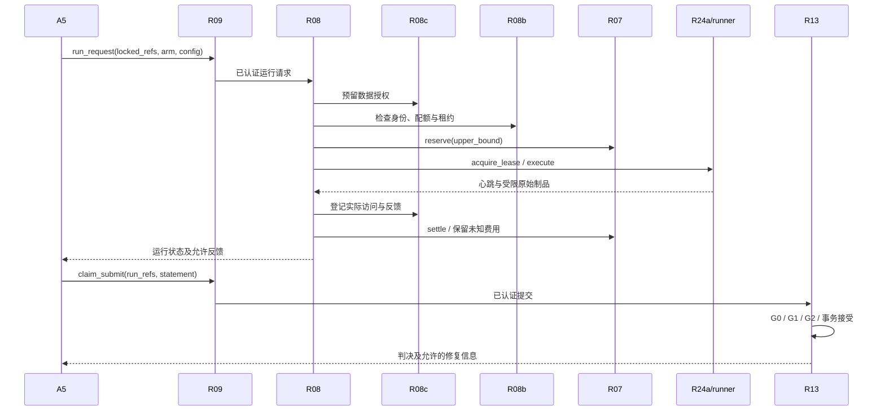
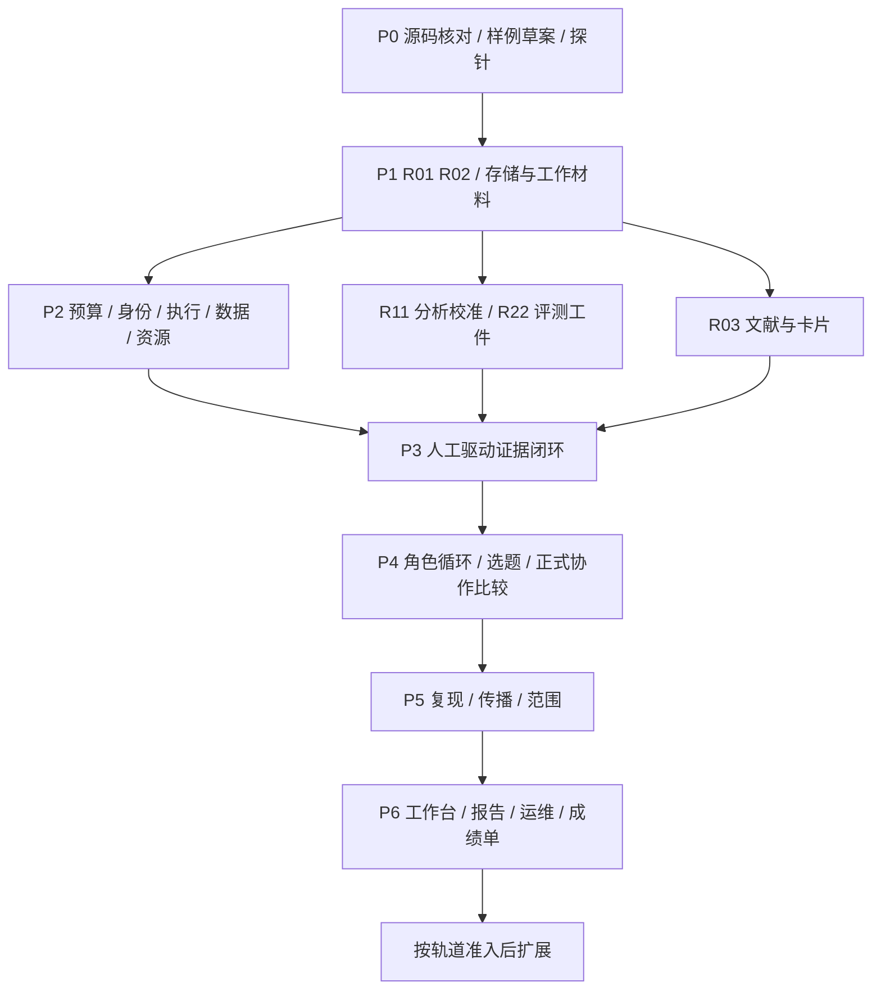

# Danus-AI 科研智能体产品架构与落地执行方案

版本：1.2 · 统一修订最终确认稿（待产品负责人确认）  
日期：2026-11-05  
适用对象：产品负责人、开发者、科研协议审核者、系统评测者  
文档性质：产品与工程执行规格。确认后作为实施基线；当前尚未代表软件已经实现或通过实测。文中“必须”表示实现或验收约束，设计目标、规划估算与实测事实分别标识。实际付费、资源购买和对外发布仍执行本文规定的授权。

配套实施规格：[《Danus-AI Agent 角色实现与验收规格》v0.2](<./Danus-AI Agent 角色实现与验收规格.md>)。交付文件及摘要见同目录 `Danus-AI v1.2 文档版本清单.json`。本轮完成文档修订，待产品负责人最终确认；不代表代码、模型资格或科研收益已通过验收。

## 目录

1. [产品范围与交付边界](#s1)
2. [用户功能与科研主流程](#s2)
3. [系统总体架构与部署结构](#s3)
4. [角色、权限与协作协议](#s4)
5. [数据对象与状态模型](#s5)
6. [模块设计与技术选型](#s6)
7. [接口衔接与依赖关系](#s7)
8. [证据验证与结论生命周期](#s8)
9. [模型、算力与预算管理](#s9)
10. [系统评测与版本验收](#s10)
11. [开发步骤与阶段交付](#s11)
12. [部署运维、发布与扩展](#s12)

附录：[A 接口与错误码](#a1) · [B 配置与锁定规则](#a2) · [C 贯穿流程的契约样例](#a3) · [D 扩展轨道规格](#a4) · [E 实施核对表](#a5) · [F 技术依据](#a6)

<a id="s1"></a>
## 1. 产品范围与交付边界

### 1.1 产品定义

Danus-AI 是面向科研工作者的研究执行与证据管理系统。用户给定研究问题、数据条件和资源上限，系统协助检索文献、形成候选假设、设计对照实验、实现与运行方法、审查证据、组织复现并生成可追溯的研究报告。协议、选题、研究价值及发布由人负责。

首个完整场景是 AI 研究。产品支持的目标领域包括智能体、训练方法和模型架构；首版先交付智能体/API 实验的完整闭环。训练和架构实验在相应任务模板、基线、统计方法和算力控制通过验收后开放，不能仅凭能执行任意 Python 程序宣称已支持整个研究轨道。

系统的核心承诺为：研究结果可追溯；证据强度与适用范围可见；失败和不确定结果保留；可信度与产出能力由独立评测报告呈现。系统不保证每次提出的新课题有价值，也不将通过审计等同于科学真理。

产品按三层交付承诺管理：第一层是工程可执行性与审计可追溯性，必须通过故障和权限验收；第二层是在明确任务分布上的科研可靠性与协作收益，必须通过第 10 章独立评测；第三层是新课题的实际研究价值，由真实研究及人的价值判断形成证据。前一层通过不自动证明后一层成立。

首版交付给能够维护 Linux/WSL2 环境、配置模型账户并承担科研审批的单名研究操作者。支持范围为安装文档、CLI/本地工作台、已验收任务模板及故障诊断；不承诺任意科研领域、任意云平台或无人值守托管。首份可运行纵向切片固定为：公开或合成数据上的一个智能体方法与基线比较，贯通协议、预注册、执行、验证、报告及一次重跑。

**面向市场的边界。** 账户表示登录者，个人租户表示数据、权限和费用归属，项目表示一次研究空间。首版业务关系为一名研究者拥有一个个人租户，平台允许存在多个个人租户；测试从 P1 使用两个租户验证隔离。A0 是租户内项目的科研批准责任，不是平台跨租户管理员。核心科研模块共用，租户认证、资源分配和服务运营通过端口隔离；这能减少后续核心改造，但不能免除托管阶段的安全、容量和迁移工程。

### 1.2 首版交付

| 能力 | 首版交付范围 | 完成条件 |
|---|---|---|
| 用户工作台 | 本地浏览器界面、等价 CLI、项目与审批队列 | 三种入口均能创建任务、查看状态、暂停和继续 |
| 文献与选题 | 可追溯卡片、候选假设、验证草案、选题检查和排序 | 每个候选可查来源、未验证条件、成本估计和检查结果 |
| 科研执行 | 协议、预注册、dev/val/test 隔离、方法与基线公平比较 | 至少一个智能体研究任务端到端运行 |
| 证据管理 | 健全性、确定性核验、统计、方法学审计、经验论断图 | 正面、有限否定、不确定、拒绝分支均正确处理 |
| 复现与报告 | 新运行随机性复核、适用的规模验证、报告和制品包 | 在干净环境按记录重跑；公开措辞与证据一致 |
| 系统评测 | 证据包评测、协作实验、再发现评测、成本与人工投入 | 发布版本附带实际测得的成绩单及区间 |
| 数学兼容 | 保留 Danus 数学核及只读引用适配 | 明确非形式审核性质；撤销能影响引用状态 |

首版交付形态是一个个人账户、一个个人租户、单控制主机和少量并发任务；该租户可拥有多个研究项目。租户边界从首版进入契约和测试，后续面向多个个人研究者托管。首版不交付公网多租户服务、团队协作或企业权限体系。初始同时运行 1 个模型角色会话，P2 真实负载验证后可启用最多 3 个；确认性对照包初始并发为 1；并发数是资源配置，不改变角色分权。

数学首版范围固定为兼容与只读引用：保留原 Danus 数学存储的来源权威，受控核验其状态并同步撤销。该项不等于同时建设完整自主数学研究产品；新的数学工作流和 Lean 能力按附录 D 的 R33/R34 准入。未适配并合格的旧模型调用路径关闭，不因“保留数学核”保留不受控的付费或执行入口。

### 1.3 模块、角色与阶段编号

- **R** 表示功能模块。主线共 **30 个**：R00–R14 中含 R04b、R08b、R08c、R10a；R15 拆为 R15a/R15b/R15c；R16–R22；另含 R24a。
- **A** 表示角色，A0–A12 共 13 个；其中部分是人或程序，不是 13 个大模型常驻进程。
- **P** 表示开发阶段，P0–P6；**T** 表示后续训练算力级别，T0–T6。
- R23–R39 的扩展功能不列入首版完成条件。R24a 是提前实现的最小算力接入；最低资源准入检查在主线完成，完整 R39 后续扩展。

模块是职责与代码组织单位，不一一对应微服务。第 3 章定义进程部署，第 6 章定义模块，第 11 章定义开发顺序。

**文档与执行契约。** 本方案规定架构、权限、科研约束和阶段门；配套角色规格 v0.2 细化七类模型角色的合同、上下文、失败处理与验收，不能扩大权限、降低统计要求或绕过审批。阅读版用于理解，同样不构成放宽要求的依据。实现时 Pydantic 类型是可执行 Schema 的唯一编辑源，文档规定业务语义；导出工具说明与字段表，不并行手写第二套可执行 Schema。发布记录绑定两份规格版本、摘要和代码契约版本；冲突时暂停受影响验收并修正。修改登记和落实对照记录决策，不是额外的运行批准源。

### 1.4 全系统不变式

1. 科研工作材料与经验证论断分开保存、分开展示。文献记载表示来源作者的主张，不自动成为系统已证实结论。
2. 研究测量值由可信收集与分析路径产生；模型可以建议方法、阈值和假设，不能自行标记数字为已测量。
3. 经验论断首次写入只经过 R13；后续证据事件也由 R13 的内部事件入口校验并提交。
4. 确认性运行开始前，协议、候选批准、预注册、分析脚本、方法代码及数据版本全部绑定。
5. 测试反馈一旦用于选择，必须计入暴露历史；换名字、换族 ID 或另设费用科目均不能清除该历史。
6. 角色权限在服务端校验，实验代码在隔离环境执行，模型提示词不承担访问控制职责。
7. 所有付费调用与资源租用均先预占预算，再记录实际费用；无人值守运行只在已批准额度内推进。
8. 人可随时停止任务；停止的科学后果如实标记，不能为了保持实验有效而剥夺停止权。
9. 外部产物使用脱敏证据快照生成；定稿和发布须绑定具体产物版本，由人签字。

10. 私有对象及派生信息始终绑定租户；角色、任务、计划修订、记忆和后台事件都不能跨越该边界。
11. 动态计划只组织合法工作，不授予权限、不恢复已耗预算、不清除科学选择或测试暴露历史。
12. 模板、检查通过和多模型一致意见分别只证明其被验收的性质，不替代测量有效性、独立参考或科学证据。

<a id="s2"></a>
## 2. 用户功能与科研主流程

### 2.1 三个任务入口

| 入口 | 用户输入 | 系统产物 | 固定停止位置 |
|---|---|---|---|
| 完整科研任务 | 问题、研究范围、数据权限、资源上限、目标产物 | 候选、实验、证据、复现与报告 | 在各人工关口等待；最终停在发布审批 |
| 生成研究候选 | 问题背景、约束、候选数量上限 | 已检查的候选、排序理由、验证草案 | 人工选题之前，不自动预注册或执行确认实验 |
| 评审已有课题 | 原始想法、已有材料、约束 | 保留原意的结构化候选、检查与改进意见 | 人工选题之前；单候选不做无意义的排序比赛 |

后两个入口复用主流程实现。选择继续时沿用相同 task_id、candidate_id 和版本，不重新生成脱离原审核的课题。用户提供的核心假设发生变化时生成新版本。

### 2.2 科研主流程与动态执行边界



图中“补充材料”受预算与轮次上限约束；不允许无限循环。没有可推进候选时返回该结论，保存依据并结束本轮。证据门拒绝或运行失败不直接进入入图与发布分支；具体状态见第 5、8 章。

图中固定的是科研资格与必要依赖，不要求每个角色每次调用一遍，也不要求所有子任务串行。确定性后续动作由 R16 程序推进；出现研究判断时才创建 A1 策略任务。A1 提出结构化计划，经程序校验后由 A8/R08b 调度，R14 按任务合同执行，完成事件回到 R16。

探索阶段允许有预算上限的检索拆分、并行候选检查、补材料及结束无结果任务。确认阶段只允许在锁定设计内安排工程执行；变更指标、Arm、样本、停止或选择规则须交 A4/协议变更路径，并核查新确认资格。预先批准的自适应规则按原合同执行，不能事后新增。两个独立入口仍停在人工选题之前。用户取消随时生效，科学后果另记。

### 2.3 选题子流程

1. R09 记录问题、项目约束、调用模式和选题预算，R16 创建任务。
2. A2 通过 R03 检索文献，记录已有结果、冲突、适用条件和检索覆盖范围。
3. A2 生成候选，分别填写已有知识、新增推断、未验证假设和可检验预测。
4. A4 补充关键对照、最小验证草案、失败判据、数据需求和费用估计。
5. R17 检查材料完整性、相关工作差异、可检验性、数据可得性及预算可行性。语义判断由 A7 提供报告。
6. R16 对通过检查的候选排序，展示取舍理由。排序不是证据等级。
7. A0 选择、退回或放弃具体候选版本。A4 随后完善正式方案；缺少协议时另派 A3 编制。

每个候选必须包含相关工作检索记录。默认寻找至少 3 项最近相关工作；不足 3 项时提交检索式、来源与覆盖限制，由 A7 核查，不能补造文献凑数。高实现不确定性、无可用数据接口或无可信费用依据的候选，必须先由 A2 在 dev 上完成小型试点；已有合格模板且输入兼容的候选可引用模板验证记录。R17 明确记录采用哪种可行性依据。

选题前试点只能支持“具备开展验证的条件”，不能提前支持科学假设。正式确认不得把探索期间得到的有利样本、参数或随机种子作为未选择过的证据。

### 2.4 四个人工关口与预算授权

| 关口 | A0 审阅材料 | 批准绑定对象 | 不通过后的动作 |
|---|---|---|---|
| 协议批准 | 测量定义、数据切分、标准基线、健全性套件、审计报告 | protocol_id | 返回独立 A3 修订 |
| 选题批准 | 候选、差异、验证草案、可行性记录、费用估计 | candidate_version + selection_decision | 返回补充或终止 |
| 价值评审与定稿 | 证据范围、效应大小、复现、成本、负面与不确定结果 | claim 集合及报告范围 | 补实验、收窄范围或停止投入 |
| 发布签字 | 可下载的最终报告、制品、披露和发布检查 | release_manifest_hash | 返回修订，改版后原签字失效 |

项目创建时由 A0 批准总预算及用途额度；已授权范围内的运行不逐次弹出付费确认。追加额度、改变用途保留额、进入高算力等级需要新的具体资源批准。该资源授权与四个科研关口分别记录。

### 2.5 工作台页面与用户反馈

首版设置项目概览、候选与审批、实验运行、证据浏览、预算、报告与发布六个页面。页面显示用户可理解的状态和下一步；内部服务名、令牌和堆栈仅在诊断页出现。

每个等待状态必须展示责任人、阻塞原因、所需材料及继续按钮。实验页同时显示已完成、失败、取消和排队尝试。证据页将“支持改善”“支持有限否定”“证据不足”分开显示。数字可展开到公开别名、运行摘要、脚本与审计报告；只有授权诊断视图显示内部标识。

暂停任务阻止新调用与新运行；已运行任务按用户选定的“等待本次结束”或“立即停止”处理。恢复前检查协议是否被取代、预算是否可用和原批准是否仍覆盖当前版本。

<a id="s3"></a>
## 3. 系统总体架构与部署结构

### 3.1 架构基线

首版采用 **Python 模块化单体控制服务 + 独立角色会话 + 隔离实验节点**。权限、预算、任务状态与论断事件在控制服务内统一提交；模型调用、实验运行、分析沙箱和写作编译在受限进程中执行。控制服务不在 HTTP 请求中同步等待长实验。



图中的箭头表示受认证接口或受控内部调用。角色宿主没有数据库凭证或制品库任意写入权限；实验节点不能连接数据库。

**编排边界。** R16 是确定性事件驱动器与 A1 策略适配器的组合；R08b 是租约、合法指派和队列的唯一执行调度；R14 是共享角色运行时。任务图存入既有控制数据库，研究状态仍由各领域服务维护。不引入模型生成任意 Python/JavaScript 编排脚本的通用执行器，也不新建第二套科研状态引擎。

### 3.2 进程与部署单元

| 单元 | 运行内容 | 所在位置 | 持久状态与权限 |
|---|---|---|---|
| `control` | R02–R07、R09、R13、R17、R19、R20/R21 控制入口及仓储 | 一台 Linux 控制主机 | 唯一业务数据库写入进程；读写授权制品目录 |
| `supervisor` | R08b 调度、R14 会话生命周期、R16 节拍、恢复扫描 | 控制主机独立受限进程 | 通过内部 API 领取租约和提交状态，不直接修改数据库 |
| `model-broker` | R08 的模型请求、提供商适配、计费与响应收集 | 控制主机隔离进程 | 持提供商密钥；只能调用预算与调用记录接口 |
| `role-session` | A1/A2/A3/A4/A5/A7/A12 的一次任务会话 | 控制主机受限容器，按需启动 | 专属工作区及短期任务令牌；无数据库、宿主目录、提供商密钥 |
| `runner-agent` | R08 节点执行代理与可信评测协调 | 本地 Linux 执行节点或远程专用 VM | 执行签名任务；可控制本节点容器；只回传自身任务制品 |
| `job-container` | 方法、基线、健全性或分析代码 | 执行节点 | 按阶段挂载数据；CPU/GPU/内存/时限受限；无云凭证 |
| `legacy-math` | Danus 数学验证与事实存储适配 | 独立工作目录/受限服务 | 唯一可写数学事实图的路径；向控制服务提供只读状态 |
| `publisher` | 报告生成、LaTeX 编译与发布检查 | 无密钥、无网络的短期容器 | 读脱敏快照，写待发布制品 |

Windows 是开发与使用入口。正式服务和实验执行使用 Linux；Windows 开发机通过 WSL2 的 Linux 文件系统运行控制服务，数据库不放在 Windows 共享挂载或网络盘。远程使用通过 SSH 隧道访问回环监听服务，首版不直接暴露公网管理端口。

控制面初始资源档位为 4 vCPU、8 GB 内存及按数据量配置的 SSD，不要求 GPU；这是待测部署起点。P0 做组件资源探针与容量预算，P2 底座完成后测真实负载，P4/P6 集成时复核并发上限。大模型推理和 GPU 实验的资源单独核算，不将其吞吐归入控制面能力。

**个人租户部署。** 本地首版初始化单个人租户，所有服务仍传递租户上下文；测试可创建第二个隔离租户。未来托管服务提供浏览器入口，用户不需要安装 WSL2。公共服务须另行验收认证、TLS、入口限流、滥用防护、隔离执行、容量及恢复。平台运维身份不得继承每个租户的 A0 科研审批权。

运行不可信科研代码时，控制面与执行面分离。面向互不信任租户的初始托管采用租户专属 VM 或同等已验证强隔离边界，再在其中使用任务容器；不能把共享宿主的普通 Docker 容器当作已证明的租户安全边界。节点租约、镜像缓存、工作区和回传制品均校验租户归属，回收前清理并验证残留。

### 3.3 首版技术栈与版本管理

| 层面 | 主选技术 | 用法与边界 |
|---|---|---|
| 语言与运行 | CPython 3.12，Linux | 单一后端语言；Windows 验证纯契约与路径兼容，不运行正式 GPU 容器 |
| 服务与契约 | FastAPI、Uvicorn、Pydantic 2 | HTTP/OpenAPI、严格对象校验；长任务进入持久队列 |
| 模型工具接口 | 官方 `mcp` Python SDK，封装于兼容层 | 暴露角色工具；业务授权由 R09 自己校验，不依赖工具是否被隐藏 |
| 数据库 | SQLite，WAL，外键，显式事务 | 单控制主机；短事务；应用单写入入口；备份使用在线备份接口 |
| 制品 | 本地内容寻址目录，SHA-256，JSON/JSONL/CSV | 大文件与不可变快照；数据库保存摘要、大小、权限及位置 |
| 检索 | 复用 Danus BM25，Unicode 规范化与中英文分词适配 | 文献过滤后词法排序；首版不依赖向量数据库 |
| 模型 HTTP | HTTPX + 按提供商实现的协议适配器 | 超时、连接池、用量解析；相似 API 格式不等于行为兼容 |
| 实验运行 | Docker Engine、Compose、Linux namespaces/cgroups | 专用执行节点、非特权任务容器；不是公共恶意代码托管平台 |
| 远程接入 | OpenSSH / SFTP，固定 host key | 传输签名任务和制品；不把模型生成的字符串拼成远程 shell |
| 分析 | NumPy、SciPy；独立参考实现用于校准 | 预注册纯函数、固定随机源；统计假设由协议规定 |
| 界面 | HTML/CSS、原生 JavaScript ES modules；ECharts、KaTeX、markdown-it 本地打包 | 延续轻量工作台；不需要前端框架或常驻 Node 服务 |
| 论文与图表 | 模板化 LaTeX、latexmk、脚本生成图表 | 禁止 shell escape；资源宏来自可信证据快照 |
| 工程检查 | pytest、Ruff、mypy、GitHub Actions | 契约、权限、事务、统计校准、恢复和端到端测试 |

Python 与依赖版本是工程兼容性选择，不代表采用“最新”版本。P0/P1 生成经过安装与测试的精确 lock 文件，固定包哈希、容器镜像 digest、操作系统与 GPU 驱动兼容记录；禁止上线时安装未锁定的 `latest`。若 Python 3.12 与选定依赖不兼容，按兼容矩阵变更整套运行配置并重跑测试，不能只更新单个生产节点。

SQLite WAL 要求同主机访问，不支持把数据库放在网络文件系统作为多机共享数据库；首版通过单控制服务满足这一约束。[SQLite WAL 官方说明](https://sqlite.org/wal.html)

Pydantic 类型定义是契约的唯一编辑源，导出 JSON Schema 2020-12 及接口文档；不同时手工维护第二套 Schema。导出结果须经过金样例和跨字段验证测试。[Pydantic JSON Schema 文档](https://docs.pydantic.dev/latest/concepts/json_schema/)

实现选型固定如下：策略与数据授权采用 Python 纯函数及 Pydantic 配置，默认拒绝；分析视图使用 SQLite 查询/物化快照，不再建立第二套账本；关键批准和发布签名使用 `cryptography` 的 Ed25519；并发状态验证使用 pytest、Hypothesis stateful 和可注入故障的假节点；Python SBOM 使用 `cyclonedx-bom`，另收集 OCI 镜像及系统包清单。上述库在 P1 固定精确版本与许可证，不使用浮动 `latest`。

跨调用追踪首版采用结构化事件及 `trace_id/span_id/parent_span_id`，不新增分布式追踪服务器。每次任务、工具调用、模型请求、预算事件、运行尝试及证据关口通过引用关联，日志正文与权限敏感数据分离。

**存储选型的确定范围。** 本文 SQLite/WAL 与 `control.db` 指本地单控制服务基线；业务层依赖仓储/事务端口，不直接拼 SQL。P0 必须形成 `StorageDecision`，在 P1 正式迁移与仓储实现前锁定本轮唯一生产后端。默认本地交付继续 SQLite；若本轮明确纳入共享托管前置建设，优先评估 PostgreSQL 的并发、隔离、备份和运维，并由 A0 批准范围、费用及选型后统一改写部署基线。本方案不强制首版同时维护两套生产数据库。

未来迁移须验证事务原子性、复合外键、唯一键、租约竞争、幂等、迁移脚本与恢复；不能按“替换驱动即可”估算。SQLite 不提供数据库级行隔离，首版由可信服务和仓储强制租户条件；数据库不得直接暴露给角色。候选 PostgreSQL 方案即便采用行安全策略，应用授权仍保留。

### 3.4 实际源码复用边界

核对基线为 [Danus 提交 `6d92e8d415933ca2ef52fd1a4da73fdfcd418f1c`](https://github.com/frenzymath/Danus/tree/6d92e8d415933ca2ef52fd1a4da73fdfcd418f1c)，分支 `codex`，仓库许可证 Apache-2.0。本次为源码检查，未将其测试通过或生产适配视为已完成。

| 原代码位置 | 采用方式 | 必须实现的变化 |
|---|---|---|
| `danus/core/factgraph.py`、`schema.py` | 数学核保留 | 不直接改造成经验论断库；加只读引用与撤销同步适配 |
| `core/global_memory.py`、`bm25.py` | 复用检索算法与材料分类 | 增加项目/角色/族的访问控制；新工作材料迁入统一仓储 |
| `gateway/server.py`、`roles.py`、`_mcp.py` | 保留 MCP 包装与工具注册结构 | 增加服务端身份授权；禁用生产 `all` 角色和任意项目路径 |
| `execution/loop.py`、`scaffold.py` | 复用轮次、工作目录及停止逻辑 | 持久任务、运行挂起、租约、隔离启动、统一计费 |
| `orchestration/cli.py` | 保留 CLI 组织 | 通过控制服务调用新功能，不能旁路写数据 |
| `verify/launcher.py`、`service.py` | 复用冷启动和结构化报告模式 | 移除无条件绕过沙箱的启动方式；经验审计另建合同 |
| `observability/` | 复用展示框架与部分图形组件 | 改读受控查询 API；浏览器第三方脚本本地打包 |
| `authoring/`、`write_paper/`、`human_summary/` | 复用隔离撰写和引用处理流程 | 脱敏快照、数字绑定、范围审计、发布签字及隔离编译 |
| 预算、实验执行、数据守门、经验统计、候选版本 | 新增 | 按第 6 章实现，不计入原仓库已有能力 |

### 3.5 存储与提交一致性

`control.db` 保存项目、身份、任务、协议状态、预注册索引、运行尝试、调用用量、预算、批准、论断元数据和事件。JSONL 是交换格式与导出格式，不是并发预算或授权状态的权威源。

制品写入采用：上传到暂存目录 → 大小及格式检查 → SHA-256 → 原子移动到内容目录 → 数据库事务引用。事务失败产生的无引用制品由延迟垃圾回收处理。不能先写“成功”状态再等待原始输出落盘。

任务完成、有效制品引用、费用调整和 outbox 事件在同一个数据库事务中提交。外部云调用不可能与本地事务原子提交，使用业务幂等键、资源标签和对账任务弥补；发现外部已执行、本地未知时标记 `reconciling`，先查询，禁止盲目重新购买。

同一 job 的每次重新领取产生递增 fencing token。控制服务在提交状态、预算关联、制品 manifest 和 outbox 回执时，均在事务内校验 job_id、当前 token、租约状态及允许转换；节点入口也拒绝已失效 token 的新命令。token 只约束相应 job，不能当作跨任务的全局顺序号。远端已发生的计费不能靠撤销数据库事务回滚，必须进入对账。

提交事件、业务状态与 outbox 同事务；外部调用采用幂等键和状态查询。供应商不支持幂等且结果未知时暂停自动重试。用状态机生成测试覆盖领取—过期—重占—旧回执、预占—启动失败—补偿、结算重复、进程崩溃与 outbox 重放，验证不双写、不双扣、不凭未知状态释放已产生的费用。

**租户与内容寻址。** 科学内容摘要沿用第 5.2 节，访问身份使用租户加对象引用，不能凭裸 SHA-256 下载内容。私有制品路径按租户分区；复合归属键和外键阻止跨租户引用，去重不向其他租户暴露内容是否存在。对象库适配器、缓存、索引、事件/outbox、导出与恢复同样携带租户。显式审核为公共资源的内容才进入公共命名空间；私有协议和校准资料不因复用自动公开。

### 3.6 模型、代码与测试数据隔离

角色会话只通过 R09 获取材料与工具。提供商密钥只在 `model-broker`；实验代码拿到的是绑定运行、模型和额度的临时调用能力，不能读取原始密钥，也不能调用其他项目或用途。

训练/调试容器只挂载批准的 train/dev/val。确认性评测由可信 harness 读取隐藏测试输入及标签：方法容器通过受限接口获得当前输入，输出预测；标签仅在评测进程中。逐样本结果、stdout、异常、检查点等先进入受限制品区，按允许字段和角色生成反馈，不能把任意日志原样回传给 A5。

分析脚本在锁定后，由无网络沙箱读取确认数据；只返回已声明的统计字段。A4 在锁定前只能用合成或 dev 数据校准；看过该族确认结果后不能继续为同一族设计独立确认分析。

不向任务容器挂载 Docker socket、宿主密钥、云 metadata 或数据库目录；默认非 root、只读根文件系统、丢弃 capabilities、限制进程数/内存/时长。容器共享宿主内核，因此实验节点与控制密钥分离；已发现的内核漏洞、平台管理员权限不在应用权限机制的保证范围内。[Docker Engine 安全文档](https://docs.docker.com/engine/security/)

本地开发验收可在同机运行受控 synthetic 任务；真实模型生成的未审核实验代码放在独立执行 VM 或远程实验实例，控制服务与模型代理不部署到该实验 VM。只有一台物理机时仍以独立 VM 隔开控制面和实验面，不将共享目录便利性当作隔离措施。

所有对外发送汇聚到 broker/export 入口。R08c 先依据数据分类、角色、用途、目标服务、地域与批准版本生成发送许可，broker 再检查文本和附件并执行。不能仅靠敏感词扫描判断是否可以外发；合法的对象 ID 和有授权的代码片段不应一律删除。分类未知、批准过期或地域不匹配则拒绝该次发送，并返回具体缺项。实验容器默认无外网；确需访问公开检索或实验 API 时只走具名代理，不能直接连接任意 URL。

### 3.7 模型调用与实验运行分流

“执行器不含大模型”指运行编排、计费、收集与验证的决定逻辑由代码实现；实验本身可以研究模型，角色本身也需要模型推理。

- **角色推理**：R14/角色宿主 → R08 `invoke_model` → R07 预占 → 提供商 → 用量结算。生成 InvocationRecord，不要求为每次编排推理建立科研预注册。
- **科研实验**：A2/A3/A5 或 A10 → R09 `run_request` → 数据/预算/配额检查 → R08/R24a → 运行与评测 → RunRecord。确认和复现模式要求相应科研锁定对象。
- **实验中的模型调用**：由实验临时能力经同一个模型代理计费，归入该 run_id，不再次归入角色推理费用。

这样既覆盖所有付费路径，又避免模型每思考一次都递归创建完整科研实验。

### 3.8 故障与重启行为

控制服务重启后，先校验数据库和制品，再扫描未结算调用、过期租约、运行中资源及待提交事件。运行状态未知时不能直接置为失败或成功。远程执行节点在控制端失联后执行本地时限与已批准资源租期，不接受未经签名的新命令。

任务队列采用至少一次投递，业务动作使用幂等键去重。对外购买和付费推理若提供商不支持幂等，超时后的收费状态须标为未知并保留预算，经过查询或账单确认后再释放。

### 3.9 运行模式与前置条件

| 模式 | 允许发起方 | 数据 | 必要锁定对象 | 结果地位 |
|---|---|---|---|---|
| exploration | A2 | dev | 任务、探索额度、数据授权 | 仅工作材料 |
| baseline_dev | A3 | 合成/dev | 协议草案、任务模板、校准额度 | 协议校准依据 |
| analysis_calibration | A4/A6 | 合成/dev 或评测侧受控模拟数据 | 分析草案、校准套件 | 分析资格报告 |
| dev / val | A5 | 对应获准切分 | 选题决定、批准协议、调参空间与额度 | 选择记录，不是确认结论 |
| sanity | A3/A5/A6 | 合成/dev | 待检查代码、环境、批准或待校准的套件版本 | L1 基本检查工件 |
| confirmation | A5 | 隐藏确认数据，经可信 harness | 批准选择/协议、锁定预注册、代码及有效 sanity | 经证据门审查后才能入图 |
| replication | A10 | 原数据或预注册新数据 | 原论断/预注册、锁定复现计划、数据授权、有效 sanity | 带复现类型的证据事件 |

sanity 运行不要求预先拥有自己的 sanity 报告；它由已批准检查引擎启动。analysis_calibration 也不要求已经锁定的正式预注册。预算与数据权限对所有模式都生效，只有对应科学前置条件因模式不同而变化。远程 runner 与控制服务通过经认证的 SSH 隧道/受限内部通道通信，回环监听不意味着远程节点可匿名上报。

<a id="s4"></a>
## 4. 角色、权限与协作协议

### 4.1 角色职责与可写对象

| 角色 | 性质 / 承载模块 | 读取范围 | 唯一业务职责与可写对象 | 禁止事项 |
|---|---|---|---|---|
| A0 操作者 | 人 / R09 | 本项目全部管理材料；访问隐藏数据需记暴露 | 批准、暂停、预算、价值决定、发布签字 | 直接改写原始运行结果或系统统计结论 |
| A1 编排器 | LLM / R16 | 授权工作材料、汇总报告、有效论断、费用摘要 | 任务分派、策略、排序理由、PCR 分诊 | 写实现代码、发起科研运行、提交论断、读取逐样本 test |
| A2 探索者 | LLM / R15c | 文献、dev、获准探索材料 | 候选、探索代码、探索报告；请求探索运行 | 读 val/test；把探索结果直接作为确认性证据 |
| A3 协议作者 | LLM / R04b/R15a | 基准定义、数据治理元信息、标准基线、合成/dev 样例 | 协议草案、标准测量与健全性代码 | 读取具体隐藏标签；参与使用该协议的假设族实现或分析 |
| A4 分析设计者 | LLM / R06/R15b | 候选、协议、文献、批准的探索摘要、合成/dev 分析数据 | 验证草案、预注册、分析脚本 | 读取 A5 工作区和确认结果；自行降低已批准意义阈值 |
| A5 方法实现者 | LLM / R15c | 批准的方案、协议公开部分、dev/val、授权汇总反馈 | 方法代码、配置、运行请求、ClaimSubmission、修复请求 | 修改协议/分析脚本；读取 test 标签或任意原始测试输出 |
| A6 证据流水线 | 代码 / R10a/R10/R11/R13 | 授权原始证据、锁定对象、审计报告 | 健全性报告、统计、判定、论断与事件提交 | 根据模型建议跳过硬性条件；伪造人工批准 |
| A7 审计者 | LLM / R12 | 本次审计的冷启动证据包、抽样输出、只读代码和来源 | 结构化发现、严重度、建议处置 | 修改任何科研工件；执行送审代码；单独授予 supported |
| A8 调度器 | 代码 / R08b | 身份绑定、任务状态、配额、优先级 | 租约、排队顺序、额度占用和升级事件 | 自动扩大预算或改变科学阈值 |
| A9 数据守门人 | 代码 / R08c | 数据清单、分割、暴露与污染记录 | 数据授权、暴露事务、隔离挂载清单 | 决定课题价值；将污染检测未命中视为无污染证明 |
| A10 复现器 | 代码 / R18 | 已接受论断、锁定代码/协议、复现计划 | 复现请求与证据事件申请 | 搜索有利种子、修改方法后继续冒称同实现复现 |
| A11 发布闸门 | 代码 / R21/R22 | 待发布快照、扫描结果和 A0 签字 | 发布清单状态、可交付包 | 没有绑定产物签字就发送或公开 |
| A12 隔离作者 | LLM / R20/R21 | 脱敏证据快照、公开别名、引用材料 | 报告草稿、论文草稿、修订稿 | 读私有思考记录、内部 ID、密钥；改写台账 |

A6 是验证流水线的服务身份，R13 是其接受/拒绝经验论断和提交证据事件的唯一业务入口，R04 是受该入口调用的仓储。A6 不能绕开 R13 直写，R04 不另设一套通过标准。“只能拒绝或降级”限制的是 A7 的模型审计裁量；R13 在全部条件满足时可以接受。A7 的 `no_blocking_issue_found` 只是必要条件之一。

**角色与实例。** A1/A2/A3/A4/A5/A7/A12 是七类模型角色；A0 是人，A6/A8/A9/A10/A11 是程序服务。实例是绑定租户、项目、task_kind、principal、工作区和合格模型配置的一次任务执行；同类角色可按需多实例化，但仍受互斥、预算及并发限制。R14 不是第十四个角色。七类角色逐项实现要求见配套规格第 4 章。

A1 的任务建议不等于实际创建、批准或启动；A8 在当前科学状态和授权范围内接受指派，R09 在每次实际调用时再检查。程序生成确定性后续任务不意味着免检，必须经过同一任务合同及服务校验。

### 4.2 身份认证与资源授权

每个会话的服务端身份含 `principal_id, role, tenant_id, on_behalf_of_account_id, project_id, task_id, family_id, model_profile_id, expires_at`。令牌由控制服务生成，随机高熵，数据库仅存摘要；它不是模型可自行填写的角色 JSON。调用同时检查令牌有效性、工具权限、对象归属、当前状态和预算。

未知角色拒绝所有业务调用。生产环境禁用原仓库的 `all` 角色。改变 `DANUS_ROLE`、伪造工具参数或猜测对象 ID 不能提升权限。stdio MCP 适配器仅作为会话工具客户端，所有有副作用操作回到 R09 授权；不会因为 stdio 的本地启动方式而信任角色自报身份。

HTTP 管理界面使用本地管理员登录会话、HttpOnly/SameSite cookie、CSRF 校验和 Origin 检查；CLI 使用单独管理员令牌。服务令牌、模型角色令牌和管理员令牌不可互换。首版不向模型暴露审批工具。

身份解析生成不可由模型覆盖的 `TrustedRequestContext`，另绑定 request/trace、有效租约与 fencing token。账户到个人租户、租户到项目、受委派身份到任务逐层验证；客户端可请求访问某对象，但不能通过 payload 指定有效 tenant、principal 或批准状态。A0 管理会话、后台服务和角色令牌分别签发与验证；后台任务无前台会话时沿已验证的委派记录恢复，不能默认成全局管理员。

授权在网关和领域服务/仓储两处核验；只读查询、计数、错误、下载 URL、trace 和缓存键同样受限。跨租户对象对普通调用者返回一致的不可访问结果，诊断细节只进获准运维视图。平台运维的账户恢复/停服能力与科研批准分离并留审计，禁止代签租户研究结论。

### 4.3 工具权限矩阵

表中“请求”表示提交申请，不表示直接写入目标存储；省略的工具默认不可调用。A6/A8/A9/A10/A11 使用服务身份和内部接口，不通过公开模型工具授权。

| 工具组 | A1 | A2 | A3 | A4 | A5 | A7 | A12 |
|---|---|---|---|---|---|---|---|
| 文献检索/取卡 | 读 | 读/提取草稿 | 读 | 读 | 读 | 审计所需只读 | 仅快照与引用核验材料 |
| 工作材料读写 | 策略/分派 | 候选/探索 | 协议目录 | 分析目录 | 实现目录 | 审计输出 | 文稿目录 |
| 论断查询 | 汇总 | 授权范围 | 基准相关 | 设计相关 | 实现相关 | 审计相关 | 脱敏快照 |
| 科研运行请求 | — | exploration | sanity/baseline_dev | analysis_calibration | dev/val/sanity/confirmation | — | — |
| 预注册提交/修订 | — | — | — | 请求 | — | — | — |
| 论断提交 | — | — | — | — | 请求 | — | — |
| R17 检查/排序组织 | 请求 | 补材料 | — | 补材料 | — | 提供语义审核 | — |
| 复现申请 | 请求排队 | — | — | — | — | 建议 | — |
| 审计工件输出 | — | — | — | — | — | 写本次报告 | — |
| 预算分配 | 已批准额度内 | — | — | — | — | — | — |
| 撤销/暂停 | 请求复核或暂停 | — | — | — | — | 建议暂停 | — |

后台取证调用不向模型开放。A1 可申请冻结可疑论断供复核，但最终撤销须有确定性失效依据或 A0 的显式决定；不得仅凭一次模型意见抹去结论。

### 4.4 数据可见性矩阵

| 数据 | A1 | A2 | A3 | A4 | A5 | A7 | A12 |
|---|---|---|---|---|---|---|---|
| 公共文献/获准项目背景 | 是 | 是 | 是 | 是 | 是 | 按审计包 | 按快照 |
| dev 原始数据 | 摘要 | 是 | 必要样例 | 校准需要部分 | 是 | 必要样例 | 否 |
| val 原始数据 | 否 | 否 | 否 | 否 | 是，记录选择 | 必要时 | 否 |
| test 原始数据/标签 | 否 | 否 | 否 | 否 | 否 | 受限样本，由服务端取样 | 否 |
| 确认统计汇总 | 是 | 不用于同族继续探索 | 不用于关联协议改造 | 同族设计期不可见 | 限定反馈，记暴露 | 是 | 审定快照 |
| A5 私有实现工作区 | 否 | 否 | 否 | 否 | 是 | 冻结后的送审代码 | 否 |
| 隐藏评测答案 | 否 | 否 | 否 | 否 | 否 | 被测 G2 也不可见 | 否 |
| 提供商/云密钥 | 否 | 否 | 否 | 否 | 否 | 否 | 否 |

全局记忆不是全员共享文件夹。R05 在检索前按项目、族、角色、数据来源和暴露类别过滤，不能只在检索结果显示时隐藏字段。受限记录的存在性、标题、向量或词法索引也不得泄漏给无权角色。

矩阵是角色可见范围的上限，另取租户、项目、用途、族、数据授权和当前状态的交集。R05 检索、摘要、缓存和 R14 上下文必须先过滤再排序；不能先跨租户检索再删正文而泄漏标题、数量或日志。外部文献、代码与节点日志按不可信数据封装，不能修改系统指令。实现按配套规格 3.3/3.8 验收。

### 4.5 身份互斥与模型独立性

A3 的协议责任身份不得在使用该协议的假设族内承担 A2/A4/A5；同一族的 A4 与 A5 绑定不同 principal 和工作区；A7 每次冷启动，不读取生成者的私有推理或历史审计对话。A2 的探索结果交接为标注过的数据摘要，A5 独立重建正式实现。

审计按对象分级，R12 根据 AuditProfile 强制校验，调用方不能自行降级：

| 配置 | 适用对象 | 独立性与放行含义 |
|---|---|---|
| `candidate_review` | 选题候选、验证草案 | 独立 principal、冷启动上下文；允许同供应商/底座。只评估能否交给人选题，不授予科学可信等级 |
| `protocol_review` | 新协议、测量修改、正式预注册 | 审计配置与相应 A3/A4 作者的供应商及底座分离；模板复用仍检查适用范围及变更 |
| `empirical_review` | 正式经验提交、重要复审计 | 审计配置与 A5 实现者、被评测模型的供应商及底座分离；使用 G2 合同 |

同一底座的不同托管商或 LoRA 不算底座分离；供应商不同也不证明错误统计独立。多来源被评测模型必须逐项检查。配置不满足正式审核条件时返回 `MODEL_INDEPENDENCE_FAILED`，只能保留探索或明示的人工审查结果，不能标记完整确认流程通过。候选审核费用较低不意味着正式审核可以省略。

身份与上下文隔离减少信息串通，不证明模型判断统计独立。分权效果由第 10 章实验测量。

### 4.6 交接、变更与修复

角色交接只传递带版本的工件引用、结构化状态、允许反馈和下一步要求。禁止用私下对话绕过工件记录。领取任务需租约和单任务锁；一个 principal 同一时刻只承担一个角色任务。

协议变更请求 PCR 分为文字澄清与测量修改。R16 只能确认不改变任何可执行字段的文字澄清；数据、指标、基线、阈值、对照或分析语义改变，必须形成新协议版本，经 A3/A7/A0 路径重批。旧运行继续归属于旧版本，不能回填成新协议运行。

G0 的格式/引用修复可由 A5 在原锁定条件下重提；G1 的数据问题交数据管道，不能改显著性规则；G2 的设计问题交 A4。若确认反馈已经暴露，新设计需新的确认数据及新的统计计划，旧尝试保留。

结构化交接包含源任务/计划版本、有效输入输出引用、未完成运行、已发生副作用、剩余额度、停止原因和需批准事项。恢复重新核验授权和权威状态，摘要不能覆盖这些记录。上下文不足、输出格式错误、引用缺失、身份失效、外部状态未知和无进展分别处理，见配套规格 3.1–3.8、5.1。跨会话、子任务或新计划不清零累计费用、修复次数、科学尝试和暴露记录。

### 4.7 单操作者模式

首版明确采用单操作者模式：A0 可以提出问题并批准协议，但系统标记 `human_separation=single_operator`。不要求形式上无效的第二账号或强制冷却期来冒充独立审核。高风险或高投入的科学判断可请求外部审核，审核人、范围和意见单独记录。

模型角色分离、代码权限和数据隔离仍执行。成绩单单列单操作者设置；用户若手动访问隐藏测试材料，系统记录暴露，相关数据不能继续被描述为对该研究流程未知。

单操作者标记属于项目的科研责任与独立性状态，不代表平台只允许一个账户，也不因平台存在其他个人租户而自动成为“多人独立复核”。不加入团队成员、实验室组织、企业 SSO 或层级审批的首版功能。

<a id="s5"></a>
## 5. 数据对象与状态模型

### 5.1 核心对象及权威来源

| 对象 | 主要字段 | 权威写入方 |
|---|---|---|
| ResearchTask | 问题、约束、模式、预算、状态、原始用户输入 | R09/R16 |
| CandidateHypothesis | 背景、来源、新推断、预测、草案、版本、原始来源 | R05，经 A2/A4 请求 |
| IdeationReport | candidate_version、逐项结果、证据引用、阻塞原因 | R17 |
| SelectionDecision | 批准候选版本、范围、意义阈值、预算范围、签署人 | R09 的 A0 入口 |
| Protocol | 数据快照、切分、指标、基线、调参空间、sanity 套件、适用模板 | R04b；批准来自 A0 |
| Prereg | 候选/批准/协议、假设族、arms、estimand、检验、阈值、分析脚本、停止规则 | R06，经 A4 请求 |
| RunRequest | 模式、代码、镜像、数据、种子、arm、prereg、配置、资源上限 | R08 接收并由服务端补全绑定 |
| RunRecord / Attempt | 运行身份、各次尝试状态、可信制品、用量、退出原因 | R08 可信收集 |
| InvocationRecord | 用途、模型配置、请求摘要、用量、费用、重试、响应版本 | R08 模型代理 |
| ClaimSubmission | 陈述、scope、run_ids、协议/预注册/前提引用 | A5 经 R09；不得写测量字段 |
| EvidenceReport | submission_id、阶段判定、依据、统计、审计引用、修复范围 | R10–R13 |
| ClaimNode / EvidenceEvent | 不可变陈述与范围、结果、证据强度、历次事件 | R13 唯一提交入口 |
| ModelProfile | 提供商/底座/版本、提示词、工具、适用任务、评测与回退 | A0 批准的模型配置管理 |
| Budget / Usage / Approval | 币种、金额、用途、预占、结算、批准对象摘要 | R07 / R09 |
| ReleaseManifest | 文稿、图表、代码、数据许可、证据快照和签字摘要 | R21/A11；签字来自 A0 |



确认性比较至少两个 Arm，允许多个方法或基线；单方法描述性研究须使用独立协议类型，不硬套比较协议。submission_id 独立存在，被拒提交也必须有完整报告。

主流程同时使用下列对象/子对象；均沿用现有仓储，不增加独立权威数据库。

| 对象 | 必填内容与锁定规则 | 权威归属 |
|---|---|---|
| ResearchQuestion | 原始问题、父问题、estimand、单位、目标总体、比较方向；意义阈值的提出/批准/修改历史 | R05；A0 批准的阈值由 R06 引用 |
| FamilyDeclaration | 核心问题、科学主张范围、纳入/排除的候选、同类历史、划分理由、确认槽位与 α 分配、相关 SelectionSet | R06 的版本化子对象；首次确认前批准锁定 |
| SelectionHistory / SelectionSet | 全部考虑过的候选、选择规则、数据暴露引用、筛选和人工干预；记录时间及可见范围 | R05 事件与 R08c 暴露记录；R06 引用，不复制成另一套事实 |
| RandomnessPlan | `seed_generalization_target`、随机源、运行重复/独立数据单位、聚类层级、估计方法 | Prereg 子对象，由 R06 锁定 |
| DiscriminationPlan | 适用状态、候选解释、各自预测或分布、可观察差异、最小区分设计和不可区分条件 | 验证草案及 Prereg 子对象；第 8.5 节 |
| OutcomeLearningRecord | 事实、推测原因、可排除内容或明确的“无”、证据、范围、验证状态和允许复用对象 | R05；升格为论断仍经过 R13 |
| ParameterDecision / CalibrationTask | 参数版本、单位、数值性质、默认值依据、诊断窗口、负责人、预算及生效边界 | R05 配置记录；A0 通过管理入口批准 |
| DataPolicy / SendPermit | 敏感级别、许可用途、伦理适用状态、存储/处理地域、接收方、有效期和审批引用 | R08c；A0 批准权限 |
| GateExecution / ReauditTask | 关口类型/尝试/结果/trace、相关调用与用量引用；复审计触发、优先级、下一步及截止时间 | R12/R13 事件、R19 队列；费用金额仅引用 R07 |
| ProductUseEvent / EvaluationCampaign | 是否被采用、人的理由、后续结果；评测冻结范围、真值来源、独立性、全部投入及报告 | R05 使用事实，R22 评测管理 |

承载研究结果、阈值或资源计划的数值须标明性质 `requirement / design_default / planning_estimate / measured / external_reported / reference_derived` 之一，并附适当依据或决策记录。external_reported 绑定原文位置，reference_derived 绑定引用输入和推导；二者不自动成为本系统已测量值。需求不冒充测量值；规划工时不冒充历史产能；不是每个设计默认值都需要文献背书。

**执行与归属对象。** 下列对象加入 R02 契约及既有权威存储，不另建科研真值源。

| 对象 | 必要内容与权威责任 |
|---|---|
| PersonalAccount / PersonalTenant / Project | 登录账户、个人租户所有权、项目归属；控制服务维护关系，首版一账户拥有一个个人租户 |
| TrustedRequestContext / Delegation | 由服务验证的租户、代行账户、principal、role、任务、租约和用途；模型无写权 |
| TaskPlan / PlanRevision | 根研究任务、版本、父版本、节点与依赖、输入快照、理由、变更影响和授权引用；R16 提交校验，控制服务原子激活 |
| PlanNode / TaskContract | node_id、role、task_kind、input_refs、output_contract_ref、depends_on、资源需求/估价、预算授权引用、完成/停止条件、来源；实际任务由 R08b 创建并分配身份 |
| RoleQualification | role + task_kind、模型/提示/合同/上下文/工具版本、评测集、报告、费用、限制和状态；R22 维护证据，能力开放经批准配置 |
| ContextManifest | 输入引用及版本、授权视图、摘要来源、构建策略版本、token 估计与截断/失效原因；R14 保存执行来源，不拥有科学批准权 |
| ProtocolBundle / CheckSuite / SanityReport | 协议组件和独立参考、套件版本、逐项状态与绑定快照；R04b 管批准，R10a 管实测检查记录 |

所有私有业务对象与引用关系增加不可由模型填写的 tenant_id；项目级对象增加 project_id。公共对象由独立公开命名空间和准入记录标记，不使用“tenant 为空”隐式放开访问。ModelProfile 关联角色资格及租户可用 credential_ref；模型配置本身不是密钥或付款授权。

### 5.2 标识、哈希与版本

科研内容对象使用完整 SHA-256，前缀仅用于界面短显示，数据库不依赖 16 位前缀唯一性。新标识使用类型和哈希版本命名空间，例如 `prereg:v1:<sha256>`；旧 Danus fact_id 原样保留在 `danus_fact:<id>` 命名空间。

规范化步骤固定为：严格解析并拒绝重复键/NaN/Infinity → Schema 规定的缺省填充与字段投影 → 字符串 NFC 和 CRLF→LF → 领域十进制字符串规范化 → RFC 8785 JCS → UTF-8 → SHA-256。NFC、换行与十进制字符串是本系统的前处理规则，不是 JCS 自动提供的行为。[RFC 8785](https://www.rfc-editor.org/rfc/rfc8785)

十进制字符串使用无指数、无多余末尾零、零统一为 `"0"` 的形式；有语义顺序的列表保持顺序，集合型列表去重后排序。每种对象维护明确的参与哈希字段表。所有科研语义字段进入哈希；注释、显示名称、缓存位置和运行状态不进入。改变科研语义须新对象和新批准，不得利用“新增字段默认不进哈希”绕过版本。

run_id 表示锁定运行定义；attempt_id 表示一次执行。同 run_id 的基础设施重试保留全部 attempt。方法代码、随机种子或数据改变即新 run_id。API 复现另加 prereg 中预先声明的 `replicate_index` 形成新运行定义；不能把再次采样伪装成故障重试。

内容身份与访问身份分开：科学内容的规范化哈希算法保持不变，租户所有权、状态和授权记录由控制服务附加并签名/审计。查询和唯一键以归属范围限定，不能仅按跨租户相同内容哈希选择记录。导入旧单人数据时由操作者明确指定归属，保留原内容和摘要、追加迁移清单；未知所有权的旧记录进入受限待认领区，禁止自动分配给当前登录者。

### 5.3 状态机

| 对象 | 允许状态及关键规则 |
|---|---|
| 研究任务 | draft → ideating → awaiting_selection → designing → executing → reviewing → completed；可进入 paused/blocked/cancelled |
| 候选版本 | draft → checked_ready / needs_revision / blocked → selected / rejected；修改产生新版本 |
| 协议 | draft → audited → approved → superseded/revoked；approved 内容不可变 |
| 预注册 | draft → validated → locked → active → completed/invalidated；锁定后不就地编辑 |
| 运行尝试 | queued → reserved → running → collecting → succeeded/failed/cancelled；未知外部状态为 reconciling |
| 科学运行资格 | valid / invalid / incomplete，与进程成功状态独立 |
| 提交 | received → checking → accepted/rejected/needs_evidence/error；error 不是科学否定 |
| 发布 | draft → checked → awaiting_signature → signed → released → withdrawn；已发布内容变更创建新版本，未发布内容变更重新检查/签字 |

基础设施故障重试不得依据结果好坏决定。默认采用第一个满足有效性条件的完整尝试；若多个完整尝试意外产生，全部保留并按预注册规则处理，不能挑最好的一次。

任务结束与发布分开：三个入口完成其约定产物即可 completed；无可推进候选是合法 `completion_outcome=no_viable_candidate`，不是系统失败。任务引用零到多个 ReleaseManifest；只有实际发布回执才能出现 released，撤回另记 withdrawn 和理由。取消、未决科学结果、技术错误及人决定不继续分别记录。发布撤回不改写原任务历史，只影响当前展示和引用资格。

工程决定另存三维状态：`decision_status`（待确认/批准/延期/撤回）、`implementation_status`（未开发/开发中/已实现/验收通过）、`evidence_status`（未评测/证据不足/达标/负面结果）。本文确认只更新第一维，不能自动填充另外两维。

**计划版本与任务状态。** 草稿计划仅供检查；合法计划由控制服务以 `expected_active_revision` 做比较并交换，激活和 job/outbox 变更同事务提交。版本冲突返回 PLAN_VERSION_CONFLICT，刷新后重新提案。节点使用已有任务状态；计划的执行概况由任务投影生成，不另维护相互竞争的“科研成功”状态。

被替换且未领取的节点撤销排队资格；运行中节点逐个列明继续或请求取消，直到外部状态和费用核对完成。合法任务的迟到结果保留在原计划历史；失去租约的实例不能直接写状态，由受信收集器对账留存。旧结果只有经过输入版本、权限、科研资格和复用依赖校验才能被新计划引用，禁止自动挪用。

### 5.4 结论类型、结果、强度与状态分别建模

| 维度 | 取值与含义 |
|---|---|
| `kind` | empirical、joint、method、efficiency、scaling_law、theorem_ref；协议与 sanity 是工件类型 |
| `outcome` | improvement、bounded_no_meaningful_gain、harm、inconclusive；不确定性只按已检验范围表述 |
| `strength` | preliminary、supported、replicated；仅对经验论断适用 |
| `status_flags` | needs_reaudit、stale、scope_aged、revoked、contamination_risk 等 |
| `origin` | internal_experiment、external_report、math_reference |
| `logical_level` | L0 协议、L1 健全性、L2 单项经验、L3 联合实验、L4 经价值评审的头条组合 |

L0–L4 表示工件层次，不是可直接求最小值的可信度分数。负面结论可以有 supported/replicated 强度。证据不足任务必须保留报告；首次提交不以 preliminary 写入已支持论断区，合格的不确定性描述只能支持其明确的区间或观察陈述，不能暗示证明无效。

### 5.5 Scope、依赖与两套存储

Scope 将模型快照、数据、任务、参数规模、序列长度、硬件、精度和估计目标显式记录。集合字段按包含比较，区间字段按区间包含，标识字段按相等比较。必填字段缺失拒绝；适用但未知的字段返回 `unknown`，与显式“不适用”区别。

Scope 同时区分声明的目标总体/任务范围与本次观察的数据快照：`target_population_ref`、抽样框和选择机制描述统计推广目标，`observed_data_ref` 绑定实际输入。样本来自某总体不意味着已直接观察整个总体；G0 检查一致性，G1/G2 检查抽样与推断是否支持该推广。有限集合枚举、固定测试集成绩和总体泛化使用不同协议模板，不能靠集合包含运算自动扩大结论。

`contains(evidence_scope, claim_scope)` 与 `overlaps(a,b)` 返回 true/false/unknown。unknown 不能被 A7 直接改写为确定的 true；须补充映射依据、收窄范围或提交由人批准的语义映射。跨不同模型、数据或指标的结论不能仅因方向相反就判为矛盾。

因果依赖 `requires` 与比较关系 `replicates/contradicts/supersedes/generalizes` 分开。依赖图必须无环；L2 经验论断不能把另一条 L2 的结果当作替代自身实验的证明。L3 需要自己的联合实验；比较关系不参与最弱环传播。

数学事实图继续是数学记录的权威存储。经验库保存只读 `theorem_ref`，包含来源 fact_id、内容摘要、验证方式及源版本。它不是可独立编辑的数学副本，也不映射成普通 external 或 replicated。非形式 LLM 审核标记 `informal_reviewed`，Lean 审计通过后标记 `formal_checked`，二者不能互换。

`comparable(a,b) → true / false / unknown`：检查 estimand、单位、目标总体、干预/方法、基线、测量语义和范围映射。来自同一目标总体的不同独立样本可以可比，不能要求 observed_data 必须相交。unknown 产生待补充映射的任务，不直接生成矛盾或跨范围推广；映射获批后保留依据与版本。

首版数学兼容以导入/引用现有记录和隔离后的原验证服务为范围。原数学项目的 fact_submit 继续经过数学验证门；其模型调用与服务身份纳入 R08/R09 的管理，不能保留未计费的直接启动旁路。新数学自主研究工作流在 R33/R34 验收后开放，经验 A5 不因此自动获得数学事实图写权限。

跨核依赖先检查数学前提状态与适用性，再检查经验强度，不对数学与经验等级直接求数值最小值。引用的数学前提失效或同步状态未知时，相关经验论断标记待复核并暂停无条件引用；依赖未形式化数学前提的经验陈述必须明确条件，不能宣传为形式证明支撑的结论。

<a id="s6"></a>
## 6. 模块设计与技术选型

### 6.1 公共实现约定

新代码命名空间使用 `danus_ai`，原 `danus` 保留为可隔离适配的上游依赖。下述路径是目标代码结构，不表示这些模块已实现。业务模块通过 R02 的 Protocol/DTO 和注入端口交互；HTTP/MCP 是传输适配层，不能另写一套业务判定。

所有写操作接受调用上下文和幂等键；所有异步操作返回 job_id 或 submission_id，并提供状态查询。模型输出先进入草稿类型，不能反序列化为已批准、已结算或已支持对象。服务端时间、身份、费用和测量来源均由可信路径填写。

每个模块的验收包含：有效输入成功、非法输入拒绝、权限边界、不重复产生副作用，以及故障留下可恢复状态。以下另列模块特有检查。

**角色统一交付。** 每类模型角色必须交付 task_kind 合同、提示与配置版本、上下文构建器、草稿输出校验器、异常/交接处理、独立测试和资格记录；详见配套规格第 2–3 章。模型完成声明经工件和业务状态校验后才生效。只有代码路径存在或 JSON 合格不能作为科学能力验收。

**统一边界。** 请求参数不含可自授的身份和批准；领域端口接受可信上下文及不可变对象引用，返回版本化报告/作业引用。异步任务、查询、检索和缓存也遵循这一边界。模块说明中的 SQLite 均按 3.3 的本地基线解释，选定其他后端须同步事务、部署及测试，不能只改技术表。

### 6.2 R00 能力、成本与环境探针

**职责与技术。** `danus_ai/probe/` 使用 Python、HTTPX 和受控任务模板测量候选模型及算力环境。探针覆盖结构化输出、工具选择、代码修复、分析设计、审计、引用抽取、延迟、用量、网络失败和版本可识别性。每个候选模型使用固定小题集、同一合同，并单列必要的提示适配。

**输入输出。** `probe(profile, suite_version, budget_cap) → ProbeReport`，包括逐题结果、费用区间、失败类型、模型指纹可用性及适用角色。`probe_compute(pool) → CapabilityReport` 记录硬件、容器、磁盘、驱动、可用端口、计费与释放能力。

**依赖与存储。** 首个探针通过独立、人工限额的 bootstrap 脚本执行，记录格式遵从 R02 草案；bootstrap 单并发，在每次调用前登记上界预占，返回后结算，外部费用未知不释放。R07/R08 完成后所有探针改走正式计费路径，早期账单按 `bootstrap` 导入，避免为了测试预算模块而循环依赖自身。最低外部资源准入记录在首次调用前完成。

**失败与验收。** 结构化输出失败不能用人工改答案掩盖；供应商费用未知标记估计并保留账单待核。P0 必须识别可用实现配置与可执行资源入口，并明确正式审计配置的可用性。缺少独立审计配置时，可以完成低风险候选/探索试跑和本地工程准备，但正式协议、确认与相应能力验收保持阻塞。API 无法提供快照时记录不可固定事实，不虚构漂移率或版本稳定性。

**P0 人工试跑。** 先用本地合成/公开任务完成不付费的解析答案与记录演练，再在已有小额授权内做最多 3 个研究案例的人工编排试跑。三例仅用于发现接口、信息隔离和成本记录问题，不构成收益检验或 P90 估计。人工脚本分别保存输入、各角色材料、隐藏参考答案、全部调用和最终输出；不能假设上游已提供经验统计门。未有付费授权时交付本地结果及具体报价，付费部分保持未启动。

探针覆盖拟用的 DeepSeek、千问、Kimi、智普等具体配置的结构化输出、工具协议、上下文、超时、用量、费用与数据发送条件；这些名称是候选，不表示已经合格。同时盘点原 Danus 的 worker、verifier、author、CLI/SDK 调用入口，逐项标为受控迁移、隔离保留或关闭；未迁移入口不得绕过 R08/R07/R08c 上线。

### 6.3 R01 工程骨架、依赖约束与 CI

**职责与技术。** `danus_ai/`、`tests/`、`infra/`、`fixtures/`、`docs/` 建立包边界；使用 pytest、Ruff、mypy 和 AST 导入规则测试。将第 3.4 节上游提交固定为供应代码基线，保留许可证及改动清单。

**接口与依赖。** 提供 I-REPO：开发安装、配置装载、CI、容器构建及依赖方向规则。只允许装配入口导入具体实现并完成注册；核心契约不导入网络、数据库、模型 SDK 或业务实现。

**执行与验收。** CI 默认无付费调用、无真实 GPU、无生产凭证；真实资源测试是人工批准的独立 job。依赖规则必须检出 R16 直接 import R17 实现、角色直接写仓储等违规。Windows/Linux 的路径、Unicode 与哈希样例必须一致；运行容器与部署测试仅在 Linux 上完成。

**依赖与发布保障。** CI 增加 Hypothesis 状态机测试、依赖锁文件/SBOM 差异、镜像 digest、签名验证与敏感输出检查。状态机验证针对真实事务不变式；集成测试注入崩溃、超时和旧 token 回执。正式镜像与 release manifest 绑定，不能只凭镜像标签验收。

### 6.4 R02 契约包与金样例

**职责与技术。** `danus_ai/contracts/` 用 Pydantic 2 严格模型、Python Protocol、枚举和跨对象验证器定义契约；`extra='forbid'`，来源和权限字段不接受模型输入。导出 JSON Schema 和 OpenAPI 组件。

**接口。** I-SCHEMA 提供 `validate_object`、`canonicalize`、`content_id`、`validate_transition`、`scope_contains`、`scope_overlaps` 和 `scope_comparable`。语义验证读取只读仓储端口，纯形状校验不访问外部服务。

**核心对象。** 必须包含第 5.1 节所有类型、候选四对象、Arm、Attempt、模型谱系、资源准入、数据暴露、预算事件及数学引用。字段说明包含单位、是否可空、是否进哈希、谁填写、何时锁定。

**金样例与验收。** 提供一条完整合格比较、有限否定、不确定、G0 拒绝、G2 拒绝、故障重试、复现降级和候选改版失效分支。样例先由独立预期结果定义，再作为集成 fixture；不能由待测实现自动生成“正确答案”。确认样本量、费用和统计结果的示意数据须标为 synthetic。

**契约验收。** 第 5.1 节对象、三值比较、数字性质、审计配置、数据外发许可均导出 schema；新增字段写明兼容迁移。历史缺少族声明或选择历史的对象显式标 `legacy_incomplete`，保留可读，禁止自动猜值后继续确认。

契约阶段固定第 5.1 节归属/计划/资格/上下文对象及第 6.16 节检查请求与报告，生成调用端与服务端一致的 Schema。金样例包括跨租户同哈希、伪造身份、环形任务依赖、版本过期、检查 error/not_covered 和授权撤销；接口字段变化同步 R08/R09/R13/R14/R16 及附录 A。禁止为兼容旧样例静默补齐科学批准。

### 6.5 R03 文献检索与论断卡片库

**职责与技术。** `danus_ai/literature/` 使用来源适配器获取 arXiv/DOI 元数据及获准全文；默认词法 BM25 检索，明确中英文切词和字段权重。HTML/LaTeX 优先；PDF 文本解析保留页码与提取方式，扫描件未经核验不自动形成精确引文。

**接口。** I-LIT：`search(query, filters)`、`get_card(card_id)`、`extract_draft(source_id)`、`verify_quote(card_id)`、`mark_source_status`。模型提取的是草稿；引文匹配、文献版本和链接校验由程序执行。

**输入输出与存储。** 来源快照、短引文、位置、条件、作者主张、方法、数据、限制、来源冲突及许可分开记录；卡片科学内容改变生成新版本。正文、摘要、权重页互相不一致时保留双方，不由提取模型自动选择真相。

**权限与异常。** R03 不自动执行下载内容中的脚本或指令；禁用不可信 HTML。网络失败使用已注明日期的缓存，缺失全文显示“仅摘要”。卡片未核验不能成为已验证结论。

**验收。** 使用人工标注的相关文献集合测 Recall@k 和关键引用支持度；与题名关键词基线比较。精确引文必须匹配已保存来源。若检索未显示改善，保留可解释基线并改进数据覆盖，不以向量库引入代替验收。向量检索只有在独立留出集上改善且费用合格后作为适配扩展上线。

来源卡片区分原文事实、作者主张和本系统推断，保留准确版本/定位及许可。协议组件候选建立来源卡并由 R04b 准入；检索不能自动赋予“已验证模板”状态。索引按租户/项目/可见范围分区，公共文献与私有笔记分别授权，搜索缓存同样绑定可见策略版本。

### 6.6 R04 经验论断存储

**职责与技术。** `danus_ai/claims/` 使用 SQLite 元数据、不可变 JSON 制品和证据事件表。提供一致查询与依赖/关系视图；不自行判定统计结论。

**接口。** 对外 I-CLAIM 仅提供 `get`、`search`、`history`、`relations` 和有效状态查询。`commit_claim`、`append_event` 是 R13 专属内部仓储端口，不能注册为模型工具。

**规则。** accepted 提交与 ClaimNode 在单事务关联；内容 ID 冲突须验证完整内容，不能静默覆盖。外部作者主张在独立来源表展示。L0/L1 作为协议与 sanity 工件引用，不能伪装成 supported 科学结论。

**失败与验收。** 重复提交不会重复建节点；拒绝提交不会留下孤立已支持节点；断电恢复后事件与物化视图一致。历史撤销不删除证据。关系图环路检查只针对 requires，不把 contradicts 双向关系误判为依赖环。

**写入与派生数据。** 仓储写方法只接受 R13 内部已授权命令，不暴露给模型；三值可比性和有效依赖状态用于查询与传播。关口成本、漏斗与使用价值只做派生视图，不回写 ClaimNode 以制造新“有效结果”。

R04 仓储只接受经 R13 校验的内部命令及可信归属上下文；禁止对角色开放通用写 SQL、文件挂载或 ClaimNode 构造入口。A2 即使猜到提交地址、复制 A5 payload 或把工作材料字段改成 supported，也不能通过身份、来源类型和入图事务校验。

### 6.7 R04b 评测协议库

**职责与技术。** `danus_ai/protocols/` 管理协议草稿、审计、批准、版本取代及 PCR。协议包含指标实现、数据划分清单、标准基线、调参空间、对照公平约束、已知答案与健全性套件。

**接口。** I-PROTOCOL：`create_draft`、`submit_for_audit`、`approve`、`resolve`、`propose_change`、`supersede`。只有 A0 的管理入口能 approve；服务按所批摘要锁定内容。

**数据隔离。** A3 定义切分规则和可信生成器，A9 在独立服务生成隐藏切分；协议公开视图不含隐藏标签或可还原它们的种子。基线实现通过 dev 校准，不能先读取确认 test 再“调到原文数字”。

**依赖与验收。** 依赖 R02/R03/R05，审计能力由 R12 后续装配；早期人工协议基线必须留审核记录。未批准协议、被撤销版本及偷偷改内容的文件均被运行入口拒绝；纯文字澄清不改变测量哈希，语义修改必建新版本。

**模板复用。** `check_applicability(template_ref, context)` 逐项检查任务类型、数据来源、单位、规模、模型/硬件、指标及统计假设；`diff_protocol` 标明科学字段和纯文字差异。纯文字修改可只核对差异；科学字段修改必须重审受影响部分及跨字段依赖。模板曾通过不等于新任务自动通过；审批绑定模板版本、具体上下文与 diff。

**协议可信基础。** 协议能力由四部分共同建立：R03 的权威来源与适用范围、R04b 的可执行组件、R10a/R11 的可信校准、独立参考及具备相应方法知识的人工复核/A7/A0 审批。A3 负责选择、适配和提出缺口，不能仅靠提示生成一份协议再由相同模型自评通过。

**协议包必交付项。** 每包包含来源及版本/许可、任务与泛化目标、适用/排除条件、输入输出 Schema、指标定义与实现、主要比较基线及调参边界、切分/去污染规则、sanity 套件、独立参考计算、正确与缺陷样例、环境锁、校准原始记录、测量有效性说明、审计批准、残余限制和变更影响表。公开视图与隐藏答案/生成种子分包，访问按租户与角色控制。

| 设计项 | 具体实现和验收 |
|---|---|
| 测量有效性 | 明确指标衡量的构念、任务成功条件、适用场景和失效反例；独立复核指标是否回答研究问题，不能用算分正确代替 |
| 计算正确性 | 标准计分在 trusted harness 执行，用独立手算/参考实现、边界和扰动样例核对；方法进程自报分数不可信 |
| 智能体任务成功 | 受控环境的终态、工具副作用与约束分别校验；到达目标却违反限制不得计成功，文本“我已完成”不能作真值 |
| 开放语义评分 | 没有确定真值时使用盲化、独立参考和经校准的评分协议，保留不确定性及争议；不能标为环境自动真值 |
| 三类基线 | 无信息/简单基线检异常；主要比较基线代表有意义的现有方法；消融检验组件贡献，三者分栏，不互相替代 |
| 公平比较 | 固定资源可比维度、搜索空间、调参/失败次数、模型与环境版本；弱或未校准基线阻塞相应优势主张 |
| 切分与有效单位 | 按欲泛化的实体、时间、任务模板/来源及交互会话定义分组；重复试验与重复计独立样本分别处理，由 A4 核对统计单位 |

**首包。** 首批建设固定聚焦受控工具环境中的智能体/API 策略比较，不同时铺开训练、架构和任意开放科研协议。包含可程序判断的终态及约束、简单脚本/无信息检查基线、经公平校准的主要比较基线、独立 dev 参考场景、隐藏场景生成/保管规则、成功率及费用记录。具体场景、主要基线、容差和样本设计由 P0 依据资源锁定；缺任一必需资格，受影响确认能力保持关闭。生成器不能自动保证无限独立实例，也不能排除模型预训练污染。

**建设和复核责任。** P0 由 A0 登记具名协议建设负责人、独立参考/方法复核责任和实际可投入时间；工程实现者完成组件，复核者检查有效性与独立参考，A7 给方法学意见，A0 批准明确版本。模型角色 A3 尚未在 P4 完成时，P1–P3 由人工按同一合同建设首包；不能等待自动 A3 才建立 A3 的测试依据，也不能用自审替代应有独立复核。

**外部组件候选与准入。** 可考察 scikit-learn 的分组/时间切分、lm-evaluation-harness 的任务计分结构、SWE-bench 的执行评测、τ-bench 的工具状态任务设计；它们只提供部分工程方法，均不能直接充当本项目通用有效协议。采用前固定仓库/版本/许可、任务匹配、独立测试和运行费用，再进入资源准入及协议批准。本方案不承诺全量接入这些基准，不以工具知名度替代验证。

### 6.8 R05 研究工作材料与全局记忆

**职责与技术。** `danus_ai/memory/` 管理候选、探索、计划、策略、审计摘要和阻塞记录。SQLite 保存元数据与访问标签，正文入制品库；JSONL 用于可追溯导出。复用 Danus BM25 而非放任角色读取全项目原始 JSONL。

**接口。** I-GM：`append_work_item`、`new_version`、`search_visible`、`link_artifact`。系统定义作者与访问范围；角色只能写自己有权的类别，不能把记录改成 verified 来获得真值地位。

**存储规则。** candidate_id 是稳定工作对象，candidate_version 是内容版本；检查和批准绑定具体版本。原用户输入按 DataPolicy、许可与用户批准的保留策略版本化保存；不承诺无限期保留。待办状态与内容分别存放，防止每次改状态产生新科学内容 ID。

**验收。** A4 查询不到 A5 实现或同族确认反馈；跨项目搜索不泄漏标题或结果数；候选核心变化自动使旧检查和批准不适用于新版本；普通材料的“结论”文字不进入论断查询。

**选择历史与失败经验。** 追加 `record_selection_event`、`record_outcome_learning`、`record_use_event`，记录未入选候选和负面/无结果任务。失败事实与原因假设分栏；“执行超时”不能生成“方法无效”。可排除事项允许为空且须说明，只有独立证据支持的有限否定才能复用为科学前提。读取时按角色、族与数据暴露过滤：A4 不能借“失败记忆”读回当前确认集结果。

**记忆分工与失效。** R14 保存会话执行和待核副作用；R05 保存可撤回的工作材料及摘要；R03 保存外部来源；协议/预注册/运行/费用/论断仍以各领域服务为权威。摘要记录来源引用、内容版本、生成配置、适用角色/族及失效条件，不能只保存无法溯源的结论。来源更新、撤销或授权收紧时，使相关摘要/缓存失效；重新生成前按新权限检索。

查询优先当前任务所需片段，BM25 和关系过滤先满足需求，不强制引入向量数据库。未来向量索引也须先按权限缩小候选，保留版本与删除联动。失败经验将“事实”“待验证解释”“可排除范围”分栏；只能依据有效证据声明科学否定。

**生命周期。** 归档、导出和删除需执行租户/对象授权、数据许可及依赖检查，覆盖正文、摘要、索引、缓存、导出链接及备份保留周期。不能用“不可变”拒绝所有合法删除，也不能以删除掩盖已发生测试暴露。须保留的最小审计/暴露元数据按适用策略限制访问；证据内容确需删除后，对依赖论断标注不可复核或限制使用并通过 R19 传播，不能声称仍有完整证据。备份按保留期到期清除，恢复时重放删除/撤销标记，防止被删资料重新可见。记忆可存储不等于允许用作模型训练数据。

### 6.9 R06 预注册与统计计划

**职责与技术。** `danus_ai/prereg/` 管理设计锁定和假设族。接收 A4 材料，验证批准、协议和预算可行性，记录服务器锁定时间。方法代码由 A5 在此后形成，确认运行前再锁定代码版本。

**接口。** I-PREREG：`submit`、`validate`、`lock`、`get_analysis_bundle`、`request_revision`。字段包括 estimand、arms、主次指标、实验单位、样本/种子安排、最小实际意义效应、缺失值、失败、停止、重试及多重比较规则。

**检验预算。** 首版默认每族最多 3 个确认分析槽位；每槽位一份锁定分析，可包含多种子。采用预分配 α 份额，槽位内对预先枚举的主比较使用 Holm；不能每次只用“当前尝试数”重新计算阈值。未执行槽位也不能在看结果后任意重新分配 α。具体实现见第 8.3 节。

**依赖与异常。** R17 通过 R09 注册为前置检查；未选题、无协议或分析校准失败不能锁定。已暴露结果后的修订形成新设计与新确认数据授权，不覆盖旧预注册。费用不足状态是 blocked_budget，不是科学否定。

**验收。** 运行时间早于锁定时间、未枚举的 Arm、修改分析脚本、重复包装同一假设以重置预算等均被拦截。聚类样本不能通过增加行数绕过最小独立单位要求。

**锁定检查。** `validate_family` 校验 FamilyDeclaration 与问题谱系、SelectionSet、测试访问是否一致；`lock` 将声明版本、随机性目标、阈值历史和适用的区分性设计一起纳入哈希。A4 可提出划分，只能读允许的历史摘要；A7 通过受限审计包查看完整选择/暴露元数据。缺记录、语义冲突或疑似借改名重置检验时阻止锁定，A0 的批准不能抹除已发生暴露。

### 6.10 R07 预算与费用账本

**职责与技术。** `danus_ai/budget/` 使用 SQLite 事务管理整数微货币单位，不用浮点金额。原币账单保留，报告按锁定汇率折算；估价、实际费用与结算调整分列。

**接口。** I-BUDGET：`quote`、`allocate`、`reserve`、`extend_reservation`、`settle`、`release`、`reconcile`。预占检查租户/项目/月度/用途/根任务多层余额，扣占和创建资源请求在同事务内提交。

**费用处理。** 提供商、付款账户/credential_ref 归属、provider_request_id 或账单行 ID 与 usage_event 构成唯一键；同一用量重复回传不重复扣费。未知费用保持预占，延迟账单到达后做追加调整事件。云实例空闲、启动、磁盘和网络费用归属于资源租约，按任务使用分摊，未分摊部分单列平台开销。

**异常边界。** 启动前预占保守上界及释放滞后费用；不能保证供应商绝无延迟收费。达到上限即停止新增负债并按策略停资源；无法控制的超额列事故与实际费用，不能通过截断台账掩盖。

**验收。** 并发抢占最后一份余额最多成功一次；重复结算结果相同；取消只释放未花费部分；真实账单与使用记录可对账；角色推理与实验调用无重复归集。

**预算保护与成本视图。** 探索额度与评测/应急额度一样受用途约束，A1 不得借调度优先级挪用；A0 调整必须记录机会成本和原任务影响。`gate_cost_view` 以 GateExecution→Invocation/Run→Usage 引用聚合，直接费用直接归属，共享费用采用事前锁定分摊键，余项列平台开销；各视图合计与唯一费用账本对平。人工分钟、货币成本、预占、估价分别呈现。

**个人租户费用。** 用户自带密钥（BYOK）与平台提供密钥分别记录所有者、可用租户、付款账户、用途和额度；请求只引用 credential_ref，密钥仅 broker 读取。禁用跨租户回退或在 BYOK 失效时自动改用平台账户。平台成本、租户科研预算和未来对客售价分别核算，当前账本不等于商业充值、支付或订阅系统。共享资源费用按事先批准规则分摊并可对平，不能重复记账或把其他租户支出算入本租户。

### 6.11 R08 实验执行器、模型调用代理与运行台账

**职责与技术。** `danus_ai/execution/` 包含 job coordinator、runner client、trusted harness、artifact collector、model broker 五个内部组件。Docker 启动与节点代理由程序控制，科研代码只作为受限任务载荷。

**接口。** I-RUN：`run_request`、`run_status`、`cancel_run`；I-LEDGER：`get_run`、`get_attempts`、`get_metrics`；角色宿主专用 `invoke_model` 记录调用费用。模型工具只暴露授权的运行模式和脱敏结果查询。

**科研运行步骤。** 按第 3.9 节验证模式前置条件 → R08c 预留数据授权 → R08b 校验角色与配额 → R07 预占 → R24a 取得资源租约 → 检出代码和镜像 → 对 confirmation/replication 核对有效 sanity → 启动 → 心跳 → 收集原始输出 → 校验摘要与格式 → 提交 attempt 与费用事件。sanity 自身从批准的检查引擎启动，不递归要求先通过自身。数据授权和预算若未全部成功，则通过补偿事务释放先前占用。

**可信收集。** 方法进程只输出预测、训练曲线和指定工件；标准指标、有效样本数、配对关系和费用由 harness 计算。禁止把方法自己报告的 accuracy 直接视为权威。测时固定预热、重复次数、硬件与计时边界。全量原始输出受限保存，超出 schema 的输出进入隔离区。

**模型调用。** 模型配置、请求摘要、提示版本、参数、响应 fingerprint/缺失标记、用量及重试完整记录。每次请求先取得预算 token；实验调用只能使用所属 run_id 的允许模型与最大输入输出额度。工具调用必须回到 R09 校验。

**错误与恢复。** 外部状态未知进入 reconciling；确认成功以制品校验完成为准，不以退出码 0 为准。基础设施失败最多自动重试 2 次，且未发生结果选择；方法确定性崩溃不得无限重试。取消后保留部分输出和已花费用。

**验收。** 杀死工作者不终止已授权实验；杀死收集进程后不重复计费；恶意修改输出统计被重算发现；测试标签不可由方法容器读取；无 API 密钥泄漏；无原始输出但退出码为 0 的运行不能成功入账为有效证据。

**追踪与外发。** `invoke_model` 必须带用途和 trace，并引用 R08c 生成的 SendPermit；接收方/模型变更使旧许可失效。收到节点日志只做受限解析，不执行其中指令。固定每次调用、重试和尝试的唯一标识，向模型返回脱敏错误，管理员可沿 trace 查看原始受限诊断。

检查和确认请求必须绑定准确协议、套件、数据/切分、实现、依赖、配置与 ValidationProfile 引用，见 R10a 和附录 A；启动前重查资格，排队时通过不代表实际启动时仍有效。broker 按可信租户上下文选择已准入凭证及模型配置，模型响应、用量和脱敏日志沿同一归属回传；提供商返回的用量和本地 token 估计分开保存。

### 6.12 R08b 持久调度与角色互斥

**职责与技术。** `danus_ai/scheduling/` 使用数据库 job 表和租约，不引入 Redis/Celery。supervisor 通过内部 API 原子领取任务；租约有 fencing_token，旧进程的迟到写入被拒绝。

**接口。** I-SCHED：`enqueue`、`claim`、`heartbeat`、`release`、`assign_identity`、`check_arm_quota`、`raise_blocker`。模型不能指定任意 principal 伪造领取。

**公平性。** 预注册按 Arm 声明可比调参额度：目标是 FLOPs、token、运行次数或费用中的哪一种，由研究问题决定；预算账本同时保存其他维度。多个 Arm 都有明确 ID，不能只硬编码 method/baseline 两列。某 Arm 剩余额度不足时暂停该对照包或整体按预注册缩减，不以不公平运行填补。

**调度。** 已启动且中断会破坏配对的确认包优先完成；其余任务进入探索、确认、复现三队列，按项目配置的份额轮转并随等待时间提升优先级。默认轮转份额为 1:1:1，是待校准的调度策略，不代表科研价值相等；不可运行队列的空闲份额可以借用，恢复后归还。预算独立保护；调度顺序不授予跨科目花费权。最长等待告警和队列积压在 R20 可见，优先级不能跳过协议、预算或身份条件。

**验收。** 双消费者不能同时持有同一任务有效租约；同族分析/实现身份冲突被拒；过期会话不能提交；调参历史包含失败尝试和人工调用，不能只统计最终成功运行。

**故障验收。** 用第 3.5 节 job 级 fencing 规则验证旧进程不能提交新状态；测试取消与结算竞态、超时后节点仍运行、重占时重复启动、调度份额饥饿。有限角色会话结束不自动杀死其已授权且仍合法的远端实验。

**计划执行。** 只接受 R16 已校验并激活的计划节点或同等合法的确定性任务；领取前重查依赖输出、task_kind 资格、互斥、批准及资源条件。计划只建议角色类别，principal、租约和实际并发由 A8/R08b 分配。拆分/重规划继承根任务的累计额度、计数、科研族和暴露引用，不允许每个子节点获得一份重置预算。

**两级公平性。** 外层按租户并发/资源配额、等待时间及平台容量分配，内层执行现有探索/确认/复现队列规则和 Arm 公平性。首版用两个测试租户验证饥饿、额度争抢和故障恢复；全局资源上限不能因租户数增加而自动成倍放大。不中断已承诺的不可中断配对包以追求表面公平，但应限制单包上限并保留用户停止权。

### 6.13 R08c 数据守门与暴露台账

**职责与技术。** `danus_ai/data/` 保存数据快照、许可证、分组/去重键、split_manifest、访问授权、反馈暴露和污染风险。所有数据凭证绑定运行模式、数据版本与授权对象。

**接口。** I-DATA：`register_snapshot`、`authorize_run`、`consume_exposure`、`build_mount_manifest`、`revoke_grant`、`get_exposure_report`。挂载和测试反馈均由可信服务执行，模型拿不到全盘路径。

**访问语义。** 第一次实际接触确认数据或释放确认反馈时消耗相应授权并记录；排队后取消且从未访问不消耗科学访问次数。基础设施重试如已暴露数据，不能自动退回次数。多种子同一锁定分析合并为一个统计槽位，但每次数据访问仍逐条记账。

**复现。** 独立费用额度不等于独立数据。原测试集上重跑仅验证运行随机性/工程可重复性；泛化复核必须使用预先保留的新样本或新任务簇。测试反馈已被用于修改的样本不得再次被标为隐藏确认集。

**验收。** 符号链接、路径穿越、任意日志、异常信息和下载接口不能绕过访问标签；原始方法工作区不含 test；重命名 family_id 不能清除同协议/数据暴露记录。污染检测只报告风险与覆盖，不给出“绝无训练污染”的结论。

**数据属性。** 准入时登记敏感级别、个人信息范围、数据授权、允许用途、地域及伦理适用状态 `required_and_approved / not_applicable / unresolved`；不适用必须附理由，unresolved 阻止受影响用途。`authorize_send` 先匹配属性策略，再扫描实际负载和附件；扫描不是授权替代。`record_exposure` 同时覆盖人工读取、导出和记忆检索。测试未知分类、跨地域、过期审批、提示注入和授权的正常外发，既检查漏放也检查误拦。

数据授权、暴露事件、发送许可及撤销均绑定 tenant/project/principal/purpose 和不可变数据版本。隐藏数据由 A9 按 A3 切分规则保管与生成，不能由 A3/A5 自领“隐藏”权限。过滤覆盖记忆检索与后台任务；新计划不重置已看结果。实体/时间/模板隔离依据泛化目标审查，不能统一套用 80/10/10；公共数据切分合格也不能据此断言底座训练未见过目标资料。

### 6.14 R24a 最小算力接入

**职责与技术。** `danus_ai/compute/` 首版采用 **已登记资源池 + SSH runner-agent**。支持本地节点与用户已租赁的国内云实例；控制面按资源清单分配，不依赖所有平台均具备统一自动购买 API。完整多云比价和自动租赁属于 R24。

**接口。** I-COMPUTE：`quote`、`acquire_lease`、`inspect`、`release_lease`、`lock_hardware`。资源字段包含 GPU/CPU、数量、驱动、镜像支持、价格来源、租期、终止能力、供应商资源 ID 和对账方式。

**付费边界。** 资源池接入之前必须将已有租期费用或后续最大负债纳入 R07。释放运行租约不等于停止云计费。按时计费节点只有经实测的供应商停机/释放能力及对账接口通过后，才允许无人值守延长租用；缺少这些能力时使用总价已封顶的预付租期，或保留人工值守资源模式，不能声称已实现自动成本封顶。

**一致性。** 每个对照包锁定硬件、精度、镜像和基准测量环境。更换节点需要兼容性验证；效率结论要求实际硬件一致。恢复记录检查检查点哈希、数据位置、优化器/RNG 状态及训练曲线；曲线连续本身不能证明恢复正确。

**验收。** 在真实目标平台完成连接、运行、回传、资源账单与释放状态核对。GPU 不一致被拒；SSH 中断后任务按本地时限结束；无法证明平台费用停止时仍显示“资源计费待核”，不得显示已完成释放。

**执行镜像准入。** 节点只启动批准 digest 和资源合同；正式平台镜像验证发布签名。研究方法的动态代码/镜像由受限构建器生成，构建器无生产密钥，记录来源及制品摘要，再由控制服务发出具名运行授权；不能把任意远端 SSH 命令作为研究工具。释放失败触发人工处理与持续费用记录。

资源租约继承租户及根任务额度，并绑定隔离等级、凭证归属与清理策略。跨租户复用节点需完成环境清理和残留检查；不复用未清理的磁盘、日志、token 或训练检查点。公共托管强隔离条件见 3.2，首版资源池功能不等于多租户云平台已经上线。

### 6.15 R09 角色网关、管理入口与装配

**职责与技术。** `danus_ai/gateway/` 包装官方 MCP Python SDK，管理工具目录、身份校验和对象授权；FastAPI 提供管理 REST，CLI 调用同一业务端口。`bootstrap.py` 注入模块实现并注册能力。

**接口。** I-GATEWAY 统一工具 envelope：`request_id, idempotency_key, payload`；身份来自会话令牌，不来自 payload。管理 API 独立注册 approve、allocate、finalize、release 等动作。

**代码边界。** R16 经 I-GATEWAY 请求 R17；R17 的接口在 R02 声明。网关不自己执行统计、搜索或预算逻辑。MCP SDK 的工具可见性仅用于减少误调用，实际操作仍检查权限。[官方 MCP Python SDK](https://github.com/modelcontextprotocol/python-sdk)

**失败与验收。** 无效身份、跨项目对象、未注册工具、过期批准、重复副作用均有稳定错误码。强制测试直接 HTTP 调用、修改角色环境变量、猜 ID、stdio 旁路和伪造管理员角色；全部不能获得额外权限。

**明确调用链。** 授权后的 A6→R13→R04 是业务提交链；工具目录不暴露 R04 写方法。A0 批准绑定对象版本和摘要；变更对象不可沿用旧批准。新增接口统一经过角色、项目、用途、批准与数据授权校验，trace 身份由服务器生成，不能信任模型传入的 actor。

R09 对 TaskPlan 草稿、报告查询和批量接口统一解析 TrustedRequestContext，拒绝模型字段替换租户/角色。内部服务调用同样必须带合法委派和对象归属，不能因“内部 API”跳过检查。A2 的工具白名单无 submission.create；直接发 HTTP 请求仍由 R09 拒绝，R13 再核对角色/证据资格，R04 不向角色暴露写入。

### 6.16 R10a 健全性检查器

**职责与技术。** `danus_ai/gates/sanity/` 运行协议指定的确定性测试、已知答案、基线一致性和小规模数值检查。使用合成/dev 校准数据，不接触正式隐藏 test。R10a 提供检查工件，不能创建经验 ClaimNode。

**三类套件。** 通用检查覆盖输出解析、标签/ID 映射、空输入、数值边界、重复关系与 token 计量一致性。协议专属检查覆盖已知答案、成功条件、无信息基线、主要基线的校准约束、切分不变量和评分器反例。轨道专属检查按资格接入；训练/架构的因果掩码、梯度、损失、kernel 等在扩展验收前不宣称已具备。

每项声明适用条件、预期、容差依据和未覆盖范围。不适用需由批准合同判定并给理由，模型不能自行 skip。区分重复数据、合法重复试验、重复记录被误当独立单位，不默认删除所有重复。token 估计、提供商用量、最终费用分别记录；无信息基线不能代替主要方法比较。

**接口。** I-SANITY 的目标契约为 `run_suite(ctx: TrustedRequestContext, request: SanityRequest) -> SanityJobRef`，`resolve_report(ctx, report_ref, expected_binding_ref) -> SanityReportView`。请求引用准确的协议版本、套件版本、数据/切分 manifest、代码 commit、依赖/镜像、配置类别及 ValidationProfile；其中实际 Git/镜像/数据摘要由可信服务核验，不能接受模型自报。长任务返回 job 引用，不以接口返回成功表示检查通过。服务内 typed signature 与外部 envelope 映射由 R02 导出。

**报告与失效。** 报告保存 binding_ref、逐项状态（pass/defect/error/not_applicable/not_covered）、依据、实际输出、覆盖和残余限制。确定缺陷使检查不合格；error 是执行错误；not_covered 是覆盖缺口；not_applicable 需有批准依据。确认必需项出现缺陷、错误或缺口均不得取得资格；不存在“所有非 pass 都算科学错误”的规则。整体资格由协议必需集合和当前绑定解析得出。相关实现、配置、套件、依赖、数据、协议或批准改变后报告保留历史但标 stale，不得自动复用；纯文字变更按 R04b 的影响检查处理。

**职责边界。** R09/R08c 管权限与数据，R07/R08 管预算与计量，R11 管统计单位与方法适用性，协议审核/R12 管测量有效性。R10a 可核对受控服务的报告，不接管这些权威判断。sanity 通过只覆盖已测性质，不证明科研主张或研究价值。

**探索配置。** 与 R10 共用 ValidationProfile：exploration_lite 保留格式、来源、单位、有限数值、权限、基本输入输出和适用已知答案检查；confirmation_full 采用确认必需集合。探索检查不要求尚不适用的预注册/α/正式审计，但不能被 R13 转换成确认资格。

**验收。** label shift、错误解析、伪独立重复、错误 token 计数和指标漏洞有独立预期；合规边界输入不应误拒。覆盖精确版本无法解析、profile 冒用、旧报告复用、权限越界、运行错误与未覆盖项，分别给固定结果。模型初筛不得跳过程序测试。

### 6.17 R10 G0 确定性预检

**职责与技术。** `danus_ai/gates/g0/` 使用严格校验器重建输入集合、比较锁定字段并重算标准指标。能机械确定的缺陷在这里处理，不能把“有来源标签”当成已核验。

**接口。** I-G0：`check(submission_id) → G0Report`。输入由服务端解析所有引用，不能信任提交者提供的“已通过”状态。

**检查顺序。** 对象存在与授权 → 版本/哈希/时间 → 运行资格与全量尝试 → sanity → Arm/种子/预算对齐 → 数据暴露 → 原始输出与有效单位 → 分析输入完整性 → scope 可判定部分。确定矛盾拒绝；语义未知列待补证，不能当成通过。

**边界。** 自由文本不允许携带未经绑定的结果数值；用结构化陈述字段和公共结果占位符表达效果。模型型号、年份等非测量数字不受“禁止裸数字”一刀切限制。

**验收。** 修改报告数字、删不利种子、伪造来源、重复计数、非法 test 访问、调参额度不一致等对应样例均有具体错误码；原始数据与台账同时被管理员篡改属于更强威胁模型，不能仅凭一致性检查宣称可检出。

**数字语义与检查配置。** `measured` 数值必须解析到可信运行与分析；设计阈值引用批准；估价引用报价；文献数值引用具体来源且保留 external_reported 标记；型号/年份等按类型允许。共享检查实现根据 ValidationProfile 选择项目，不复制一套宽松校验器。正式提交遇到探索报告即拒绝资格升级，不能靠字段改名获得确认标签。

### 6.18 R11 G1 统计与结论措辞

**职责与技术。** `danus_ai/stats/` 使用 NumPy/SciPy 和受控分析脚本输出效应、区间、检验及允许措辞。分析脚本以版本化纯函数接收固定格式数据，不连接网络、时钟或外部文件。

**接口。** I-STATS：`analyze(dataset_manifest, prereg_id) → StatsReport`、`calibrate(analysis_id, suite)`、`allowed_wording(report)`。分析输出必须标出估计目标、独立单位、缺失处理、多重比较及适用假设。

**计算权威。** 首版由 R11 的受信统计算子注册表完成效应、区间、p 值和多重性运算。A4 脚本声明输入变换、分组与选定算子，不能自行返回一个 p 值就获得 gate_computed 来源。新增统计方法或自定义估计量必须有独立参考计算、校准数据和审计记录，注册后才能用于确认；未注册方法只可探索。纯函数和锁定哈希防止计算被偷换，不单独证明计算正确。

**实施规则。** 按配对与聚类结构重采样；同一样本跨种子和同模板多题不能当作完全独立行。样本过少、方差估计不稳定或假设不满足时给 inconclusive/unsupported_analysis，不强行产生显著性。Bootstrap 和置换工具不自行保证研究设计正确。[SciPy bootstrap](https://docs.scipy.org/doc/scipy/reference/generated/scipy.stats.bootstrap.html)、[SciPy permutation_test](https://docs.scipy.org/doc/scipy/reference/generated/scipy.stats.permutation_test.html)

**校准与验收。** 在已知零效应及已知非零效应的模拟分布上，检验错误率、区间覆盖和检出力；不要求一次零效应试验永远不显著。参考计算独立于待测脚本。第 8 章规定 improvement、有限否定和 inconclusive 的映射，任何模型不得改写 p 值或区间。

**统计合同。** 随机性泛化目标决定重采样层级与允许措辞；`comparable` 的 unknown 不能在统计模块被默认为 true。单位有效产出成本实现第 10.6 节联合费用—产出分析，新增算子须通过独立参考与校准后进入注册表。

### 6.19 R12 G2 方法学审计

**职责与技术。** `danus_ai/audit/` 创建单次冷启动 A7 会话，经模型代理调用合格审计配置，输出严格 AuditReport。审计协议、预注册、选题依据和经验提交分别使用不同合同与材料范围。

**接口。** I-AUDIT：`audit_protocol`、`audit_prereg`、`audit_candidate`、`audit_submission`。返回 `blocking_issue / needs_evidence / no_blocking_issue_found` 以及问题代码、依据、受影响 scope、可修复条件。超时/格式错误返回 error，不当成无问题。

**材料。** 包含冻结代码、协议、预注册、关键对照、统计摘要及可信服务按锁定抽样规则选出的原始输出。`reviewed_sample_ids` 检查引用覆盖和具体依据，不声称可证明模型认真阅读。被测者解释与审计输入分离，避免生产者自我辩护主导判断。

**权限。** A7 不运行送审代码；如发现需要执行的新检查，提交请求给 A6，在隔离路径执行后另建审计包。审计模型无真值标签、无数据库写权限。

**验收。** 固定缺陷集分别测 G2 拦截和误拒，按问题类型报告；不满足对应 AuditProfile 的配置被阻止；审计服务故障不能默认放行；A7 不能覆盖 G0 的确定性拒绝。

**分级与费用。** 第 4.5 节三个 profile 共用接口，报告包含 profile、独立性检查、审计输入 manifest、采用的模板及差异覆盖。每次尝试产生 GateExecution，并引用实际用量；被拒、超时和重审同样计入。必要科学与权限检查不因“省下的费用小于关口费用”而取消；可选增补审查才按预期信息价值和批准预算排序。

**角色交付。** 对应模型角色按配套规格第 4.6 节完成任务合同、上下文、异常处理及独立验收。A7 意见不替代 R13 接受；A12 仅基于授权快照写作，不授予新的科学资格或发布权限。主配置和回退配置均按具体 task_kind 验收。

### 6.20 R13 提交门与证据事务

**职责与技术。** `danus_ai/submission/` 是经验论断首次写入及证据事件的唯一业务入口。它是确定性状态机，调用 G0/G1/G2，不让某个模型直接决定数据落盘。

**接口。** I-SUBMIT：`submit(ClaimSubmission)`、`status(submission_id)`；服务专用 `apply_evidence_event(claim_id, event, expected_version)`。新事件需验证发起服务、来源证据和合法状态转换。

**入图规则。** G0 通过，G1 支持当前精确陈述，G2 无阻塞问题，前提有效，才接受。有限否定可入图，未建立改善不自动入图为无效证明。首次证据不足保存完整报告及工作材料；既有 supported 结论遭反证时追加降级/待复核事件，不删除历史。

**持久性。** received 即记录提交；任何判决、服务故障和重试均留下 attempt 轨迹。只有成功事务才产生 accepted 和 claim_id。写入后通过 outbox 通知传播器和界面。

**验收。** 任意角色直接写 ClaimNode 被拒；G2 未完成、预算耗尽、分析失败都不能得到 accepted；幂等重提不重复计费或建图；正文改变、引用证据改变必须产生新提交版本。

**原子接受条件。** 审计配置、族声明、数据授权、验证 profile 与证据快照均检查版本一致。通过事件、ClaimNode 和后续传播 outbox 同事务写入。复审计队列可以先冻结新的无条件引用，再等待实际复核，不要求先得到完整复核结果才限制风险。

### 6.21 R14 Agent 角色运行时：执行、状态保存与暂停恢复

**职责与技术。** `danus_ai/runtime/` 提供角色适配器、工作区生成、轮次持久化、工具调用和挂起恢复。首版生产适配器为自研薄循环，经 R08 调用已准入模型 API；Codex CLI 仅为按需启用的可选兼容入口，不是首版必交付或运行依赖。

**接口。** I-LOOP：`start_role(task, profile)`、`step`、`pause`、`resume`、`terminate`、`snapshot`。持久状态包括已领取任务、工具请求、运行引用、轮次、拒绝次数和停止原因；无需保存或展示模型私有思维链。

**执行。** 每轮先核对租约与 pending runs，再读取授权材料；运行未完成时挂起，不重复问模型“是否完成”。模型输入仅含该角色应见视图；代码调试经无网络的小沙箱工具，不调用宿主 shell。

**上限。** 默认每任务 10 个决策轮、连续失败 5 轮退出；每次模型调用和工具有独立超时。单会话累计激活运行 4 小时后退出并交接，挂起等待不计入该时长，不终止仍有效的远程实验。用户暂停优先于新轮次。

**验收。** 脚本化角色先验证跨轮次恢复，再接模型；杀会话后同任务恢复不重复启动实验；收到越权工具请求时拒绝并计入事件；退出释放身份租约而不丢失运行跟踪。

**计数单位。** 一轮指一次持久化模型决策及其工具响应归并；该轮可能有多个工具请求，各请求另计。`decision_rounds`、`model_invocations`、`tool_calls`、`experiment_attempts`、`repair_rounds` 分开；连续失败指相同任务中未产生有效进展的失败决策轮。4 小时会话期限从激活起累计角色运行时间，人工待批与远端任务挂起等待另计，不用会话超时取消合法长实验。到限生成结构化交接和停止原因。

**上下文构建。** 按配套规格 3.3 的顺序装配：角色/动作合同，任务与有效批准，当前权威状态和待核副作用，授权证据，最后是可压缩历史。上下文配额按 role + task_kind + ModelProfile 设输入上限、输出预留、工具响应/检索分片上限、摘要触发及重建规则，P4 角色资格前基于实测锁定；P2 脚本测试不提供模型容量结论。不设置凭空统一 token 数，也不能把未知配置当成无限。

输入估计加输出预留须落在已验证容量内；不足先裁剪非关键历史，再按引用分片，仍不能容纳关键约束时拆分合法任务或阻塞。不得压缩掉批准版本、停止条件、未对账运行或暴露记录。摘要绑定来源版本和权限，恢复时先核对领域权威，不能直接重放旧对话。A7 新任务冷启动；同一审计合法恢复可以读取其已授权状态，不能借恢复导入被审作者私有对话。

**动作与脚本。** 模型只输出注册的结构化动作/草稿，R02 校验后由 R09/领域服务执行，不从自由文本猜测高权限命令。脚本化角色是固定输入/动作序列，用于测试循环、幂等、恢复、暂停和故障；不能冒充真实 Agent 的研究能力。每角色交付物与通用测试见配套规格第 2–3 章；本模块不持有数据库或模型密钥的角色侧副本。

### 6.22 R15a 协议作者运行合同

**职责与技术。** `danus_ai/roles/protocol_author/` 包含角色提示、输入输出模板、允许工具和任务验收规则，由 R14 运行。A3 将独立测量需求转换为可执行协议，不为某个方法调整标准基线。

**输入输出。** 输入研究任务类型、公开基准与资源条件；输出指标代码、标准基线、调参空间、数据切分规则、sanity 套件和已知答案。产物通过 R04b/A7/A0 后锁定。

**依赖与失败。** 依赖 R03/R04b/R08/R12/R14；只可进行 dev 基线与合成校准运行。无法达到基线容差时记录差异并定位，不降低容差以迎合结果。隐藏数据由 A9 创建和保管。

**验收。** 一个完整协议在干净环境复现基线和已知答案；协议作者 principal 不得兼任引用其协议的同族 A2/A4/A5，不能直接批准自己的协议；未完成审计不得转为 approved。

**模板责任。** A3 提供适用条件、参考计算、可执行检查和测量变更差异；复用模板走 R04b 适用性检查后仍保留审批链。协议作者的独立性是 principal/任务约束，不能仅通过修改提示中的角色名实现。

**能力路径。** A3 分为合格协议复用、受限适配、新协议建设三类任务资格。复用逐项核验当前上下文并保留审批链；适配提交科学字段 diff，重验受影响组件及跨字段依赖；新协议先作为设计/探索工件，具备独立参考、方法复核与完整批准后才允许确认。无法证明适用或缺少复核资源时如实阻塞，不能以多数模型赞同代替依据。

A3 定义指标的测量含义与实现、标准基线资格、切分规则和容差依据；A4 选择比较对象、主次指标、estimand、独立单位、样本和停止规则；A0 批准实际意义阈值与投入。A3 不为某方法放宽标准，A4 不代改评分器。随机 API 基线按事先锁定的重复设计和容差校准，不要求无法保证的逐次复现论文单个数值。完整实施与独立测试按配套规格 4.3 及 R04b 首包要求。

### 6.23 R15b 分析设计者运行合同

**职责与技术。** `danus_ai/roles/analyst/` 包含“选题前验证草案”和“选题后正式分析”两个明确任务类型。前者只支持选题判断，后者形成可锁定预注册。

**输入输出。** 输入候选版本、选择决定、协议、文献与获准探索摘要；输出 estimand、竞争解释与对照、样本/种子计划、意义阈值引用、分析脚本、缺失和停止规则。

**依赖与失败。** 使用 R03/R06/R11/R12/R14；只能用合成/dev 数据分析校准，不获得实现工作区与确认反馈。设计缺陷反馈可以修订，已看到确认数据则变为新研究设计路径。

**验收。** 对弱对照、重复样本、伪独立种子和事后改指标任务，能被合同校验或审核拦截；R11 校准通过后才能锁定。A4 无法通过工具修改 A0 批准的实际意义阈值。

**正式设计。** A4 显式提交问题与阈值历史、族声明、随机性目标及适用的 DiscriminationPlan；仅从授权历史获得设计信息。性能比较无需虚构竞争机制；机制问题不能只给“更好”这种无法区分解释的预测。确认之后的原因分析以假设记录，不能重写原设计。

**协议后核对。** 选题后可先明确分析需求，但正式可锁定分析必须以适用且批准的协议为输入，再核对指标方向/量纲、成功条件、Arm 公平性、切分/独立单位、缺失及停止规则、意义阈值和效度限制。协议后来发生科学变化则重新完成该核对及校准；不能沿用先前分析直接跳到预注册。新方法仍须 R11 独立参考和注册资格。按配套规格 4.4 交付任务合同与独立验收。

### 6.24 R15c 探索者与方法实现者运行合同

**职责与技术。** `danus_ai/roles/explorer/` 与 `implementer/` 共属 R15c，但使用不同 principal、工作区、工具集和数据授权。

**A2 路径。** 读取背景 → 生成候选 → 需要时 dev 试点 → 形成标明选择过程的探索报告。只能写工作材料，不能提交经验论断。探索用的候选代码不是正式确认的可信实现依据。

**A5 路径。** 读取批准方案 → 编写方法与配置 → dev/val 调试和公平调参 → 锁定实现 → sanity → 确认运行 → 提交引用证据的陈述。代码通过受控 Git 工作区提交；实际 commit 由运行服务验证，不能接受模型虚构哈希。

**依赖与失败。** 依赖 R03/R05/R06/R08/R09/R13/R14；G2 设计意见只能提交 A4 修订请求。修复 bug 后必须重新 sanity，已经用于选择的 test 不得重复当作新隐藏验证。

**验收。** 两类路径在工程验收中分别端到端演练，并非每次任务必须同时执行：探索材料不得直接获得经验论断资格；实现者不能改分析脚本或直接付费；数字全部引用可信记录；配置、种子和代码变化均被版本机制捕获。

**经验记录边界。** A2/A5 对每次有效或失败尝试记录事实及待验证解释，R05 按角色过滤复用；A5 不修改划族和分析目标。需要改变科学设计时通过正式变更任务交回 A4，不能将确认反馈伪装为 dev 调试。

**权限落地。** A2 只持工作材料/候选和获准 dev 工具，R09 拦截其 submission 请求，R13 验角色和证据前置，R04 仓储仅接受内部命令；角色进程无数据库和论断目录写权。探索发现须经正式设计、A5 独立实现及证据链后才可形成经验论断，不能给探索记录改标签直接晋级。A2/A5 分别按配套规格 4.2/4.5 交付与验收；只生成候选的入口不创建 A5 确认任务。

### 6.25 R16 主编排与研究策略

**职责与技术。** `danus_ai/orchestration/` 由确定性事件驱动器调度 A1 策略会话。任务完成、阻塞、预算变化触发更新；30 分钟兜底检查、4 小时宏观复核仅在活跃项目生效，无新事件不重复消耗模型调用。

**接口。** I-STRATEGY：`create_task`、`propose_assignment`、`rank_candidates`、`summarize_state`、`triage_pcr`。A1 输出先过代码校验，再由 A8 接受指派。

**策略产物。** 研究判断、已支持/已排除/未决事项、效度威胁、需要警惕的推断、下一项最有区分力的实验；引用有效论断和 R07 成本估计。缺失实验排序基于预期信息价值、成本和用户目标，不把“可区分解释数/费用”当作精确真值。

**候选排序。** 先调用 R17，只排序 ready 候选；小候选集用结构化维度比较，接近或新候选再成对比较。保存理由、输入版本与模型配置；不以 Elo 或创新分授予科学等级。

**依赖与验收。** 通过 R09 调用 R17/R18 等能力，代码不反向导入。无候选时不强行立项；不生成代码、不启动科研运行、不提交论断。已建立状态必须引用有效证据，不能只靠提示词保证。

**决策与诊断。** 每次排序保存完整候选集合、特征、审核版本、排序和选择理由；未选候选不删除。策略调整先检查可靠性、信息隔离、候选质量、吞吐、费用和人工负担，区分约束与偏好，不能用单一 Δ 分数自动通过。触及预算/统计/权限边界由 A0 批准；轻量提示优化先旁路评测。

```mermaid
flowchart TD
  E[项目事件与有效人工决定] --> O[R16 确定性判断]
  O --> J{是否需要研究策略判断}
  J -->|是| A[R08b / R14 执行合格 A1 策略任务]
  J -->|否| D[按已批准规则生成确定性后续任务]
  A --> P[结构化 TaskPlan 草稿]
  D --> V[合同 权限 依赖 科学阶段与版本校验]
  P --> V
  V -->|合法| S[控制服务原子激活 / R08b 合法指派]
  V -->|不满足| B[返回缺项或阻塞 / 不产生越权副作用]
  S --> R[R14 角色实例 / R09 与领域服务再检查]
  R --> F[工件 状态 费用与事件]
  F --> E
```



**结构化任务计划。** 既有 I-STRATEGY 保留；新增 `propose_plan`、`validate_plan`、`activate_plan`、`revise_plan`、`get_plan_state` 的目标合同在 R02 明确。模型仅可提案与查询；validate/activate 由可信服务调用。`create_task`/`propose_assignment` 是受限草稿能力，不能据此假定已有完整 DAG 执行器。节点字段见 5.1，接口映射见附录 A。

校验器检查任务图无环、所有引用和输出合同可解析、task_kind 已注册且角色合格、租户及授权一致、依赖与科学阶段合法、身份互斥可满足、额度/资源可行及停止条件完整。估价不是预占，激活计划不是实际运行授权；执行时 R08b/R09/R07/R08c 重新核验。主循环是事件 → R16 确定性判断 → 必要时 A1 → 计划校验/激活 → A8/R08b → R14 → R09/领域服务 → 工件和事件。

| 允许操作 | 程序约束 |
|---|---|
| 拆分/组合 | 按注册 task_kind 拆分，输出合同和来源可追；不得增加权限或重置根任务限额 |
| 并行 | 依赖已满足、数据及 principal 隔离、资源配额允许；A1 仅建议，不直接开实例 |
| 重排优先级 | 只影响可运行任务顺序，不改变 Arm 配额、保护预算和科学停止规则 |
| 协助/复用 | 通过显式输入视图和工件引用交接；不得共享 A4/A5 私有上下文或暗传确认反馈 |
| 合并/去重 | 保留原节点来源和任务费用；只复用经有效性核对的产物，不删除失败或选择历史 |
| 取消/重规划 | 指定旧节点处置，绑定原计划版本，按 5.3 处理排队、运行、迟到结果和费用 |

**确认与故障规则。** 探索允许在已批准范围内灵活补证；确认只调整工程执行顺序，科学改变走正式变更。A0 可以批准新范围或投入，不能补写事后预注册、抹去暴露或在证据不足时指定 supported。计划替换保存完整差异、依赖失效清单、待对账任务和输入快照；恢复使用当前激活版本及实际任务记录，不仅重放策略摘要。

**验收。** 保留原候选排序、研究判断与受限行为的验收，再增加有环计划、未知 task_kind、越权分派、预算重置、同族身份冲突、取消竞态、迟到结果和故障恢复测试。按配套规格 4.1/5.3 落地。动态编排是否比固定调度更有科研收益需独立批准比较；a/b/c 分权实验不能单独证明动态规划的增益。

### 6.26 R17 新颖性、可检验性与可行性检查

**职责与技术。** `danus_ai/ideation/` 分为确定性材料检查与 A7 语义审核。它回答是否具备交给人选题的条件，不能保证全球首创或未来实验成功。

**接口。** I-IDEAGATE：`check(candidate_version) → ready / needs_revision / blocked`；报告逐项列来源、差异、可检验预测、关键对照、数据、算力、试点/模板依据和费用。

**流程。** 验证材料引用 → 查最相关工作与冲突 → 核对最小验证是否能区分主张 → 判断数据可得性与许可 → R07 报价 → 检查是否须 dev 试点 → A7 审核 → 返回结果。失败项指向 A2 或 A4，修改后重新检查新版本。

**依赖与权限。** R03/R05/R07/R08/R12 提供证据；R09 注册接口；R06 验证候选版本、检查报告与 A0 决定匹配。费用估计是 estimate，不能写入 effect 字段。

**验收。** 缺来源、不可测预测、无数据或预算不够的候选不能进入 ready；全部失败返回“没有可推进候选”；独立入口与主流程对同一候选得到相同检查结果；批准过期后不能继续预注册。

**固定审核位置。** 主流程和两个独立入口均在 A4 验证草案后调用本模块，使用 `candidate_review`，之后由 R16 排序、A0 选题；正式预注册另走正式审核。机制候选检查第 8.5 节区分性，普通性能问题检查可测对照。候选 ready 表示具备选题材料与可行路径，不表示已证实新颖性、可行性或解释正确。

### 6.27 R18 独立复现与规模验证

**职责与技术。** `danus_ai/replication/` 是程序化计划执行器，读取锁定复现计划，调用 R08/R10a/R11/R13。首版包括新运行随机性复核与适用的规模验证；R27 后续只负责算力等级和晋级额度。

**接口。** I-REPLICATE：`request_replication`、`scale_ladder`、`get_report`。新随机种子或 replicate_index 在看结果前确定；干净检出相同代码、环境和数据版本。

**结论范围。** 新种子+原 test 是同任务重复性；新独立样本是泛化复核；独立重新实现是更强复现类型。三者单独标记，不能仅凭第一种宣称已排除共同实现 bug。

**规模规则。** 对规模主张至少验证原规模外一个预先指定点；多点判据、预算和停止预先锁定。失败形成新范围论断或降级事件，不能原地修改已哈希 scope。单点结果允许发布单点范围结论，但不得标为跨规模稳定。

**验收。** 有利种子选择构造例在新运行下暴露并按协议处理；代码/环境漂移不能误算纯科学反证；资源不够标为 replication_pending。不同规模的成功须各自满足 sanity 和分析要求。

**复现目标。** 计划须写明针对固定随机实现、随机过程期望、新样本或独立实现的哪一项；是否复现成功按预注册效应兼容/精度与环境条件判定，不统一要求“再显著一次”。证据与费用进入 R13/R07，复现未完成不会被视作原主张已被反证。

### 6.28 R19 证据传播、矛盾与时效

**职责与技术。** `danus_ai/evidence/` 维护依赖图物化视图、受影响集合、矛盾候选和数学引用同步。读取证据事件并提出新事件，由 R13 提交；不直接修改 ClaimNode 内容。

**接口。** I-PROPAGATE：`effective_status`、`affected_descendants`、`review_contradiction`、`sync_math_refs`。经验依赖先检查有效性，再按 preliminary < supported < replicated 求强度上限；来源标记、L 层级和数学验证状态不放进该序列。

**矛盾。** 只有 estimand、条件、比较方向和 scope 可比，才产生矛盾候选。优先核对数据、版本与实现，无法解释则保持争议及待复核。不同 CI 是否重叠不能独自判定两项研究互相矛盾。

**故障与验收。** 事件重复消费不得重复传播；缓存可从日志重建。数学源失联标记 freshness_unknown 并限制后续无条件引用。构造依赖图中撤销前提后，所有真实依赖后继受影响，纯比较关系节点不被误撤销。

**复审计队列。** `enqueue_reaudit`、`triage_reaudit`、`resolve_reaudit` 保存触发源、依赖范围、风险、预算、负责人、下一动作及其截止时间。已知前提撤销立即限制下游使用；其余按第 8.8 节分诊。时效到期不自动制造科学反证，也不能无限期挂起而无下一步。

### 6.29 R20 工作台与进展报告

**职责与技术。** `danus_ai/observability/` 提供第 2.5 节页面。静态资源本地托管；查询 API 只读；用户动作调用独立 R09 管理 API，不通过看板数据库直写。

**接口。** I-OBS：项目/候选/运行/证据/预算/审批查询、事件游标轮询和脱敏进展报告。首版前端每 5 秒轮询变更游标，页面隐藏时降频；避免为实时刷新引入额外消息平台。

**显示规则。** 显示实际花费与预占、已支持与未决、同数据重复性与新数据复现、人的等待时间与机器时间。绝不把任务完成百分比包装成科研发现进度。错误详情有可执行下一步，敏感日志只供管理员。

**验收。** 有故障、负结果、预算耗尽和待审批的完整项目在页面可见；并发事件更新不丢记录；A12 的报告每条结论可映射回快照，措辞不得超过有效等级；页面无跨项目数据泄漏。

**运营视图。** 从上线第一天记录同一候选 cohort 的全流程漏斗、运行/排队/人工等待分解、关口成本和使用事件。有效产出由独立核验定义，不用 accepted 替代。关口分析包含全部输入、失败、重审和最终成本，关联其拦截价值与漏检证据，不因费用高就建议删除必要关口。记录从开始即保留，决策窗口依第 9.7 节设置，不要求先等三个月。

**观测清单与决策责任。** 预算/批准/暴露/依赖/阈值历史属于审计基础，持续保留；漏斗、触顶、队列与人工等待服务 P4 的参数/流程决策，由产品负责人复盘；关口成本服务 R12/R22 的诊断，由评测负责人复盘；长期留存及商业分析延后。每个诊断视图登记上线时间、计划决策点、首次复审时间、维护/存储费用、实际使用和保留理由，复审从上线或既定决策点触发，不等待“首次有人使用”。停止展示/计算、停止新增采集和删除历史分别批准，审计基础不能随视图停用而删除。

GateExecution 必含 gate_execution_id、subject_ref/版本、策略、调用/费用引用、开始结束、等待原因、返工父项与结果。展示全部次数、单次费用分布、错误/不可用与独立标签下拦截/误拒；并行等待按时间轴计算，不直接相加成总延期。一次调用支撑多个关口只按事前分摊键分配一次，零通过但正确拦截也有完整报告。

**角色交付。** 对应模型角色按配套规格第 4.7 节完成任务合同、上下文、异常处理及独立验收。A7 意见不替代 R13 接受；A12 仅基于授权快照写作，不授予新的科学资格或发布权限。主配置和回退配置均按具体 task_kind 验收。

### 6.30 R21 报告、论文与制品发布流水线

**职责与技术。** `danus_ai/publishing/` 先生成冻结证据快照，再由 A12 撰写，程序生成表图和结果宏，最后审计引用/数字/范围、隔离编译并形成 ReleaseManifest。

**接口。** I-PAPER：`build_snapshot`、`draft`、`reference_audit`、`overclaim_audit`、`compile`、`build_bundle`、`request_signature`。实际发布连接器在 A0 签字之后调用，首版允许只交付可下载包，由用户自行发布。

**数字与引用。** 结果段使用公开简名宏绑定可信值；年份、模型名称、公式常数等允许按字段白名单出现，不用“全文任何裸数字为零”替代精确审计。公开简名到公开运行编号/代码版本的映射保留可追溯性；内部身份和机器路径不进入发布包。

**报告内容。** 明确样本、种子、调参预算、模型版本、所有主要尝试、失败/不确定、复现类型、单人审核、污染限制和未验证范围。头条若未复现，必须降为初步结论；不以是否足够写论文强迫继续花钱。

**验收。** 注入数字错配、越界推广、虚假引用、绝对路径、主机名和凭证均被检查；正常型号数字不误拦。发布签字后任一制品变化使签字失效；在新环境按制品包可重跑声明范围内主结果。

**可验证发布。** ReleaseManifest 纳入 SBOM、镜像 digest、代码/数据/指标映射、重跑步骤及结果容差；A0 对内容摘要签名，发布包可离线验证。公开编号映射不泄漏内部路径或用户身份；受限数据只交授权复核路径和必要元数据，不能为了可重跑而违规公开。

**角色交付。** 对应模型角色按配套规格第 4.7 节完成任务合同、上下文、异常处理及独立验收。A7 意见不替代 R13 接受；A12 仅基于授权快照写作，不授予新的科学资格或发布权限。主配置和回退配置均按具体 task_kind 验收。

### 6.31 R22 系统评测与运维验收

**职责与技术。** `danus_ai/evaluation/` 与 `ops/` 提供隐藏参考答案的评测驱动、比较实验、成绩单、健康检查、恢复演练和版本验收。最小驱动从 P0/P1 开始，最终报告在 P6 汇总。

**接口。** `evaluate_package`、`run_comparison`、`run_rediscovery`、`build_scorecard`、`doctor`、`recover_check`。评测答案存于独立 evaluator 目录和身份；不能作为被测 A7 的检索来源。

**计分。** 使用第 10 章的任务级结果和固定分母；独立参考核验有效产出，不能用系统自己接受多少条当作正确产出数。模型替换、关键提示/工具变化、统计算法或权限变化触发相应回归。

**验收。** 可从逐题记录重新生成所有指标；能区分系统失败与评测故障；恢复演练包括数据库恢复、未结算调用、孤儿资源及数学源撤销。预算不足时报告证据不足，不自动降低通过标准。

**评测接口。** 提供 `evaluate_product_utility`、`audit_verifiability`、`evaluate_candidate_ranking` 和 `estimate_joint_power`；统一使用 EvaluationCampaign 保存设计、成本、独立性与结果分类。三方案协作、产品效用、选题排序、可验证性分别回答不同问题，不相互替代。

评测增加第 10.13 节的逐角色、动态计划、协议与个人租户联调覆盖；隐藏参考与被测角色隔离。组件计算正确性、测量适用性、角色选择/适配能力和端到端科研结果分别报告，不能折为掩盖关键缺陷的单一平均分。版本报告同时记录上下文构建、记忆检索、模型调用协议及权限策略。

<a id="s7"></a>
## 7. 接口衔接与依赖关系

### 7.1 四种依赖分别管理

| 依赖类型 | 约束 | 校验方式 |
|---|---|---|
| 代码依赖 | 契约不依赖实现；业务模块不跨层导入具体提供方；装配入口统一注入 | AST 导入规则与类型检查 |
| 数据依赖 | 运行引用有效协议、批准、预注册、数据及代码；提交引用完整运行 | R02 跨对象不变式与外键 |
| 运行调用 | 调用者在当前任务状态具有对应工具和对象权限 | R09/R08b/R08c 服务端检查 |
| 开发依赖 | 先完成可验证契约和最小提供方，再联调使用方 | P 阶段交付与契约 fixture |

代码依赖箭头统一表示“左方 import 右方”：`transport adapters → application services → contracts/domain ports`；`storage/provider adapters → contracts/domain ports`。application services 不导入具体 storage/provider 实现，bootstrap 同时导入各实现并注入端口。R 编号不是 import 顺序。

### 7.2 功能链与接口对接

| 功能链 | 必需提供方 | 调用者与下一步 | 关键交接对象 |
|---|---|---|---|
| 建立研究任务 | R02/R05/R07/R09 | R16 → A2 | ResearchTask、授权预算 |
| 候选生成 | R03/R05/R14/R15c | A2 → A4 | CandidateHypothesis |
| 验证草案与检查 | R15b/R17/R07/R12 | R16 → A0 | IdeationReport、排序 |
| 选题批准 | R09/R05 | A4 → R04b/R06 | SelectionDecision |
| 协议与预注册 | R04b/R06/R11/R12 | A5 → R08 | 锁定 Prereg、Arm、分析包 |
| 实现与执行 | R08/R08b/R08c/R24a/R10a | A5 → R13 | RunRecord、可信制品 |
| 首次证据接受 | R10/R11/R12/R13/R04 | R18/R19/R20 | EvidenceReport、ClaimNode |
| 复现与范围 | R18/R08/R11/R13 | R19 → R20/R21 | EvidenceEvent、新范围节点 |
| 成果交付 | R19/R20/R21/R09 | A0 → A11 | 证据快照、ReleaseManifest |
| 系统验收 | R22/R04b/R07 | 开发者/A0 → 版本发布 | 逐题结果、成本、成绩单 |

| 联动链 | 调用方 → 接口/契约 → 被调用方 | 权威边界 |
|---|---|---|
| 动态计划 | R16/A1 → TaskPlan 草稿 → 控制校验 → R08b → R14 | A1 无直接执行权；任务状态来自既有账本 |
| 协议建设 | R03 → R04b 组件/适用性 → A3/人工建设 → R10a/R11 校准 → R12/A0 | 批准协议后 A4 完成正式设计，再由 R06 锁定 |
| 检查绑定 | R08/角色 → SanityRequest → R10a → report_ref → R08/R13 | 请求与解析均核验精确版本和当前资格 |
| 上下文 | R14 → 授权后的 R03/R05/领域视图 → ContextManifest | R05 摘要不是协议/论断/费用真源 |
| 个人租户 | R09 认证 → TrustedRequestContext → 所有端口/异步事件/仓储 | 身份归属贯穿；裸对象 ID/摘要无访问权 |

这些依赖只通过 R02 端口、DTO 和装配注入实现；R16 不反向导入 R17/R18 的实现类，角色不导入存储驱动。接口修改的调用方、返回值、错误码、持久化迁移和测试必须在同一版本完成。

### 7.3 一次确认性运行的接口顺序



步骤中任一条件失败，后续有副作用动作不执行。预算预占后启动失败要对账并释放未发生费用；授权已消耗且测试已暴露时不回滚科学历史。接口测试须覆盖每一步中断。

上述顺序在同一 tenant/project 的有效计划与授权上下文中执行；异步等待不丢失该绑定。启动时解析当前有效 SanityReport，不接收“上轮已通过”的自由文本。排队后协议撤销、套件变化或租约失效，均必须停止原启动路径；重新获批仍不能复用已经暴露的确认数据资格。

### 7.4 开发依赖图



图表示整体验收依赖，界面原型、角色合同、文献组件和统计校准可提前对 mock 开发。mock 只能证明接口一致，不能替代真实运行、权限攻击测试和科学评测。

<a id="s8"></a>
## 8. 证据验证与结论生命周期

### 8.1 门的顺序及责任

确认性运行前需有效 L1 健全性工件；提交后由 G0 检查完整性与一致性，G1 对锁定分析进行计算，G2 审查程序难以判定的方法学问题，R13 汇总判定。G3 是后续独立运行验证，不是首次入图的必经耗费。

| 层级 | 要回答的问题 | 不能据此推出的结论 |
|---|---|---|
| Sanity | 已声明的实现基本性质是否满足 | 方法完全无 bug |
| G0 | 记录、数据、版本和数字是否一致、合规 | 科学设计必然有效 |
| G1 | 在预注册假设下，数据支持什么效应和范围 | 所有未测情形均成立 |
| G2 | 是否存在未解决的设计、混杂、解释或范围问题 | 模型没发现问题即证明正确 |
| G3 | 在指定复现条件下能否再次支持主张 | 同实现、同数据重跑等于完全独立验证 |

### 8.2 科学结果的判定

设 θ 为方向统一后的方法相对基线收益，δ>0 为选题时确定的最小实际意义收益。具体指标、区间和显著性方案在预注册锁定。

| 结果 | 支持条件 | 允许表述 |
|---|---|---|
| 有实际意义的改善 | 经多重性处理的单侧下界 L>δ，且对照和效度条件满足 | “在指定条件下，收益超过 δ” |
| 有统计方向但意义未确立 | L>0，但不能支持 θ>δ | “观察到正向效应；尚未确立实际意义阈值以上改善” |
| 有限否定 | 经预注册检验得到单侧上界 U<δ | “在此范围内，排除超过 δ 的改善” |
| 反向效应 | 对预设伤害阈值的单侧上界满足相应负向条件 | “指定条件下存在至少某幅度的不利影响” |
| 等效 | 预先规定等效界限，并通过相应双单侧检验或等价区间判据 | “差异处于预设等效范围” |
| 证据不足 | 区间过宽、样本不足、检验条件不满足，或不能区分关键解释 | “现有证据不足以作出目标判断” |

同一张报告可列多个估计，但主要科研结论必须对应预注册的主张。不得事后在“优越、非劣、等效、无效”之间选最有利的检验。研究若只预注册相对零的优越性检验，p 未达阈值只能表示未确立优越，不能自动形成有限否定。

### 8.3 多重比较、假设族与测试反馈

首版经验比较采用以下固定统计治理：

1. 族在首次确认前注册，记录核心科学问题、estimand、数据、候选和关联历史。R17/R06 检查疑似重命名族，语义争议由 A7/A0 处理。
2. 默认族总体 α=0.05、最多 K=3 个确认分析槽位。等额分配 α/K；用户在首次看确认数据前可批准不同的固定分配，但总和不超过 α。
3. 每槽位列出全部主要比较及其假设，在槽位 α 下使用 Holm 控制这些主比较。若用区间形成接受判据，使用相应同时/多重性调整后的区间；首版允许较保守的 Bonferroni 同时界限，不能混用未经调整的普通 95% 区间宣称家族控制。
4. 后续槽位若受前一结果影响，必须在新鲜确认样本上产生条件有效的检验。重复使用已经反馈的 test 不因分配了 α 就自动有效；不能提供有效独立数据时仅做探索或重复性诊断。
5. 次要指标、子集与未预注册分析全部标为探索。不能从多个结果中挑显著者晋升主指标。
6. 每协议/数据的总暴露另计，不因族结束清零。独立复现费用可以单列，但其统计资格由样本独立性及预注册决定。

这套控制针对被定义的族和有效检验，不宣称跨无限研究项目的全局错误率始终为 5%。协议的验证条件由 R11 校准套件检验。

FamilyDeclaration 是 R06 内部锁定对象，不能成为绕开预注册的第二套批准源。划族依据科学问题与共同推断，不按“读过同一篇论文”自动构成选择闭包；SelectionHistory 另行记录实际选择与数据反馈风险。不同问题可能共享选择历史，同一问题改写措辞也不能自动成为新族。A7 核查划分理由与暴露元数据，冲突解决前 R06 拒绝锁定；新族、新月份或新项目 ID 均不自动恢复已耗用的统计资格。

意义阈值必须绑定 ResearchQuestion 的 estimand、单位与范围。修改阈值保留旧值、理由、见过的数据及批准，影响正式推断时建立新设计并处理既有暴露，不能下调阈值让旧结果事后达标。

K 是每族确认分析槽位数，不是全系统发现上限；本方案不声称无限项目的整体错误率均受 5% 控制。跨周期连续尝试、跨数据池候选择优仍保留相关历史。事后发现漏记关联时，R06/R19 重评既往推断资格；补录只修复记录，不自动修复已发生的选择偏差。数据/模型/环境越出模板条件、触及核心测量假设或变更影响无法确定时转完整审核，不能只看文字 diff。

### 8.4 分析的有效单位

统计单位在实验前声明：任务、样本、用户、模板、种子或实验运行。模板变体、重复文本、同一基础样本多次生成、同一数据集上的多个种子存在相关性，不能简单相乘得到样本量。

首版受控样本比较采用配对分析；有模板或项目簇时按簇重采样，并保留组内配对。多种子估计需说明希望泛化到新随机性还是新数据。只有 1–2 个种子时可以报告观察值和限定范围，不凭借小规模方差给大规模结果自动赋予高置信度。

随机性目标在预注册中显式选择：`fixed_realization` 只解释指定随机实现；`new_randomness` 推断所声明随机过程下的表现，必须覆盖相应随机源和层级；`not_applicable` 用于确定性枚举等并附理由。重复种子与独立数据分开标识，标准误和重采样遵从实际层级。没有测新随机性时，不把单次运行推广成跨种子稳定。

### 8.5 规律与解释性发现

适用的规律发现任务必须在探索后锁定解释、预测规则、scope、容差、候选数量及确认计划，再对隐藏的新样本提交预测并运行验证。修改解释产生新版本，并消耗新的确认数据和额度。

隐藏样本检验同一规律；改变世界规律的随机种子不能当作相同公式的泛化检验。存在可执行干预时，用干预区分竞争解释；预测准确不能独自证明因果机制。搜索到有效配置可以作为有限成果，不能升级成未被验证的机制解释。

对解释性/机制问题，DiscriminationPlan 在确认前列出待区分解释、各自对同一可观察量的预测或分布、关键干预、统计精度与“本设计不能区分”的条件。预测均值相同但方差或其他分布特征不同，仍可能可区分；只做均值检验则须承认其局限。前置检查只能标记具体的识别风险或设计不足，不能输出笼统的“信息量为零”。

性能比较、工具正确性或工程成本任务可以标 `not_applicable` 并说明目标；不要求所有课题虚构竞争机制。运行后区分设计是否执行、结果是否精确到能区分、哪种解释受到何种约束。没有区分成功时保存未决记录；若要生成可复用知识，仍须经过证据门及范围审核。

### 8.6 复现、降级与撤销

复现报告保存来源运行、复现类型、独立性边界、容差和结论。首版使用预注册的效应/区间或一致性检验，不以“新结果的 p 值又小于 0.05”作为唯一复现标准，也不在看到复现结果后设容差。

发现实现错误、数据污染或协议失效，R13 追加 invalidating_evidence 事件；R19 将相关依赖标为 needs_reaudit。新结果只有范围不同则生成新 scope 节点并关联，不改旧哈希。模型快照变化标 scope_aged；它不是自动推翻旧版本上的发现。

L4 头条组合由 A0 的价值评审产生，要求组成论断有效且关键经验主张有相应复现。跨规模主张另须 scale_consistent；只在小规模成立的结果仍可定稿为限定范围成果，不强制升级到大模型才能发布。

### 8.7 状态标记对使用资格的影响

| 标记 | 查询与展示 | 新研究和发布中的使用 |
|---|---|---|
| revoked | 保留历史并显著标注 | 不能作为有效前提或当前支持性结论 |
| needs_reaudit | 显示原强度及“待复核”，有效资格暂停 | 不能支撑新的确认性依赖或作为头条 |
| stale | 保留旧协议/环境下结果 | 只可明确引用旧版本范围；新版本任务需重新核验 |
| scope_aged | 显示模型/条件已被取代 | 不自动撤销历史结论；禁止推广到未测新版本 |
| contamination_risk | 展示来源与风险级别 | 未解决且影响确认效度时暂停；仅残余不可排除风险按协议披露 |
| freshness_unknown | 显示外部/数学源未同步 | 暂停依赖源当前有效性的新主张 |

多标记并存时执行最严格的使用限制。去除标记需对应复核/同步证据事件，不能由模型直接清空 flags。

### 8.8 复审计的分诊、执行与关闭

R19 接到撤销、模型漂移、数据问题、过期或矛盾事件后，先计算受影响对象并更新使用资格，再进入队列。明确失效的必要前提立即阻止新的无条件引用与发布；无法判断时标记待复核并说明具体限制。每次分诊必须给出下一动作、负责人、资源及动作截止时间，截止时间按严重度和可用资源设置，不统一套用 30/90 天。

复核结果为维持、收窄/降级、撤销或证据不足待补充；保留全部历史。预算不足可以延后验证，但不得恢复已被阻止的使用资格。等待外部材料也必须记录跟进日期和当前限制。关闭依据是已完成的处置，不能以“超时自动三选一”代替科学判断。

<a id="s9"></a>
## 9. 模型、算力与预算管理

### 9.1 模型使用基线

需要语言理解与生成的角色使用经过任务评测的现成模型；预算、权限、哈希、指标、统计及状态机使用程序。模型品牌和具体型号不写死在业务代码中，由 ModelProfile 与 P0 的实际评测结果确定。

每个生产角色必须有一个批准的主配置；可选回退配置也须事先通过相同角色测试。回退若破坏审计独立性或改变被测条件，该任务暂停，不能静默降级完成确认。

模型档案保存提供商、底座谱系、版本/快照、参数、上下文上限、工具和提示版本、地区/数据使用约束、成本、评测报告与回退规则。当前 API 不提供底层权重版本时如实标记未知，复现报告披露局限。

科研轨迹按文献报告、审计发现、工程失败、独立核验经验结果及形式证明分别标注。几十条确认性轨迹不能被当作已形成微调数据壁垒；优先积累可核验的审计意见、拦截记录、引用核对与任务错误样例，再按任务评估数量、覆盖、独立性和许可。所有厂商输出的训练使用权限在准入时逐家核验，不从“能导出日志”推断有训练权。

首版使用经 R08 统一代理的模型 API，候选包括 DeepSeek、千问、Kimi、智普，按实际版本和任务资格选用，不依赖 GPT。RoleQualification 绑定 role + task_kind + 模型/提示/合同/工具/上下文策略版本；主配置和回退分别验收，审计继续满足 4.5 的供应商与底座谱系约束。品牌或通用榜单不能替代协议设计、正式分析或审计能力资格。

### 9.2 两类运行适配器

**薄循环适配器是首版生产默认。** 宿主控制消息、结构化工具调用、会话状态和停止条件，所有推理经 R08 模型代理。角色只能调用注册工具；调试工具在受限容器执行。选用的提供商至少支持可解析工具调用或经过测试的结构化动作格式；不把自由文本正则猜测当作可靠工具协议。

**Codex CLI 适配器是按需启用的兼容入口，不列入首版必交付。** 仅在决定使用时交付单独资格测试；不启用时无需为其建设或验证专用路径。 它复用原 Danus 的启动与会话管理经验，但必须证明：外部工具范围可限制、内置执行不会越过隔离环境、模型调用可统一计费、不能读取宿主凭证、重启可恢复且审计可冷启动。官方配置和沙箱能力随版本锁定；不能仅因配置“禁止 shell”就认为所有外部工具都受同样限制。[官方配置说明](https://learn.chatgpt.com/docs/config-file/config-reference)、[官方安全说明](https://learn.chatgpt.com/docs/agent-approvals-security)

未通过任何一项，生产任务使用薄循环；该适配器仍保留测试报告和后续改造任务，不阻塞首版核心交付。不得沿用原仓库无条件绕过审批与沙箱的启动参数。CLI 订阅费用若无法提供逐调用金额，按独立运行成本科目分摊并披露，不能记为零成本。

生产主线始终为角色合同/上下文构建 → 自研薄循环 → R08 模型适配/代理 → 获准 API → 结构化动作 → R09 领域服务。适配器统一处理工具调用、JSON 约束、上下文、流式中断、重试、用量和费用；不同供应商兼容接口外观相似不表示行为一致。原 Danus 所有模型入口依 R00 清单受控迁移或关闭，数学 verifier/author 也不能成为隐藏的 GPT/CLI 硬依赖。未经过验证的适配器不得进入生产路由。

### 9.3 微调试验与生产替换

Agent 自身的训练不属于首份成绩单之前的主线交付；用户研究微调方法的课题属于研究轨道任务，两者分开排期和核算。

| 决策 | 必须具备的条件 | 固定动作 |
|---|---|---|
| 继续现成模型 | 任务质量与预算满足要求，或瓶颈尚未定位 | 记录错误与费用，先修复工具/数据/协议问题 |
| 立项窄任务微调 | 稳定任务契约；可复现质量问题或成本压力；可合法使用且可追溯的标签；独立留出集；预算获批 | 用当前配置、未微调底座、微调模型作预注册比较 |
| 替换生产任务模型 | 质量非劣或改善，关键错误约束、时延、权限、完整成本合格；旁路验证通过 | 只替换指定任务，绑定生产版本及自动回退 |
| 立项强化学习 | 可验证奖励、可重复环境、多步目标、强基线、总成本可承担、防奖励漏洞及泄漏机制 | 独立研究项目；不作为微调之后的必经步骤 |

微调优先评估论断卡片提取等窄任务。健全性初筛只提示风险，不取代 R10a；引用标识匹配由程序，语义支持关系由模型辅助。编排、假设生成和 G2 暂不作为首批训练替换目标。

质量门采用任务协议锁定的非劣界限和关键错误上限；不以“差异不显著”当作证明不劣。训练数据按论文/项目/假设族分组切分，审计意见、代码检查、人工核验和复现标签分别保存。一次论断成立不能给整条过程自动贴全正确标签。

### 9.4 模型总成本比较

统一比较周期 H：

`C_current = H 内调用 + 重试 + 返工 + 维护成本`

`C_tuned = 数据整理 + 训练试错 + 验收 + H 内部署推理 + 运维更新 + 回退成本`

降成本项目要求质量合格且保守成本估计有足够下降空间；补能力项目允许增加成本，但新增质量必须有独立证据、总额必须已批准。H 和收益要求在立项前确定，不设对所有任务通用的月费触发值。LoRA 只是一种参数更新方法，不自动消除推理或维护成本。

### 9.5 月度预算基线

首版初始上限为每月等值 300 美元。下表是**互斥用途科目**，同一笔调用只计一次；全部角色、失败、重试及空闲资源费用都归入某一科目。

| 用途 | 初始额度 | 归集范围 |
|---|---:|---|
| 研究控制与文献 | 60 | 真实研究的编排、检索提取、正式设计与审计 |
| 确认性实验 | 90 | 方法和基线的正式 GPU/API、相关资源开销 |
| 探索与选题 | 45 | 候选生成、草案、检查、dev 试点及探索角色调用 |
| 复现与规模验证 | 30 | 真实研究的复现计算及相关审核 |
| 系统评测专项 | 45 | 缺陷包、协作实验、再发现全部角色与运行费用 |
| 平台运行与应急保留 | 30 | 存储、未分摊云开销、恢复与释放滞后 |
| **合计** | **300** | 不允许各项分别取区间上限造成总额超支 |

上述分配是启动设计默认值，尚未证明最优。A1 仅在 A0 明确授权的可调范围内调整；探索与选题、评测专项和应急保留不能由 A1 挪用。A0 可以在实际价格和任务量测得后重新分配，但新分配必须满足总上限。一次正式比较可能跨月累积预算；不能因月度限额而减少留出样本后仍宣称达到原统计标准。

预算不包含本次文档撰写或开发者劳动的承诺价格；开发劳动在项目排期中另列，科研运行评测同时报告人工分钟数。报告中的美元只是统一核算币种，真实支付币种与汇率保留。

每个校准任务先由 R07 在系统评测科目内锁定子预算，包含方法、负责人、停止条件和决策用途；统计覆盖、评测器校准与容量测试无需虚构“待调参数”。A0 重编月度或跨月专项时同时列常规月度、专项、资金来源与合计，未使用额度是否结转显式决定，不自动滚存。

本节 300 美元为单个人租户试运行的可配置研究预算示例，非平台总预算、每租户免费赠额或未来售价；实际账户额度由 A0 批准。平台共享容量和运营费用另列，正式评测专项按 10.12 执行。一个计划拆成多任务仍受同一根额度约束；未来多租户上线必须另定平台容量及商业计费，不自动复制该额度承诺。

### 9.6 算力阶梯与提前停止

首版通过智能体任务中的样本量、交互长度或模型规模等协议维度做限定规模验证；训练扩展使用附录 D 的 T0–T6。固定机器与镜像只控制环境变量，不保证不同 GPU 或精度下完全确定性。

算力晋级须同时具备：本级证据支持继续、可解释的规模趋势、下一阶段预注册、可用预算和资源能力。未达到晋级标准可以 hold 或停止，不能自动写成科学无效。T4 及以上单独追加批准；T6 另需外部验证与多机演练。

中途停止由预注册规则执行；人可紧急停机。非预注册的选择性停止标 invalid_for_confirmation，保留观察记录。抢占恢复只有在协议允许、检查点完整且随机性/数据进度正确时保持原资格；否则生成新运行或标无效。

### 9.7 参数校准与运行诊断

ParameterDecision 记录参数名、单位、初始值、性质、适用范围、约束/偏好类型、依据、负责人、触发条件、观察窗口、预算与生效版本。候选数、修订轮数、并发、队列份额属于初始策略；α、族上限和正式评测判据属于锁定设计，不能混在“自动调参”中。

P0 测单次调用/小任务成本与接口可行性；P2 测实际并发和故障恢复；P4 用独立开发题做候选数、修订轮数和审核强度的对照诊断。初始诊断窗口为每个配置最多 10 个已登记小任务或 2 周，以先到者为复盘触发；这是资源控制值，不是统计充分性标准。未攒够可判断样本时保留默认值并记录未知，不用小样本分位数承诺产能。

校准计算计入系统评测科目并在子预算中预占；不额外虚增一笔“10% 预算”。R22 产出观察报告，A0 决定维持/调整/停止，调整附受影响能力回归。效果判据、边界和成本假设在看诊断结果前冻结，正式留出不能用来反复改默认参数。

工作台持续记录每一候选的生成、可检验、检查就绪、人工选中、完成运行、得到有效证据、被使用等阶段。月度 cohort 与观察截止固定，未成熟任务不从分母移除。记录事实与估算分开；90 天价值复访仅对已有足够观察期的 cohort 启用，不成为初始上线前置。

<a id="s10"></a>
## 10. 系统评测与版本验收

### 10.1 五类评测与计分对象

| 评测 | 计分对象 | 独立参考 | 主要指标 |
|---|---|---|---|
| 证据门校准 | 固定论断、措辞、scope 和证据包 | 独立核验的可支持性及预期处置 | 误放行、误拒、缺陷检出、成本 |
| 端到端协作比较 | 预分配固定命题任务 | 隐藏机制、解析解或独立参考 | FPR、Recall、单位有效产出成本 |
| 选题能力 | 固定背景、语料、完整候选集 | 隐藏目标与独立盲评量表 | 再发现覆盖、排序质量、可检验性 |
| 产品效用 | 用户研究工作流 | 预注册外部工作流基线和质量复核 | 成果质量、人工投入、历时、采用情况 |
| 可验证性 | 发布数字、论断、代码及授权制品 | 独立复核和受控重算 | 可定位率、重算一致性、授权内复核成功率 |

五类分表报告；漏斗、关口费用和人工等待作为运营诊断另表。不得合成一个“科研正确率”。正式成绩使用冻结版本和隐藏留出集，开发反馈题不能再次冒充未见验证题。

### 10.2 参考实验包与缺陷包

首批参考任务采用可控制真值的小型实验：已知生成机制的分类比较、实现等价性、受控运行成本比较。先锁定具体陈述和 scope，再执行，保存全部尝试，并由独立脚本或解析计算复核。参考包覆盖正面、有限否定和诚实的不确定性报告。

每包包含协议、预注册、数据/生成器、切分、代码/镜像、Arm/种子/配置、所有运行台账、原始输出、分析与具体陈述。评测侧另存隐藏 manifest：参考标签、核查范围、独立依据、缺陷位置、可见线索、影响论断和允许处置。争议包单列，不强制二元金标。

| 缺陷 | 构造与核查 | 预期处置 |
|---|---|---|
| 数字不一致 | 修改报告，保留可信原始输出 | 拒绝原提交或生成需重新提交的修正 |
| 挑种子 | 隐去不利运行，可信台账仍保留全量 | 拦截选择性报告 |
| 调参不公平 | 实际减少基线调参并记录/重跑 | 拒绝原公平比较主张 |
| test 泄漏 | 实际改变数据访问或训练过程 | 拒绝确认资格并记暴露 |
| test 选参 | 在隔离评测环境实施选择反馈 | 降为探索，要求新确认样本 |
| 范围夸大 | 修改 scope 或因果/机制陈述 | 拒绝原命题或收窄后新提交 |
| token/算力混杂 | 真实增加方法资源而不对齐 | 拒绝效率归因或要求额外对照 |
| 评审未校准 | 使用未经验证的模型评分作指标 | 要求效度依据，不默认全部结果为真 |
| 伪独立样本 | 重复行/同源样本按独立样本计算 | 重算有效单位并重新分析 |
| 来源冲突 | 给出互相矛盾的一手材料 | 保留冲突，阻止无依据的单一断言 |

报告层缺陷可改提交文件；实验过程缺陷必须真实改变流程并保留可信记录。先单缺陷配对，再组合缺陷；另含表面可疑但合规的包。真实论文只有复现并独立核查具体实验后才能加入参考集，发表状态不作金标。

### 10.3 证据门指标

以原始固定提交为单位：

- `误放行率 = 不可支持却被接受的提交数 / 全部不可支持提交数`。
- `误拒率 = 可支持但在截止前未被接受的提交数 / 全部可支持提交数`。
- `缺陷检出率 = 正确识别指定缺陷并采取允许处置的数量 / 该缺陷可评价包数量`。

收窄范围后的新论断不算接受原命题。转人工、补证和超时在截止时计入未接受，同时分原因报告。多论断实验包按预先拆好的论断计分，并按包聚类估计区间，不能把同一个缺陷衍生的许多句子当独立样本。

确定性可检出的已支持缺陷类型，发布回归集要求零已知漏检、零已知合规包误拒。G2 等经验性部分的初始发布设计目标为：缺陷检出率单侧 95% 下界不低于 0.80，可支持包误拒率单侧 95% 上界不超过 0.10；这不是现有成绩。首轮协议可在查看最终留出结果前收紧，不能在失败后放宽以获得通过。

每个缺陷类型单列样本数和区间。某类型样本不足则写未充分验证，不能仅凭总平均达标宣称该类型达标。

### 10.4 三方案协作实验

首轮实验检验组合设计的实际收益。任务固定为同一命题、同一环境实例与数据预算；各方案资源总上限一致，计入所有角色调用。方案内部的方法/基线调参公平与方案之间的资源可比是两项不同约束。

| 配置 | 设计与实现 | 健全性前置 | 方法/基线调参预算 | 共同部分 |
|---|---|---|---|---|
| (a) | 单工作者完成协议适配、分析、实现 | 不强制，允许自行使用同样检查工具 | 不强制对等，所有花费记录 | 相同任务、模型池、数据权限、工具能力、总额度、独立评分器 |
| (b) | 独立协议、分析、实现角色 | 强制 | 按协议对等 | 同左 |
| (c) | 与 (b) 同样的角色分离 | 不强制 | 不强制对等 | 同左 |

a/c 不强制不等于禁止自主检查；实际使用情况必须记录。模型池和统一外部审计配置固定，多个角色不会各获得一份额外总预算。为避免角色模型差异混淆，首轮设计/分析/实现使用同一基模型配置的独立会话，A7 使用另一合格来源；后续才评估角色专用模型组合。

实验在独立命名空间运行，共同评价各方案最终提交的科学主张和证据，不使用生产系统“缺少 b 的规定步骤即拒绝”的规则预先判 c 失败。生产合规性另报；实验接受不写入生产论断图。对 b 另做完整生产门后结果评测。

该 a/b/c 首轮支持组合方案比较；b 对 a 的差异不能单独归因于分权，b 对 c 也只能识别健全性与公平预算的合并贡献。正式对照配置作为实验 manifest 锁定，不依运行结果改条件。

### 10.5 隐藏真值与主指标

任务中包含真命题和假命题，真值由已知生成机制、解析计算或可穷举环境确定。独立大规模运行仅提供带不确定性的参考，不把本轮 p 值当作真值；阈值边界不稳的题放挑战集，主要比较集使用标签明确任务。

每题最终状态为确认成立、明确否定、证据不足、超时、执行失败或预算耗尽；一题多次尝试按截止时最后有效锁定结论归并，所有尝试和成本保留。

`FPR = 假命题被最终确认成立的题数 / 全部预分配假命题题数`

`Recall = 真命题被最终确认成立的题数 / 全部预分配真命题题数`

`未确认率 = 1 - Recall`，它包含错误否定与各种未决/运行失败，不等同于错误科学判断率。错误否定率、证据不足率、超时率和执行失败率另列。

系统自身失败不删除。只有评测任务未正常交付、生成器故障或参考真值错误等 evaluator 问题，才能按预注册条件配对作废/重跑，且对所有方案同样处理。不能因某方案不擅长任务而排除。

### 10.6 对比判据、样本与成本

正式主要比较为 b−a，c 用于机制诊断。初始设计参数：FPR 改善阈值 δF=0.02，Recall 非劣界限 ε=0.05，单侧置信水平 95%。三项成功条件必须同时成立：

1. `U95(FPR_b − FPR_a) < −0.02`。
2. `L95(Recall_b − Recall_a) > −0.05`。
3. `U95(C_b / C_a) ≤ 1.5`。

ε=0.05 是明确的非劣容许界限，不能对外写成已经证明 FNR 完全不增加。若产品要求严格零容许差，须在正式数据生成/解封前改为 ε=0 并重新设计样本量。上述阈值均为拟定设计，A0 在正式评测前锁定；不能看到结果后放宽。

**描述性成本与推断目标。** 本批成本为 `C_batch=ΣT/ΣY`。T 包括所有角色、审计、失败、重试、被拒输出和任务分摊资源费用；Y 由独立 evaluator 判定，每个预分配固定命题最多贡献 1 条有效结果，正面或有限否定均须与真值及证据相符，重复改写不增加 Y。不确定性报告作为合格交付另计，不自动充当该任务有效发现。共享题库建设单列，并同时报告含摊销总成本；人工分钟与含人工价格的情景另表。

需要推广到相同任务分布时，目标为 `C_j=E[T_j]/E[Y_j]`，成本比为两方案该目标之比，不是逐题 T/Y 的平均。每题零产出保留 T 和 Y=0；任一方案本批零有效产出时比值不判通过。费用与产出必须一起进入不确定性计算，不能固定观察到的总费用只重采样 Y。

**首版可执行分析合同。** `bounded_cluster_ratio_v1` 作为保守默认算子：事先固定真/假题及主题的分层权重，每个独立簇内纳入同模板相关任务和全部配对 a/b/c 结果；簇内先按冻结规则形成平均费用 t 与有效产出率 y。按独立簇加权估计 μt、μy，目标权重决定是任务平均还是族平均，报告明确。首轮各独立簇安排等数量任务，保持批次口径与目标口径一致；不能事后按成功数重加权。

若每簇费用存在经核验的事前上界、结果在 [0,1] 且簇之间独立，使用加权 Hoeffding 单侧界。对变量 x 的区间 [aᵢ,bᵢ]、预先固定且和为 1 的权重 wᵢ，半宽为 `sqrt(log(1/η) × Σ[wᵢ²(bᵢ−aᵢ)²] / 2)`，再裁到变量合法范围。成本比使用四个单侧均值界，各 η=0.05/4，构造 `U_R = U(μtb) × U(μya) / [L(μyb) × L(μta)]`；任一分母下界≤0 则上界为无穷，不能通过。FPR/Recall 的配对簇差值在 [-1,1] 上分别计算所需单侧界。该方法保守，可能需要大量独立簇，不保证 300 美元月度预算足以判定。[Hoeffding 原始论文](https://www.cs.rpi.edu/academics/courses/spring06/random/hoefding.pdf)

外部延迟账单未知时先等待结算；实际费用超出声明上界不得截断费用，而是标记该算子适用条件失败。缺少可靠费用上界、独立簇不足或层级无法处理时，只给描述性结果及不可推断原因。更高效的配对分层 cluster bootstrap/比值区间可在 P3 另注册，必须保留费用—产出联合记录、配对和层级，并经过零/稀少产出、重尾费用、少簇及任务异质性的覆盖校准与独立审查。方法、适用条件、重采样次数和退化处置在正式留出前锁定；没有通过校准不得替换默认算子，看到结果后不能择优切换区间。

**样本与联合功效。** 目标是在事先声明的替代效应、任务分布和设计条件下，三项条件同时通过的概率不低于 80%。δF=0.02 是验收边界；功效计算的替代改善须明确大于该边界，不能在边界上承诺 80% 通过。模拟保留配对错误、簇内相关、费用—产出关系和全部失败；输出所需簇数、费用区间、人工投入、敏感性情景及模拟误差。

小试跑仅提供初估；不得把三个各自 80% 当成联合 80%。达不到目标设计能力时，A0 决定增加投入或执行明确用途的小规模诊断；不能用降低验收阈值代替。结果按达标、证据不足、观察到明确不利证据分类，欠功效不自动证明失败，也不能消除负面结果。固定样本与停止规则后执行；若需序贯设计须事先注册相应方法。三项全过为交并检验，不自动再拆成各 0.05/3；新增主要比较则另处理多重性。

### 10.7 DiscoveryWorld 适配边界

DiscoveryWorld 作为可选受控发现环境，版本、任务主题、难度和种子固定。官方实例与额外生成变体分开；扩展实例须验证可解性、评分一致性、重复程度和簇相关，不能将可增加种子解释为无限独立科学问题。

任务成功、过程分、解释知识分分别保存；任务完成由环境规则判定，解释知识使用金标问题及人工/模型评分，不能统一称作确定性判真。单元测试的解释评分适用性与挑战任务不同。“完成但解释低分”仅作联合诊断，不直接替代 FPR。正式 FPR 任务必须另有固定命题和独立隐藏真值。[DiscoveryWorld 官方仓库与评分接口](https://github.com/allenai/discoveryworld)

评测端掌握完整世界状态、关键问题、答案和可还原隐藏规则的种子；被测系统只能获得授权观察和动作接口。模型解释评分须盲化方案身份、校准并抽样复核；能结构化验证的预测使用独立代码。首版主评测不依赖 DiscoveryWorld 的全量题库，也不打包分发未独立核准许可的美术资源。

任务成功平均分与解释平均分不能直接相减成“完成但解释错误”的比例，也不能仅凭均分差认定暴力搜索是原因。个体失配必须使用同一实例的联合记录，机制归因另有过程证据或对照。解释分存在主观评分误差时，同时报告评分校准与复核限制。

### 10.8 再发现与选题评测

R04b 保存评测协议，R22 调用生产选题步骤 1–6。参考目标保留在评分侧；用户真实课题不需要先完成再发现考试。

首轮准备 6 个试跑问题，按智能体/训练/架构各 2 个，仅检验选题能力，不表示后两个执行轨道已上线。正式留出初始目标为 15–20 个独立问题，最终规模由标注成本和试跑变异决定并预注册。目标论文、预印本版本、后续近重复总结和泄漏答案的引用从允许语料中排除；模型训练截止不明时不得声称无污染，另记录来源时间及污染审查。

比较直接提问基线与结构化流程，固定模型池、总费用和候选上限。使用盲化量表评价具体性、可检验性、来源支撑、核心思路覆盖及前列候选质量；目标相似度只表示再发现程度，不等于创新价值或真实性。不同于参考假设的候选可获得独立质量分，不因“不像原文”直接判无价值。

MOOSE-Chem 只提供再发现构造和背景—启发—假设组织的借鉴；本系统复用机制，候选仍要经过选题与实验验证。[MOOSE-Chem 官方仓库](https://github.com/ZonglinY/MOOSE-Chem)

排序评测使用冻结的**完整候选池**，在不知道排序和最终人工选择的情况下独立评分，再比较同一池上的系统排序、简单规则排序与随机排序。预注册前列质量、质量阈值命中率和候选覆盖；不能把 top-k 中“最终被系统选中”的比例当作独立收益。实际研究价值只在执行过的候选上可观察时，必须标记选择性观测；若要比较未选候选价值，需要额外批准的随机抽样执行或其他明确识别设计，不凭已选课题推断全部候选价值。再发现和排序改善也不等于整个协作系统已获益。

### 10.9 公开成绩单

成绩单必须包含：代码/配置版本、题库版本与范围、独立簇数、逐类指标及区间、排除/重跑规则、全部失败、成本、人工时间、单人审核状态、模型谱系、污染限制、评测器偏差及尚未验证范围。

产出率同时报告每月和每千美元的独立核验有效论断数、从选题批准到首次合格提交的中位时间、人工分钟数；任务无产出不能从耗时统计中无声删除，应报告未完成比例和观察截止时间。

漏斗按稳定问题/候选 ID 去重；版本修订次数另列。选题转化率为“固定观察期内已选问题中至少产生一项独立核验有效结果的问题数 / 全部已选问题数”，合格有限否定可以计入。每题论断数单列，多次改写不增加问题数；零有效产出时单位成本不显示有限值。观察未满的任务报告右删失/未完成比例，不能删掉难题后计算时间优势。

采用、放弃、调整研究和复用是用户价值事件，附原因与任务引用，不证明科学正确或市场需求。单用户阶段先展示事实案例，留存/复访比率待有足够用户和观察期再开发。

### 10.10 产品效用的外部工作流对照

首版固定采用 d2：同一用户问题、输入材料和计算预算，比较 Danus-AI 与“真实研究者＋通用 Agent＋人工预注册＋留出数据隔离”的可复现工作流。基线保留正常检索、脚本执行和人工帮助，研究者在查看确认结果前锁定假设、指标、分析与停止规则；记录具体模型、步骤和全部人工分钟，不能刻意削弱基线。按问题难度配对/随机分配任务，控制用户学习与顺序效应；同一人做过的问题不能无标记地再次当作未知题。

先在受监督试点检验流程与量表，再扩展正式任务量；质量评审盲化系统来源，报告可执行产物、证据质量、总历时、主动人工时间、返工和采用理由。价格敏感性按明确的 API/算力价格变化与人工时薪假设重算，不把所有用户都假定为同一价格。

d1 定义为相应研究者＋通用 Agent 工作流但不强制正式预注册，仅在另有明确问题与预算时增加。d2−d1 表示这组流程约束的增量，Danus−d2 表示完整产品的增量，不能分别直接归因为“证据门”和“编排”。组件因果归因需要另做其余条件尽量一致的消融；未检出差异不等于等效。d2 的产品效用结果不能替代 a/b/c 的机制比较，反之亦然。

### 10.11 可验证性抽查与重算

R22 按论断类型、成本、敏感性和风险分层抽取发布项，样本量与抽样规则在查看抽查结果前写入 campaign。复核者从公开编号或授权身份出发，定位正文→论断→提交→运行/数据→分析→代码/镜像，并检查许可和脱敏映射。对缺失制品、无法授权访问、错误映射和计算不符分别计数。

确定性分析按数值容差重算；随机训练/模型调用按预注册复现标准复核，不能要求字节完全相同。记录环境准备、下载、实际计算及人工时间，不设所有课题通用“10 分钟重现”承诺。受限数据提供授权内核验方案，不能把无法公开数据本身算作证据不实；若声称可公开复现却无合法路径，则该宣称不通过。

抽查总体为相应版本的全部已发布实证论断；同任务/运行的相关论断按簇处理。复核者不得参与原任务，只用正常发布物与授权材料；临时作者协助单列，不计作自主核验成功。记录所有失败及实际费用，核实材料确实对应所称运行。初始按 campaign 的精度与费用设计样本，不将 20–30 条固定成通用充分样本。

### 10.12 评测独立性、预算与版本结论

评测分为开发校准、内部冻结留出、外部独立复核三个层级。记录题库设计者、参考计算者、标注者、执行者和审查者；与被测生成/审计模型同源的标签不能仅靠另一个提示词称作独立真值。解析/穷举可提供独立参考；语义争议由盲化复核处理，争议项与主金标集分开。

正式 EvaluationCampaign 核算题库构建、标注/复核工时、角色与实验运行、失败重试、数据/资源、分析和发布；给出资金及人力来源，再批准启动。300 美元是常规月度启动预算，不是已证明足够的正式评测总价。没有额外投入时可跨月或缩小试点用途，保持正式判据不变。

工程安全与科学证据核心验收属于必要条件，不以“预计能省多少钱”决定是否执行。可选扩展评测、额外机制消融和成本优化实验按信息价值及预算排序。受监督验证版、满足工程交付的版本、获得协作收益证据的版本在 capability manifest 中分开，成绩单只声明实际通过的层级。

### 10.13 角色能力与交接验收

验收分三层：确定性工程测试验证权限、契约、恢复和状态；真实模型角色测试验证具体 task_kind 在冻结独立参考上的质量；联合测试验证任务交接及完整流程。脚本通过不证明模型能力，单角色合格不证明协作优越。配套规格第 3–6 章给出逐角色与联合用例；10.3 的证据门及 10.6 的协作成功判据保持不变。

| 验收组 | 必覆盖内容 | 交付依据 |
|---|---|---|
| 七类角色 | 合同/配置/上下文/工具、格式/引用/状态、诚实阻塞、合格回退；A7 冷启动，A12 数字及证据忠实 | TC-COM、TC-A1/A2/A3/A4/A5/A7/A12、RoleQualification |
| 动态计划 | 合法拆分并行重排、非法权限/环/身份冲突、根预算与历史继承、替换/取消/恢复 | TC-PLAN-01–06、逐节点事件与费用 |
| 个人租户 | 两租户读写/搜索/缓存/下载/事件/恢复、凭证与费用、任务/资源公平、旧数据归属 | TC-TEN-01–06、归属及隔离测试报告 |
| 协议包 | 测量有效性和计算正确性、三类基线、切分/有效单位、独立参考、复用/适配/新建阻塞 | TC-PROTO-01–06、首包及审核证据 |
| 上下文与记忆 | 关键约束保留、摘要过期、撤销/删除、注入、跨角色/族/租户信息隔离 | TC-MEM-01–04、ContextManifest 与访问事件 |
| 联合链 | 三入口、协议后分析核对、确认前绑定、失败不冒充科学否定、发布签字 | TC-JOINT-01–08 及新增角色场景 |

真实角色按任务分层报告合格交付、诚实无结果、误选/漏报/误拒、格式错误、超时、执行失败、耗时和费用，不用一项成功率掩盖阻塞。端到端分母保留系统超时、证据不足及执行失败并分类；评测器自身故障按事前规则隔离复核，不在看结果后任意剔除。角色阈值由对应任务参考、误差代价与样本计划事先锁定；未确定或证据不足的资格不得标通过，不把 G2 数值门槛机械套给生成/写作角色。

所有测试编号是待实施验收场景，不是已通过记录。资格引用测试集/冻结版本、逐题结果、费用和适用范围；允许受监督试验与允许正式确认分别配置。权限红线未通过则关闭受影响能力；无已知违规不等于不存在未知风险。动态规划效果比较为有独立问题与预算时开展的专项，不能额外强制扩大首版研究承诺。

<a id="s11"></a>
## 11. 开发步骤与阶段交付

### 11.1 开发组织

按产品负责人 A0、实现与集成负责人、协议建设/方法与统计复核、部署/安全复核四类责任组织，P0 登记具名负责人及可投入时间。一人可兼任工程工作，但自审不算独立复核；没有相应复核资源时，受影响功能保持设计/受监督试验范围。AI 辅助不替代实际批准和验收责任。

交付顺序为 P0→P1→P2→P3→P4→P5→P6，先人工科学闭环，再真实角色自动化。P1 后可并行准备独立参考、题库和界面原型，不能提前开放尚未合格的生产工具。

**排期口径。** 当前完整范围的总工时待 P0 工作包拆解和首批实测后锁定，不沿用缺少角色资格、动态计划、租户隔离及协议包建设工作量的总数。P0-6 交付逐包负责人、乐观/常规/保守工程工时、前置、人工复核时数、评测费用、外部等待和风险，A0 据此确认阶段投入。没有实际团队与复核资源，不能给出看似精确的完工日期。

| 必计工作包 | 首次阶段 | 估算与验收边界 |
|---|---|---|
| 契约、仓储与归属 | P0 选型，P1 实现 | 单一选定后端、迁移、复合归属键、双租户测试 |
| 角色基础及上下文 | P1 合同，P2 执行，P4 真实模型 | 配置/构建器/异常处理、恢复、独立资格；脚本与模型测试分开 |
| 协议组件与独立参考 | P0 定范围，P1–P3 建设 | 首包、计算校准、方法复核、批准与正常/缺陷样例 |
| 动态编排 | P1 契约，P2 任务设施，P4 装配 | 计划校验、修改影响、取消竞态、恢复及联合演练 |
| 租户贯穿与执行安全 | P1–P2，P6 汇总 | 数据/记忆/费用/凭证/事件/资源/恢复；不是完整公共 SaaS |
| 科学证据与评测 | P1–P6 持续 | 保留原统计、证据门、协作及产品效用要求；人工与模型费用分别列 |
| 文档、工具与发布 | P5–P6 | 角色版本绑定、报告、SBOM、备份恢复、签名与使用说明 |

工程主动工时、机器历时、审批等待、方法复核和付费评测分别记录。A0 初步预留每周 2–4 小时审批，统计/安全复核投入在 P0 按首包风险确定；均为待落实资源，不假定已有免费人员。正式大样本评测另批 campaign，不藏在单租户日常预算内。

资源不足时优先延期训练/架构轨道、自有模型训练、额外规模点、可选 d1/动态策略收益比较及界面美化；身份、预算、数据隔离、首包必要参考与证据检查不能通过削减而宣称已完成。不能把 30 模块同时开工或用 mock 代替最终真实链路验收。

### 11.2 P0：固定工程与评测基线

**前置：** 六份设计输入及本方案；A0 的小额探针授权。  
**工作包：** P0-1 固定上游提交/许可及复用测试清单；P0-2 完成金样例草案与关键对象语义；P0-3 模型/资源/费用探针；P0-4 小规模受控任务及参考计算；P0-5 评测设计与样本预算初估。

**交付：** `reuse_manifest.json`、`capability_report.json`、`resource_admission.json`、金样例草案、首批参考题、成本表与评测协议草案。bootstrap 脚本和费用全部留档。

**通过：** 至少一个可用角色组合、实际可执行节点、可核算费用路径；科学对象无明显循环定义；存在预算内可开展的试跑方案。尚不能测得 b 的实际效果时只做敏感性样本估计，不虚构检出力实测。

**未通过：** 减小任务与运行规模或调整提供商；不得承诺完整自动租赁、跨轨道能力或分权收益。

P0 的首轮执行窗口按最多 10 个工作日安排，是启动计划，非完成全部系统的承诺：第 1–2 日登记实际人员/预算、固定源码与能力清单；第 3–4 日做合成任务、隐藏答案与记录模板；第 5–7 日在已批准额度内做至多 3 例人工试跑与成本探针；第 8–10 日核对失败分支、形成任务拆解、风险与修订工时。付费或人员条件不足则保留已完成的本地工件和具体阻塞，不假装完成真实运行。

P0 仅要求最低必要的手动边界、限额、日志及真值隔离，不提前要求 P2/P3 的完整平台。其评测、sanity 与统计脚本由本项目明确补齐，不把原数学项目作为现成实证基准。

**P0-6 实施基线锁定。** 明确首包任务清单、候选组件/许可、独立参考及具名建设/复核责任，形成 StorageDecision 和本轮后端选择，登记个人账户/租户模型、七角色 task_kind 与资格计划、模型入口迁移清单。交付新增工作包估算与阶段依赖，实际上下文容量、阈值和样本设计列出验证时点及负责人。缺少付费或复核条件的能力保持阻塞；不妨碍无依赖本地工程。

### 11.3 P1：契约、数据与文献基础

**前置：** P0 的对象语义和源码复用边界。  
**工作包：** P1-1 R01 骨架/CI；P1-2 R02 类型、哈希、状态机；P1-3 按 P0 锁定后端实现仓储/CAS、R04/R05；P1-4 R03 卡片与来源；P1-5 R04b/R06 草稿与管理审批存储；P1-6 R22 最小评测数据格式。

**交付：** 可安装项目、锁定依赖、数据库迁移、金样例、文献检索与卡片 CLI、协议/选题批准对象。界面原型只读这些真实对象。

P1 的 R03 交付来源抓取、人工/规则卡片和 BM25 检索；模型提取先对 I-RUN 的 mock 做契约测试，P2 模型代理具备后接入，P3 前完成真实提取验收。P1 不为尚未实现的模型计费路径新开旁路。

**通过：** 跨平台哈希一致；内容与状态分离；访问过滤基础测试通过；引文有可定位来源；关键金样例 JSON 经校验。检索优于基线尚无证据时保留基线，不伪造提升。

P1 同时交付问题谱系、FamilyDeclaration、选择历史、随机性计划、三维决定状态、DataPolicy、数字类型和参数台账的 schema/迁移；形成事件哈希链基础与 GateExecution 引用结构。确认本文后仍缺字段的旧记录标 legacy_incomplete，不自动升级。

**新增合同与测试。** 完成租户/账户/委派、TaskPlan、角色合同、ProtocolBundle、SanityRequest/Report、ContextManifest 与资格引用；生成 Schema。两个测试租户验证仓储、引用、检索/缓存及制品归属；实现旧数据显式认领迁移。首包独立参考与正反样例在此阶段人工建立，避免依赖 P4 自动角色。

### 11.4 P2：身份、预算与可恢复执行

**前置：** R02/R04/R05 契约和存储。  
**工作包：** P2-1 R09 身份及管理 API；P2-2 R07 事务账本；P2-3 R08b 租约/Arm 配额；P2-4 R08c 数据授权与反馈；P2-5 R24a 实际资源池；P2-6 R08 runner/harness/broker；P2-7 R14 脚本化循环。

**交付：** 一次真实限额运行及完整账单；无模型的脚本化角色完成申请、挂起、恢复、收集；远程资源停止与对账演练；最小运行/预算页面。

**通过：** 并发预占不超分配；未知角色/跨项目/未批准数据被拒；A5 容器读不到标签、密钥与数据库；掉线不重复购买、不重复结算；真实硬件和镜像绑定生效。

**未通过：** 不允许自主付费实验。继续使用人工限额执行测试，故障仍记账，不能绕开网关临时上线。

**配套交付：**发送前授权、地域/敏感性限制、密钥撤销、job fencing 与 outbox 故障测试、最小 trace 链，以及 4 vCPU/8 GB 起点上的真实容量报告。报告写清负载、并发、延迟、争用、内存/磁盘及失效条件；通过后才启用并发 3，未经测量保持 1。

**运行与隔离交付。** R14 脚本驱动覆盖关键上下文、动作与交接/恢复；R08b 验证计划节点依赖、租约和取消对账设施，P4 再装配策略提案。双测试租户验证凭证/费用/授权外发、事件、资源租约和公平性；初始并发仍为 1，按真实容量才能提高。模型适配不要求 Codex CLI，旧 worker/verifier/author 未迁移入口关闭。

### 11.5 P3：人工驱动证据闭环与评测原型

**前置：** P2 可控运行。  
**工作包：** P3-1 R10a sanity；P3-2 R10 G0；P3-3 R11 分析及独立校准；P3-4 R12 G2；P3-5 R13 事务入图；P3-6 R22 参考包/缺陷包试跑；P3-7 再发现基线；P3-8 协作机制最小原型。

**交付：** 人工安排的协议→预注册→运行→门→图闭环；正面、有限否定、未决、拒绝、错误恢复各一条完整实例；R03 模型提取的真实联调；初批植入缺陷结果；基线再发现结果；a/b/c 试跑及样本量估算更新。

**原型定义：** 使用薄循环和明确的隔离工作区驱动最少角色，不依赖尚未完成的完整 R16 产品编排。试跑用于测费用、配对差异和评测可行性，不当作正式产品成绩。a/c 也必须执行真实模型任务，脚本预置答案不能替代智能体性能。

**通过：** 确定性拒绝路径和统计校准通过，人工闭环可追溯；评测器能正确区分参考/缺陷/争议；下一阶段正式评测协议和资源方案已锁定或明确证据不足状态。此处不要求尚未接入的完整选题/协作系统已获正式收益证明。

**配套交付：**共享探索/确认校验 profile、分级审计、模板适用性、族/选择历史冲突拦截、随机性目标、区分性设计和成本统计算子。正式评测只在方法资格、联合功效情景和费用清单获批后启动；保守方法太昂贵时如实给出小试点用途。必要核心验证与可选收益消融分别排期。

**协议与角色最小资格。** 人工建设首个协议包并完成独立参考、测量有效性复核、计算校准、A7 方法学审计和 A0 批准，再做人工闭环；该过程不依赖完整 A3 自动化。此阶段启用的最小 A7 必须有受测 profile 与隐藏参考；未合格则只能做标明限制的开发演练，不能算正式审计通过。R10a 三类套件、准确报告绑定和错误/未覆盖语义一并验收。

### 11.6 P4：选题与多角色协作

**前置：** P3 证据闭环和有效评测驱动。  
**工作包：** P4-1 R14 真实角色宿主；P4-2 R15a/R15b/R15c；P4-3 R17 检查；P4-4 R16 编排排序；P4-5 两个独立入口与完整流程共用实现；P4-6 正式协作与再发现评测。

**交付：** 实际选题子流程、角色交接、四关口中的选题/协议演练；连续 24 小时的已知答案任务运行；a/b/c 留出集结果及选题能力报告；所有失败及人工干预记录。

**通过：** 无已知权限绕过、身份冲突或未授权支出；所有状态可恢复；对可确定真值任务不产生未记录错误；协作收益达到第 10.6 节成功标准才可宣称该组合有效。

**未通过：** 工程隔离失败则停止自动运行；统计证据不足则保持受监督验证版，允许为定位问题开展批准测试，但不开放无人值守真实科研承诺。可在批准预算中改进后用新留出集重测，不能复用已经反馈的最终集调参再报告首次成绩。

**配套交付：**候选池冻结及盲评排序基线、失败经验的事实/推断隔离、受控参数诊断、探索配额与无候选分支、全漏斗及人工等待视图。W-EVAL 依资源批准执行正式比较；工程可继续完善，但统计未达标时能力清单不得宣称已证明协作优势。d2 先做工作流与量表试点。

**自动化交付。** A1–A5、A7 按 task_kind 交付真实模型资格，完成结构化计划的拆分/并行/重排/取消/重规划及联合测试；上下文配额、摘要和检索策略依据测试锁定。缺合同、红线失败或无合格角色证据的功能不能作为已验收自动能力开放。24 小时运行只验证连续性，不替代统计收益判定。

### 11.7 P5：复现、证据传播与范围

**前置：** P4 的角色和证据路径稳定。正式可信产品发布还必须满足其评测条件。  
**工作包：** P5-1 R18 新随机性与新样本复现；P5-2 适用规模验证；P5-3 R19 传播/矛盾/老化；P5-4 数学只读引用与撤销同步；P5-5 价值评审演练。

**交付：** clean checkout 重跑、复现类型报告、规模范围记录、引用图变化、数学源失效演练。无跨规模研究主张的项目使用“规模验证不适用”标记，不虚构规模检查。

**通过：** 构造的选择性种子例能够被正确诊断；独立样本与重复运行分开；降级后引用与发布资格及时改变；源失联不保持过期的强保证。

**配套交付：**复审计队列的分诊/截止动作、前提失效即时限制、comparable 三值映射，以及可验证性抽查预演。没有新证据的延期不能恢复被限制引用。

**失效联动。** 将协议/指标/切分/批准变化传播到检查、计划节点、工作摘要、引用图及发布快照；演练租户隔离的恢复和删除标记重放。数学兼容只验收只读引用、受控状态核验和撤销，不提前验收 R33/R34 自主数学研究。

### 11.8 P6：产品交付、运维与公开成绩单

**前置：** P1–P5 所需工程检查通过；用于可信度宣称的评测满足预注册判据。  
**工作包：** P6-1 R20 完整页面；P6-2 R21 脱敏报告/论文/制品；P6-3 R22 全量评测与恢复；P6-4 单真实课题受监督试运行；P6-5 发布包与成绩单。

**交付：** 安装包/容器清单、操作说明、完整 UI/CLI、真实课题报告、可重算成绩单、资源账单、备份恢复报告和一键重跑制品。真实课题无正结果仍可交付诚实负面或不确定报告，不虚构发现满足里程碑。

**通过：** 数字和引用均可追溯；不泄漏密钥/路径/内部身份；暂停、重启、恢复和发布签字全部通过；用户能独立完成三入口与审批。公开发布由 A0 对具体版本签字，不因开发阶段结束自动执行。

**配套交付：**SBOM、签名、镜像验证、独立检查点恢复、密钥泄露演练；d2 结果、可验证性抽查、关口成本与全流程成绩单。交付受监督版还是可作特定科研收益宣称的版本，由实际验收与评测决定，不能随“P6 完成”自动提升承诺。

**角色与文档交付。** A12 报告/论文任务在正式启用前逐项验收；若早期启用自动进展写作，须提前完成对应窄 task_kind 资格，不能等 P6 补证。发布记录绑定本方案、配套角色规格、代码契约、模型/上下文/工具及测试报告。P6 双测试租户演练不等于公网多租户上线资格；公共服务上线另按 12.5 评估。

### 11.9 阶段与模块覆盖

本表标明模块首次形成可独立验收的主要能力；新增调用方在后续阶段按固定接口装配。尚未装配的能力不得注册为可调用生产工具，mock 不进入生产路由。

| 阶段 | 首次主要交付模块 | 提前/贯穿工作 |
|---|---|---|
| P0 | R00 | R02 金样例草案、R22 评测设计、最低资源准入 |
| P1 | R01、R02、R03、R04、R05 | R04b/R06 存储与人工入口、R11 校准框架 |
| P2 | R07、R08、R08b、R08c、R24a、R09 | R14 脚本循环、R20 最小查询 |
| P3 | R04b、R06、R10a、R10、R11、R12、R13 | R22 评测原型、R15 合同试跑 |
| P4 | R14、R15a、R15b、R15c、R16、R17 | R22 正式协作与选题比较 |
| P5 | R18、R19 | R21 快照及价值评审 |
| P6 | R20、R21、R22 | 运维、真实课题、发布验收 |

阶段覆盖表保持 30 个模块，不为租户、动态计划或角色测试新增重复模块。它们贯穿现有 R02/R05/R07/R08/R09/R14/R16/R22；具体首次交付按 11.2–11.8 的工作包和 10.13 的验收组执行。

### 11.10 W-EVAL 持续评测工作流

| 工作包 | 责任与交付 | 阶段/费用归属 |
|---|---|---|
| W-EVAL-1 题库与真值 | 评测负责人构造，独立参考计算/复核；冻结分层和争议规则 | P0–P1；评测专项，人工另列 |
| W-EVAL-2 统计与成本资格 | 实现负责人实现，统计复核人核查独立参考、覆盖与联合功效情景 | P1–P3；评测专项 |
| W-EVAL-3 门与协作对照 | R22 隔离执行，A0 批准冻结版本/投入/停止规则 | P3 试跑、P4 正式；跨月或另批 campaign |
| W-EVAL-4 选题与产品效用 | 冻结完整候选池、盲评；d2 工作流基线与用户投入记录 | P3 基线、P4 试点、P6 汇总 |
| W-EVAL-5 可验证性与运维 | 独立复核人按抽样协议重算；部署负责人恢复/撤销演练 | P5 预演、P6 验收 |
| W-EVAL-6 版本回归 | 依据变更影响选取必要评测，旧成绩注明失效范围 | 每次发布；版本评测预算 |

每项 campaign 的负责人、具体费用上限、样本设计与数据冻结版本在启动前必填；这是运行配置需要真实资源输入，不能在本方案中虚填。缺项时不启动相应 campaign，但不阻塞无依赖的本地工程开发。

W-EVAL-1 同时覆盖协议独立参考，W-EVAL-5 覆盖双租户/上下文/恢复，W-EVAL-6 覆盖逐角色与主/回退配置。新增用例及评测投入纳入 11.1 的完整估算，不能把确定性安全测试与付费模型实验混成同一通过率。

<a id="s12"></a>
## 12. 部署运维、发布与扩展

### 12.1 安装与首次配置

1. 安装锁定的 Linux 运行环境与 Docker，校验镜像 digest；Windows 用户在 WSL2 Linux 盘内部署。
2. 创建独立数据目录、个人账户与其个人租户，登记项目和租户内 A0；按 P0 选定后端初始化数据库，关闭匿名管理入口，服务默认只监听回环。
3. A0 录入模型配置和提供商密钥，密钥由受限服务读取，配置导出仅含引用名。
4. 登记数据许可、资源池和价格来源；设置月度/用途额度，执行 doctor 与限额连通测试。
5. 导入经过批准的基线协议，运行完整 synthetic 金样例与故障演练。
6. 三个用户入口开放；真实确认性任务仅在所需协议、角色和任务模板均合格后启用。

不得将文档中列出的目标接口误认为当前安装已经具备。安装包必须带 capability manifest，界面仅启用经过当前版本验收的能力。

### 12.2 运行监控与恢复

结构化事件记录 `timestamp, tenant, on_behalf_of_account, actor, project, task, plan_revision, operation, object_ref, result, cost_ref`，不记录明文密钥。角色原始提示与模型输出依任务数据许可保存，并按角色隔离；无需把模型私有推理链作为证据。

告警覆盖预算预计超限、数据越权、租约失效、远程资源失联、磁盘不足、模型错误率升高、重复收费、数学源状态未知及发布扫描失败。告警首先阻止新负债/新暴露，再给 A0 可操作处置。

本地 SQLite 基线备份使用在线备份和不可变制品增量清单，不单独复制运行中的 `.db` 而遗漏 WAL。每日备份，关键发布前另做快照；初始恢复目标 RPO≤24 小时、RTO≤2 小时，必须用实测恢复演练验收。云资源和账单是外部状态，恢复后额外逐项对账。

关键事件包含序号、前事件哈希、对象摘要、actor、时间和版本；建立可检测删除/重排的哈希链。单机管理员能重写整条链，因此每日和每次发布把链头导出到操作者控制、与应用写权限分离的位置，并由独立保管密钥签名。初始采用操作者设备上的加密备份/只追加目录，不新建公共透明日志服务；恢复核对数据库链与独立检查点。不宣称能够对抗同时控制应用、签名私钥和所有备份的攻击者。[RFC 9162 的签名检查点机制](https://www.rfc-editor.org/info/rfc9162/)

批准/发布使用 Ed25519，私钥由操作者本地签名工具保管，控制服务只持公钥验证；这沿用原有审批动作，不另加无人负责的签署步骤。发布签名绑定完整 manifest，包含代码、依赖、镜像及结果快照；节点/安装器验证签名和 digest 后使用。Python SBOM 不替代系统包清单，也不保证没有漏洞。[Ed25519 实现接口](https://cryptography.io/en/latest/hazmat/primitives/asymmetric/ed25519/)、[CycloneDX Python 工具](https://cyclonedx-bom-tool.readthedocs.io/en/stable/)

提供商密钥按服务/环境分开，仅 broker 读取；记录 key_id、权限、创建、轮换、撤销，不记录明文。轮换先验证新密钥，再撤销旧密钥；泄露时立即撤销受影响凭证和任务令牌、停止新外发/新负债、核查仍运行任务与未结账费用，再用新凭证恢复。签名密钥撤销保留旧签名时间与可信检查点，明确旧制品的验证策略，不能直接删除旧公钥使历史不可核验。

备份清单标注租户归属、权限版本与保留期；整机备份仅限获准运维，租户导出不能夹带其他人的记录。恢复先校验版本、签名、租户/对象映射，再重放删除与撤销、核对运行/资源/账单，未完成前不开放旧租约。若选 PostgreSQL，须在其后端交付中给出并实测对应备份与恢复方案，不能把 SQLite 操作步骤原样照搬。RPO/RTO 为目标，真实达成值由报告证明。

### 12.3 资源与外部组件准入

首次使用任何代码、数据、模型或外部技能前，记录准确来源、版本/提交、许可或服务条款核验日期、允许用途、数据去向、权限、成本及撤销方式。本文不替任何厂商作训练数据授权判断；不明许可的内容不得进入训练或对外再分发。

外部技能只能获得所需最小工具能力，脚本在执行环境运行，不继承审批身份。外部内容中的“执行指令”作为待处理材料，不改变系统角色规则。上游更新先进入候选版本，不能自动覆盖已批准依赖。

数据准入还须确认敏感性、个人信息、伦理适用状态、处理/存储地域及允许接收方。公开数据不自动意味着允许训练、再发布或跨地域发送。未决状态阻止相应用途；不适用有理由和责任人。具体法律或厂商条款由使用时逐项核验并写入准入记录，本方案不预填“全部允许”。

### 12.4 版本升级与回滚

代码、提示词、模型、数据、协议、统计脚本、依赖和容器分别版本化，发布 manifest 将它们绑定。数据迁移必须可演练、留旧快照；回滚应用时先检查数据库兼容，不运行旧代码读取新语义并静默写坏记录。

模型或提示替换先旁路运行；结果不影响正式结论。权限、统计、数据隔离变更必须重跑相应红线测试及证据包回归；选题生成变化重跑再发现；模型角色组合变化重跑协作比较的受影响范围。验证费用计入版本评测预算。

发布 manifest 同时绑定配套角色规格 v0.2 的摘要及 RoleQualification 引用。变更模型/提示/合同/工具/上下文构建或记忆检索策略，重跑受影响任务类型与主/回退资格；变更协议指标、基线、切分或评分器，重验适用性、独立参考/校准、批准及下游运行。租户/权限和数据生命周期变更须重做隔离与恢复红线测试。新版本不能自动继承全部旧成绩，回滚也不能恢复已经暴露的数据资格。

### 12.5 扩展准入

主线形成首份可信成绩单后，按附录 D 顺序接入轨道。每条轨道须具备任务模板、协议、sanity、统计/验证、基线、资源阶梯及独立校准集；只有工具可调用不视为轨道上线。

轨道可以增加检查，或以经审查的等价/更严规则替换不适用检查；替换必须说明被保证的性质、适用范围和残余限制，经 A7 审计及 A0 批准。数学形式证明、确定性数值收敛和随机实验不是同一种证据，不能统一硬套种子数和 p 值。

**多个个人租户托管准入。** 在首版租户契约基础上，另行完成公网身份/TLS/密钥管理、强执行隔离、负载与租户公平、数据库迁移/备份恢复、生命周期和运维权限、费用与商业服务边界的专项验收。容量、资源预算及付费模式由实际测量和产品决策确定。无需首版提前建设团队邀请、组织成员、企业 SSO、订阅支付或多地域部署；也不能把这些未做项目记作已支持。科研内核、30 模块职责与三入口语义保持，基础设施适配依测量结果演进。

<a id="a1"></a>
## 附录 A：接口、消息与错误码

### A.1 统一调用封装

以下为接口消息设计示例，示例标识不是有效生产令牌。身份从认证连接解析，禁止在 payload 中指定有效角色。

```json
{
  "request_id": "req-example-001",
  "idempotency_key": "project-example-task-001-action-003",
  "contract_version": "1.2",
  "operation": "ideation.check",
  "payload": {"candidate_version_ref": "candidate-version-example"}
}
```

```json
{
  "request_id": "req-example-001",
  "status": "blocked",
  "result_ref": "ideation-report-example",
  "error": {
    "code": "FEASIBILITY_EVIDENCE_MISSING",
    "retryable": false,
    "message": "缺少适用模板验证记录或已完成的 dev 试点。",
    "next_action": "补充可行性依据后检查新候选版本"
  }
}
```

同一幂等键且 payload 摘要相同返回原结果；同键异内容返回 IDEMPOTENCY_CONFLICT。error 的 retryable 只表示相同操作是否可安全重试，不能授权改变研究设计或追加预算。

可信上下文由服务端从认证/委派解析，不出现在可由模型编辑的 payload 中。幂等作用域至少包括租户、项目、根任务/调用主体及 operation；同租户同作用域同键异内容拒绝。跨租户猜测 key 不能读取原返回。trace 及 parent trace 均验证归属；DTO 中的授权引用仅供解析核对，不授予批准权限。

### A.2 核心接口签名

| 接口 | 请求要点 | 返回 | 必要前提 |
|---|---|---|---|
| `task.create` | 原问题、约束、模式、预算引用 | TaskRef | A0、额度有效 |
| `candidate.save_version` | 稳定候选 ID、内容、父版本 | CandidateVersionRef | A2/A4 对应任务 |
| `ideation.check` | 候选版本 | job_id → IdeationReport | 材料存在且有权访问 |
| `selection.decide` | 候选版本、范围、意义阈值、决定 | SelectionDecisionRef | A0、当前检查有效 |
| `protocol.approve` | 协议内容摘要、审计报告 | ProtocolRef | A0、无阻塞审计问题 |
| `prereg.lock` | 选择/协议、统计计划、分析 bundle | PreregRef | A4、前置与校准全部通过 |
| `run.request` | 预注册、Arm、代码、镜像、数据、配置、种子/重复编号、资源上限 | run_id + job_id | 模式权限、sanity、数据与预算 |
| `run.cancel` | run_id、原因、取消方式 | cancellation_requested | A0 或获准服务规则 |
| `model.invoke` | ModelProfile、任务能力、输入、调用上限 | InvocationRecordRef + 输出 | 宿主/实验临时能力，R07 预占 |
| `submission.create` | 精确陈述模板、scope、证据与前提引用 | submission_id | A5、有效数据路径 |
| `submission.status` | submission_id | 判决/报告/允许反馈 | 项目和角色授权 |
| `replication.request` | claim_id、复现类型、锁定计划 | job_id 或 blocked | 批准额度，适用协议 |
| `evidence.apply_event` | 目标、事件、来源证据、预期版本 | event_id | R13 内部服务身份 |
| `release.sign` | manifest 摘要、目的地/交付方式 | 签署记录 | A0、全部检查通过 |

分析函数签名固定为 `analyze(inputs: AnalysisInput, plan: LockedAnalysisPlan) -> AnalysisOutput`。AnalysisInput 引用样本表、分组键、配对键、Arm、运行与缺失状态；AnalysisOutput 返回估计目标、effect、interval、test、multiplicity、validity、allowed_claims。缺失或不适用数值使用 null 并给 reason，不使用 0 代替缺失。

| 扩展接口 | 请求要点 | 返回 | 必要前提 |
|---|---|---|---|
| `question.record_threshold` | question_ref、estimand/单位/范围、旧新值、理由和暴露引用 | ThresholdDecisionRef | A0 批准，旧值不可覆盖 |
| `prereg.validate_family` | FamilyDeclaration、SelectionSet、历史引用 | FamilyCheckReport | 角色过滤后的元数据，冲突则阻塞 |
| `protocol.check_applicability` | 模板版本、上下文、结构化 diff | ApplicabilityReport | 超范围/影响未知转完整审核 |
| `scope.comparable` | 两个 scope/estimand、允许映射 | true/false/unknown + 依据 | 数据及语义映射有权限 |
| `data.authorize_send` | 数据引用、用途、角色、接收方、地域、负载摘要 | SendPermit / 拒绝 | R08c 策略有效；broker 使用前再核验 |
| `memory.record_outcome` | 事实、原因假设、证据、scope、验证状态 | OutcomeLearningRef | R05 不授予科学论断资格 |
| `audit.execute` | subject_ref、AuditProfile、材料 manifest | GateExecutionRef + AuditReport | 具体对象固定 profile，调用方不能降级 |
| `evidence.reaudit` | 触发、影响、动作、负责人、预算和截止时间 | ReauditTaskRef | R19 管理，状态变化经 R13 |
| `budget.gate_cost_view` | cohort/时间、分摊策略 | 只读成本视图 | R07 用量引用；不生成新账单 |
| `evaluation.start` | 类型、冻结版本/题库、方法、样本、批准和预算 | CampaignRef | 完整设计与授权，答案隔离 |
| `parameter.decide` | 旧新配置、诊断证据、适用范围与生效时点 | ParameterDecisionRef | A0；不得覆盖科学锁定设计 |

统一 envelope 的 trace 由可信服务补全；调用者携带的 parent trace 先校验归属。只读查询仍按项目/角色授权。旧 1.0 契约由明确迁移器导入，缺少必填科研语义时阻塞确认，不静默补默认值。

以下新增签名是 v1.2 的目标合同，P1 在 R02 固化并导出；不宣称已有可调用实现。

| 接口 | 草稿请求 / 可信调用 | 返回及约束 |
|---|---|---|
| `strategy.propose_plan` / `strategy.revise_plan` | 根任务、expected_active_revision、节点/差异、理由和输入版本 | PlanDraftRef；A1 只能提案 |
| `strategy.validate_plan` | ctx + PlanDraftRef | ValidationReport；权限/依赖/资格/预算可行性缺项逐项列出 |
| `strategy.activate_plan` | 内部 ctx + 已校验草稿 + expected_active_revision | PlanRevisionRef；原子激活，不能启动未经授权运行 |
| `strategy.get_plan_state` | 已授权计划引用 | 当前版本、节点状态、阻塞及待对账引用 |
| `sanity.run_suite` | ctx + SanityRequest（协议/套件/数据/代码/镜像/配置/profile 引用） | SanityJobRef；R08 受控执行，不使用确认 test |
| `sanity.resolve_report` | ctx + report_ref + expected_binding_ref | 报告视图、逐项状态、当前有效性及失效原因 |
| `memory.search_visible` | ctx + 查询/目标材料类型/片段限额 | 已授权、可溯源的片段；先过滤再排序 |
| `protocol.check_applicability` | ctx + 协议版本 + 任务上下文引用 + diff | 适用性及受影响检查，不自行 approve |

计划与检查接口的返回引用解析均再次核验 tenant/project、版本和可见视图。协议批准仍由现有管理入口完成，TaskPlan 激活不得承担第二个审批系统的职责。

### A.3 错误码与固定处置

| 错误码 | 含义 | 固定处置 |
|---|---|---|
| AUTH_DENIED / TOKEN_EXPIRED | 无权限或会话过期 | 不执行；重新认证/领取任务 |
| CROSS_PROJECT_ACCESS | 请求跨项目数据 | 拒绝并记录安全事件 |
| VERSION_MISMATCH | 批准、对象或预期状态版本不符 | 读取当前版本，重新检查适用性 |
| PROTOCOL_NOT_APPROVED | 无有效协议 | 阻塞确认运行，转协议关口 |
| SELECTION_STALE | 候选已变而批准未更新 | 重新检查并人工选择 |
| PREREG_NOT_LOCKED | 未预注册或锁定晚于运行 | 禁止确认资格 |
| ROLE_CONFLICT | 同族身份互斥不满足 | 重新分派合格身份 |
| MODEL_INDEPENDENCE_FAILED | 审计谱系不满足 | 更换合格配置或暂停确认 |
| BUDGET_EXCEEDED | 预占超过可用额度 | 排队/停止，不自动增加额度 |
| COST_PENDING_RECONCILIATION | 外部费用未知 | 保留预占，查询账单 |
| DATA_GRANT_DENIED | 切分/用途/暴露授权不符 | 拒绝挂载及反馈 |
| TEST_EXPOSURE_EXHAUSTED | 可用确认槽位或数据用尽 | 新协议/新数据或结束确认 |
| HARDWARE_MISMATCH | 对照包硬件锁定不符 | 不启动，重新分配 |
| SANITY_FAILED / SANITY_STALE | 基本检查失败或绑定过期 | 修复后重跑 sanity |
| ARTIFACT_INCOMPLETE | 输出缺失/摘要不符 | 收集恢复，不能判为成功证据 |
| ANALYSIS_UNSUPPORTED | 独立单位或分析假设不满足 | 报告证据不足，禁止强制显著性 |
| AUDIT_UNAVAILABLE | 审计故障 | error，禁止默认通过 |
| SCOPE_UNKNOWN | 证据与主张范围不可判定 | 补依据或收窄，禁止语义强行放行 |
| LEASE_LOST | 旧执行者丢失租约 | 拒绝迟到写入，按任务状态恢复 |
| MANUAL_STOP_INVALID | 未预注册的中途停止影响确认 | 留记录，取消确认资格 |
| RELEASE_SIGNATURE_STALE | 已签字产物发生变化 | 重新检查并签字 |

| 错误码 | 含义 | 固定处置 |
|---|---|---|
| FAMILY_CONFLICT / FAMILY_HISTORY_INCOMPLETE | 族划分冲突或历史缺失 | 停止锁定，补材料并审查，保留暴露 |
| RANDOMNESS_TARGET_MISSING | 随机性目标缺失 | 补正式设计，不默认固定种子 |
| TEMPLATE_NOT_APPLICABLE | 模板条件不满足或影响未知 | 转完整协议审核 |
| SEND_POLICY_DENIED / DATA_CLASSIFICATION_UNKNOWN | 外发未获授权/数据分类未知 | 不发送，返回具体缺项 |
| VALIDATION_PROFILE_MISMATCH | 探索校验冒充确认 | 拒绝资格升级 |
| COST_INFERENCE_UNSUPPORTED | 上界、簇或方法条件不满足 | 保留账单与描述，不判成本通过 |
| SIGNATURE_INVALID / IMAGE_NOT_ADMITTED | 签名无效或镜像未准入 | 拒绝安装/启动/发布 |
| LEGACY_RECORD_INCOMPLETE | 旧对象缺少确认所需信息 | 保持历史可读，限制新确认用途 |

| v1.2 目标错误码 | 含义 | 固定处置 |
|---|---|---|
| OBJECT_ACCESS_DENIED | 对象不存在或无权访问 | 不向普通调用者区分跨租户存在性；不产生副作用 |
| PLAN_INVALID / TASK_KIND_UNQUALIFIED | 依赖有环、合同不匹配或能力未合格 | 拒绝激活，返回可见范围内的修正项 |
| PLAN_VERSION_CONFLICT | 当前激活版本与提案前提不符 | 重新读取合法状态再提案，不覆盖新计划 |
| CONTEXT_INSUFFICIENT / CONTEXT_STALE | 关键约束装不下或摘要/授权过期 | 按引用重建、合法拆分或阻塞，不静默删约束 |
| MODEL_ACTION_INVALID | 模型动作不满足注册合同 | 原额度内修复；不猜测执行 |
| SANITY_ERROR / SANITY_INCOMPLETE | 检查执行失败或必需项未覆盖 | 保留报告，修复检查/补覆盖，不算科学否定 |
| PROTOCOL_REFERENCE_MISSING | 缺独立参考或有效性依据 | 限设计/探索，禁止确认；A0 点击批准不能填补 |
| CREDENTIAL_SCOPE_MISMATCH | 密钥所属账户、租户或用途不符 | 禁止发送/计费，不跨账户回退 |

以上命名在 R02 契约版本中落实；错误语义不能因重命名而放宽。实际接口只导出已实现且验收的能力。

<a id="a2"></a>
## 附录 B：配置、默认值与锁定规则

### B.1 初始配置

以下值是首版默认运行策略；项目可以在运行前按权限覆盖。科学阈值和统计计划一旦锁定，不能通过普通配置热更新改变。

| 配置 | 默认值/规则 | 锁定者与时点 |
|---|---|---|
| 单个人租户试运行月度预算 | 示例等值 300 美元；非售价 | A0，首次付费前 |
| 用途额度 | 第 9.5 节互斥分配 | A0，月度或明确调整时 |
| 模型会话并发 | 初始 1；P2 测试通过后上限 3 | P0 资源预算，P2 真实负载报告后生效 |
| 确认对照包并发 | 1 | A0，资源能力验证后可调整 |
| 候选数 | 最多 5 个 | 建立选题任务时 |
| 候选补充轮次 | 最多 2 次；其后返回无可推进候选或结束 | 建立选题任务时 |
| 角色任务轮次 | 10 个决策轮；连续失败 5 轮退出，计数定义见 R14 | 任务开始前，P4 受控诊断 |
| 单会话运行时限 | 累计激活运行 4 小时；人工/远端挂起另计，单调用另限时 | ModelProfile/任务模板；见 R14 |
| 基础设施自动重试 | 最多 2 次；同一完整结果不重复试 | 任务模板，确认前 |
| 心跳/租约 | 心跳 30 秒，租约 120 秒 | 部署配置；重占先核对节点实际状态 |
| 主编排兜底检查 | 30 分钟；宏观复核 4 小时 | 活跃项目；无变化不强制模型调用 |
| 同族确认分析槽位 | K=3，默认总 α=0.05 | 首次确认前锁定 |
| 预注册退回修订 | 锁定前最多 2 轮；锁定后走变更流程 | 任务建立时 |
| 修改测量的 PCR | 每协议版本最多 3 次申请；超限回到整体协议重审 | 协议启动时 |
| 科研意义阈值 δ | 必填，不设跨任务通用值 | A0 选题，A4 引用 |
| 样本与种子数 | 由 estimand、相关性与检出力确定 | A4/A7，预注册前 |
| 健全性容差 | 由数值精度、参考实现或基线校准确定 | A3，协议批准前 |
| 协作评测阈值 | δF=0.02、ε=0.05、成本比上界 1.5 | 最终留出解封前锁定 |
| 备份 | 每日；发布前增加快照 | 部署时 |
| 数据保留 | 活动项目默认完整保留证据；依许可/删除要求执行6.8的限制与传播，不承诺永久保存 | 数据准入及项目关闭时 |

不适用的配置显式标记，不能用缺省 0 表示无限预算、无限重试或不限时。无法确定关键科学阈值的项目停在 designing，不能先运行再补阈值。

| 治理配置 | 初始规则 | 校准/锁定时点 |
|---|---|---|
| 调度份额 | 探索:确认:复现=1:1:1；可运行队列轮转，等待老化 | P2 压测，P4 实际诊断；不改变预算科目 |
| 参数诊断窗口 | 每配置最多 10 个小任务或 2 周触发复盘 | P4；不是统计样本量结论 |
| P0 人工案例 | 最多 3 例，人工限额、隐藏参考分离 | 启动时；只诊断可执行性 |
| 正式成本分析 | bounded_cluster_ratio_v1；不适用时不强推区间 | P3 注册，正式留出前锁定 |
| 目标联合功效 | 声明替代效应下三项同时通过≥80% | 正式 campaign 批准前 |
| 外部工作流 | 必做含人工预注册的 d2 试点；d1 另有问题和预算时增设 | P4/P6 |
| 检查点 | 每日及每次发布，应用写权限外保存并签名 | P2 原型、P6 恢复验收 |

这些配置均进入 ParameterDecision；源码不得隐藏第二份“默认真值”。规划工时见 11.1，不作为软件超时或人员绩效阈值。

| v1.2 配置 | 必填规则 | 关闭时点 |
|---|---|---|
| 存储后端 | 本地基线 SQLite；变更须 StorageDecision，无两套生产必选要求 | P0，P1 仓储前 |
| 租户归属/凭证 | 账户、租户、项目、BYOK/平台付款范围，不能由模型设置 | 初始化/凭证准入前 |
| 租户配额及全局容量 | 并发、资源、费用和队列规则；双租户测试，不默认无限 | P2，托管时专项重测 |
| 上下文策略 | 输入上限、输出预留、分片上限、摘要触发、失效/恢复 | 具体角色配置资格前，P4；提前启用则提前验证 |
| 角色资格 | role + task_kind + 主/回退配置及全部绑定版本 | 相应自动能力开放前 |
| 首包容差/重复设计 | 基于独立参考、数值精度和 API 波动事先制定 | 协议批准前，不凭结果改宽 |
| 计划限制 | 允许 task_kind、节点/派生上限、变更策略，引用原根额度/计数 | P4 联调前；缺失时不启用动态派生 |
| 数据生命周期 | 原输入/证据/摘要/缓存/索引/备份保留和删除传播 | 数据准入/归档前 |

运行限制缺项即阻塞相应能力，不能把 TBD 当作无限资源。配置批准不会抹除科学锁定、测试暴露或既有费用。

### B.2 配置生效边界

显示偏好可即时更改；并发降低只影响新任务；身份和数据权限撤销立即影响新访问并中断不再合法的运行；科学设计变更创建新锁定对象；模型/提示变化产生新 ModelProfile，不修改正在运行的确认条件。每次变更记录 actor、旧版本、新版本、影响范围和生效时间。

<a id="a3"></a>
## 附录 C：贯穿流程的契约样例

### C.1 样例性质与研究定义

本附录是 R02 的实现规格样例，不是系统实测。为使引用易读，使用 `fixture:` 别名；正式 fixture 构建器必须按第 5.2 节计算完整内容哈希并替换引用，测试验证别名到内容的映射。生产接口拒绝 `fixture:` 标识及 `fixture_only=true` 对象。

样例研究限定为一个包含 4 道二元分类题的**有限、固定、完全枚举任务集**：比较两个确定性分类器在这 4 题上的准确率。基线答对 2 题，方法答对 3 题，差值为 0.25。它只支持这 4 题的描述性比较；没有总体泛化、统计显著性或机制结论。该样例有意把“数字正确但范围有限”与“对总体的强结论”区分开。

以下示例是科学载荷片段，不是完整网络/持久化记录。P1 金样例为其包装可信的 tenant/project/委派、精确协议/套件绑定和计划版本；身份由 fixture 服务生成，不从 JSON 科学内容接受。两测试租户可持相同科学载荷哈希但不得互读。原样例数值和统计目标不因增加归属包装而改变。

### C.2 选题、协议与预注册

```json
{
  "fixture_only": true,
  "task": {
    "task_id": "fixture:task-01",
    "mode": "full_research",
    "question": "在固定的四题集合上，方法准确率是否比基线高超过 0.1？",
    "budget_ref": "fixture:budget-01"
  },
  "candidate": {
    "candidate_id": "fixture:candidate-01",
    "version_ref": "fixture:candidate-v1",
    "source_kind": "synthetic_design",
    "prediction": "固定集合准确率差大于 0.1",
    "scope_ref": "fixture:scope-four-items"
  },
  "selection": {
    "decision_id": "fixture:selection-01",
    "candidate_version_ref": "fixture:candidate-v1",
    "ideation_report_ref": "fixture:ideation-ready-01",
    "decision": "approve",
    "meaningful_delta": "0.1"
  },
  "protocol": {
    "protocol_id": "fixture:protocol-v1",
    "approval_ref": "fixture:protocol-approval-01",
    "design_type": "finite_population_enumeration",
    "dataset_ref": "fixture:data-four-items",
    "metric": "accuracy",
    "evaluation_unit": "unique_item",
    "required_items": ["q1", "q2", "q3", "q4"],
    "sanity_suite_ref": "fixture:sanity-suite-v1"
  },
  "prereg": {
    "prereg_id": "fixture:prereg-v1",
    "selection_ref": "fixture:selection-01",
    "protocol_ref": "fixture:protocol-v1",
    "family_id": "fixture:family-01",
    "question_ref": "fixture:question-v1",
    "threshold_decision_ref": "fixture:threshold-01",
    "family_declaration_ref": "fixture:family-declaration-v1",
    "selection_history_ref": "fixture:selection-history-v1",
    "randomness_plan": {
      "seed_generalization_target": "not_applicable",
      "reason": "deterministic_classifiers_and_complete_fixed_set"
    },
    "discrimination_plan": {
      "applicability": "not_applicable",
      "reason": "finite_set_performance_comparison_without_mechanism_claim"
    },
    "family_alpha": null,
    "family_alpha_reason": "no_sampling_inference_in_finite_enumeration",
    "arms": [
      {"arm_id": "baseline", "role": "reference"},
      {"arm_id": "method", "role": "candidate"}
    ],
    "estimand": "method_accuracy_minus_baseline_accuracy_on_exact_four_items",
    "analysis_ref": "fixture:analysis-exact-accuracy-v1",
    "effect_threshold": "0.1",
    "inference": "exact_finite_population_only",
    "missing_policy": "incomplete_if_any_item_missing",
    "selection_feedback_policy": "one_locked_evaluation",
    "stop_rule": "evaluate_all_four_items"
  }
}
```

批准者身份、时间和哈希由服务填入；正式对象不能只因示例中出现 `approval_ref` 就视为已批准。finite_population_enumeration 是 R11 的独立分析模板，不走随机抽样 p 值检验。

关联引用由 fixture 构建器生成：ResearchQuestion 绑定四题固定总体、准确率差与单位；阈值决定在观察输出前批准 0.1；FamilyDeclaration 将该唯一候选及一次锁定评价归于本问题，注明不进行抽样推断；SelectionHistory 保存候选和无测试反馈事实。缺其中任一引用时样例应校验失败，不能以 fixture 别名豁免结构完整性。

### C.3 运行与原始输出

```json
{
  "fixture_only": true,
  "runs": [
    {
      "run_id": "fixture:run-baseline",
      "attempt_id": "fixture:attempt-baseline-1",
      "mode": "confirmation",
      "prereg_ref": "fixture:prereg-v1",
      "arm_id": "baseline",
      "code_ref": "fixture:code-baseline-v1",
      "image_ref": "fixture:image-v1",
      "data_ref": "fixture:data-four-items",
      "sanity_ref": "fixture:sanity-baseline-pass",
      "deterministic": true,
      "seed": null,
      "status": "succeeded",
      "scientific_validity": "valid",
      "predictions_ref": "fixture:predictions-baseline"
    },
    {
      "run_id": "fixture:run-method",
      "attempt_id": "fixture:attempt-method-1",
      "mode": "confirmation",
      "prereg_ref": "fixture:prereg-v1",
      "arm_id": "method",
      "code_ref": "fixture:code-method-v1",
      "image_ref": "fixture:image-v1",
      "data_ref": "fixture:data-four-items",
      "sanity_ref": "fixture:sanity-method-pass",
      "deterministic": true,
      "seed": null,
      "status": "succeeded",
      "scientific_validity": "valid",
      "predictions_ref": "fixture:predictions-method"
    }
  ],
  "evaluator_only_rows": [
    {"sample_id": "q1", "label": 1, "baseline": 1, "method": 1},
    {"sample_id": "q2", "label": 0, "baseline": 0, "method": 0},
    {"sample_id": "q3", "label": 1, "baseline": 0, "method": 1},
    {"sample_id": "q4", "label": 0, "baseline": 1, "method": 1}
  ]
}
```

该表在 fixture 的 evaluator 身份下可见，不能挂载到 A5 会话。真正的多种子科学任务另建 sampling fixture，不能把这份确定性 4 题样例复制多个 seed 当作独立样本。

### C.4 提交、分析与入图预期

```json
{
  "fixture_only": true,
  "submission": {
    "submission_id": "fixture:submission-01",
    "statement_template": "在指定固定集合上，方法准确率相对基线增加 {{effect}}。",
    "scope_ref": "fixture:scope-four-items",
    "protocol_ref": "fixture:protocol-v1",
    "prereg_ref": "fixture:prereg-v1",
    "run_refs": ["fixture:run-baseline", "fixture:run-method"],
    "required_premises": []
  },
  "expected_stats": {
    "baseline_accuracy": "0.5",
    "method_accuracy": "0.75",
    "effect": "0.25",
    "interval": null,
    "p_value": null,
    "not_applicable_reason": "complete_enumeration_of_declared_finite_population",
    "outcome": "improvement",
    "provenance": "gate_computed"
  },
  "expected_gate": {
    "g0": "pass",
    "g1": "supports_exact_scoped_statement",
    "g2_required": true,
    "accept_if_g2": "no_blocking_issue_found"
  },
  "expected_claim_if_all_pass": {
    "claim_id": "fixture:claim-01",
    "kind": "empirical",
    "outcome": "improvement",
    "strength": "supported",
    "logical_level": "L2",
    "scope_ref": "fixture:scope-four-items",
    "source_submission_ref": "fixture:submission-01"
  }
}
```

上面的 expected 字段属于测试答案，不是被测系统输入。G2 仍须实际运行或在纯状态机测试中以明确 mock 替代；mock 成绩不能写进正式评测报告。

### C.5 必须补齐的分支与预期

| 分支 | 变更 | 预期状态与后续 |
|---|---|---|
| 数字被改成 0.50 | 只改报告，原预测保留 | G0 拒绝错配，不接受原提交 |
| 删除 q4 | 运行输出不完整 | incomplete，不能按三题重算后继续原主张 |
| 复制 q3 十次 | 行数增加但 unique_item 不变 | 去重/拒绝伪样本量，不能增加证据强度 |
| 声称泛化到所有分类任务 | 数字不变，scope 扩大 | 范围不支持，拒绝原主张或新建收窄提交 |
| 结果差值为 0 | 完整输出但未支持预期 | 报告未达到阈值；仅对枚举集合的有限结论有效 |
| 审计超时 | G0/G1 正常 | error/needs_evidence，不产生 accepted |
| 重复提交相同幂等键 | 内容相同 | 返回原 submission，不重复建图 |
| 收集进程崩溃 | 节点执行已完成 | 恢复收集与对账，不重复运行挑结果 |
| 干净环境重复运行一致 | 同代码同四题重新执行 | 记录 repeatability，不宣称独立数据泛化 |
| 新数据结果不同 | 使用预注册的新数据集合 | 形成独立范围结果，核查是否反驳原泛化主张 |
| 候选核心发生改变 | candidate-v2 | 旧选题决定不覆盖，新检查与批准 |

v1.2 同时补齐：合法多节点计划与环拒绝；计划替换时运行仍在对账；两租户相同哈希/幂等键；旧协议/检查摘要；检查 error/not_covered；撤销授权后的记忆命中；数据删除后恢复不重现；A2 绕过工具目录提交；新协议缺独立参考；批准协议之后 A4 的分析不匹配。全部使用合成工件和独立预期，不把脚本结果当角色真实模型成绩。

<a id="a4"></a>
## 附录 D：扩展轨道与模型训练边界

### D.1 扩展模块对照

| 模块 | 功能与依赖 | 接入验收 |
|---|---|---|
| R23 | 轨道包注册；协议、任务、sanity、分析、阶梯、基线六类组件 | 加载首版 agent 包后回归结果不变；替换规则经审计批准 |
| R24 | 完整算力供应商适配、购买、终止、计费和比价 | 每家平台分别跑通购买/异常/停止/对账；不假定统一 API |
| R25 | 单机小模型预训练模板；固定数据/分词器/环境 | 参考训练曲线、吞吐、检查点及恢复正确 |
| R26 | 架构轨道包；复用 R25 | 掩码、kernel、基线、参数/FLOPs/token 对齐及效率检查 |
| R27 | 算力级别、晋级/暂停/停止、分级预算 | 不夺取 R18 的规模证据职责；无批准不可进入高等级 |
| R28 | 单机多卡训练与预注册中止 | 并行配置、RNG、数据进度、检查点恢复及停止资格验证 |
| R29 | 缩放拟合、趋势、外推不确定性 | 合成覆盖校准；样本太少或外推不稳返回 hold |
| R30 | 训练轨道包：预训练、继续训练、后训练 | 数据去重、超参迁移公平、奖励漏洞和独立评测 |
| R31 | 外部复现登记与制品发布 | 外部记录可核验；采用/引用量不作为科学真值 |
| R32 | 多机执行 | T6 批准、外部验证、预算及两机小规模演练全部满足 |
| R33 | 数学轨道注册 | 非形式审核与形式证明分列；跨核引用有效 |
| R34 | Lean 构建与公理审计 | 固定工具链、statement 对照、无占位和非允许公理 |
| R35 | 生命科学线上预测轨道 | 时间或严格分组切分、成熟基线、预测标记传播 |
| R36 | 生物任务范围与风险筛查 | 不确定任务升级人工；受限方向不能自动开展 |
| R37 | 物理/工程协议与 V&V | 解析校准、量纲守恒、网格/步长收敛、保真度范围 |
| R38 | 数值求解器环境 | 固定求解器/网格/步长/容差，在不同节点验证可复现性 |
| R39 | 完整外部技能与资源生命周期 | 版本锁定、最小权限、更新复审、撤销传播 |

### D.2 AI 三轨道与算力等级

智能体轨道研究推理、工具调用和交互策略，主要控制模型、任务、token、时延与费用；训练轨道控制数据配比、优化器、超参迁移和训练量；架构轨道同时报告参数、token、FLOPs 与硬件效率的适用条件。

以下等级作为容量模板，不意味着每个实验都必须使用约 20 token/参数，也不把该比例当成普遍最优训练规律。

| 级别 | 参数容量参考 | token 容量参考 | 资源与审批 |
|---|---:|---:|---|
| T0 | ≤10M | 合成任务按协议 | 单卡/CPU，先验与实现检查 |
| T1 | 30M | 0.6B | 单机小规模，实测报价 |
| T2 | 125M | 2.5B | 单机，实际显存与时长验收 |
| T3 | 350M | 7B | 单机多卡能力验收；按月度额度安排 |
| T4 | 1B | 20B | 单独价值与预算批准 |
| T5 | 3B | 60B | 单机≤8卡能力实测，必要时调整配置 |
| T6 | 7B | 140B | 不预设一定需要多机；需多机时才启用 R32 的额外准入 |

参数规模不能单独决定卡数或时长；优化器、精度、激活、序列长度及并行方案都进入资源报价。`6ND` 仅作为特定稠密训练的估算起点，MoE、稀疏、重计算及通信需分别测量。正式成本以实际运行和账单为准。

R29 至少需要足以识别拟合参数的规模点和重复运行；“至少 3 点”不是含不可约项幂律拟合可靠的保证。多种候选模型拟合、外推范围与校准均预先规定，趋势不显著变差不能自动等同于已证明规模非劣。

### D.3 数学、生命科学与物理

**数学。** Danus 原验证是模型审核；数学轨道主定理要宣称形式验证时须经过 R34。锁定 Lean/Mathlib、扫描占位与新增公理、检查最终证明实际依赖；默认允许公理清单经协议确定。自然语言问题与形式命题由人审核对应，编译通过不能替代陈述保真。形式证明中的搜索奖励必须绑定固定命题和允许假设。

**生命科学。** 首选可实现的前瞻时间划分；不可行时按任务实体关系采用双重连通分量等严格分组方案，防止相关分子/蛋白跨集。具体切分依任务而定，不套用单一分组键。在线结果标为预测，湿实验未发生不得声称已实验验证；未验证标记沿依赖传播。病原体增强、毒素设计等不在产品开放范围，序列/分子任务按 R36 筛查。

**物理与工程。** 使用固定求解器和已知解析/公开实验参考，先验证数值实现，再确认模型适用性；量纲、守恒、网格/时间步收敛和不确定性分列。代理模型同时遵守 AI 数据与统计规则。没有真实实验输入时不声称实施物理实验。Foam-Agent/CFDLLMBench 等资源须在实际接入时重新核验版本、许可及适用性，当前不构成主线依赖。

<a id="a5"></a>
## 附录 E：实施核对表

| 检查编号 | 通过要求 | 主要责任模块 |
|---|---|---|
| CHK-01 | 三个用户入口复用同一候选实现，独立调用在选题前停止 | R09/R16/R17 |
| CHK-02 | A0 的选择绑定候选版本，重大修改使批准失效 | R02/R05/R06 |
| CHK-03 | 未批准协议、未锁定预注册不能启动确认运行 | R04b/R06/R08 |
| CHK-04 | 角色环境变量、猜 ID、直接调用均不能提升权限 | R09 |
| CHK-05 | A4 与 A5 互斥，A3 不参与关联族，A7 满足谱系要求 | R08b/R12/R14 |
| CHK-06 | test 标签、隐藏评测答案和密钥不进入模型工作区 | R08/R08c/R22 |
| CHK-07 | 每笔费用有唯一归集；失败和重试全部入账 | R07/R08/R24a |
| CHK-08 | 云资源释放与停止计费分别核对，未知费用保留 | R07/R24a/R22 |
| CHK-09 | 提交不能伪造数值来源，G0 从可信原始输出复核 | R02/R08/R10 |
| CHK-10 | 显著性、实际意义、有限否定和证据不足区分 | R06/R11/R13 |
| CHK-11 | 序贯尝试和多重比较规则在首次确认前锁定 | R06/R08c/R11 |
| CHK-12 | A7 无法覆盖硬拒绝或独立写入论断 | R09/R12/R13 |
| CHK-13 | 首次入图及后续事件都经过 R13 校验 | R04/R13/R18/R19 |
| CHK-14 | 新种子、新数据、独立实现复现分别标记 | R18/R20/R21 |
| CHK-15 | 数学非形式审核不被映射为形式证明或经验 replicated | 数学适配/R19 |
| CHK-16 | 系统失败保留在评测主分母，例外配对处理 | R22 |
| CHK-17 | b 的成功判据有差值界限、非劣界限和成本界限 | R22/R04b |
| CHK-18 | 再发现评分不保证新颖/真实/有价值 | R17/R22 |
| CHK-19 | 模型替换通过旁路与回退，权限与证据门不改变 | R00/R09/R22 |
| CHK-20 | 发布数字、引用、范围与实际证据一致，签字绑定最终制品 | R21/A0 |
| CHK-21 | 控制服务、会话和远程节点中断后可恢复且不重复副作用 | R07/R08/R14/R22 |
| CHK-22 | 无实测能力和无许可资源不会被当成已上线能力 | R00/R22/准入管理 |

本表是实现验收索引，不是本文件撰写完成即已通过的测试清单。最终产品版本须逐项关联测试报告或实际验收记录。

以下检查同属首版验收，与上述检查共用报告，不以文档打勾代替运行记录。

| 编号 | 可验证条件 | 负责模块 |
|---|---|---|
| CHK-23 | candidate 审核可以同源冷启动，正式审核不满足独立性被阻止 | R12/R17 |
| CHK-24 | 模板不适用和科学字段修改不能只走文字差异审核 | R04b/R06 |
| CHK-25 | 问题阈值、族声明、选择历史冲突或缺失阻止锁定 | R05/R06/R08c |
| CHK-26 | 固定种子结果不被推广为新随机性期望；确定性任务可显式不适用 | R02/R11/R18 |
| CHK-27 | 两个独立样本可比；未知映射不自动判矛盾 | R02/R19 |
| CHK-28 | 失败记录分开事实和原因；未支持的原因不能成为科学前提 | R05/R16 |
| CHK-29 | 探索配额不被 A1 挪用；任务排队不长期饥饿 | R07/R08b |
| CHK-30 | 外发按数据/用途/接收方授权，未知或过期拒绝，合法内容不过度拦截 | R08c/R08/R09 |
| CHK-31 | 旧 fencing token、重复结算、outbox 重放和崩溃组合不破坏不变式 | R07/R08b/R08 |
| CHK-32 | trace 连通任务、调用、运行、用量、关口；明文密钥不入日志 | R08/R09/R20 |
| CHK-33 | 关键事件与独立签名检查点可核对；篡改 manifest 或镜像被发现 | R01/R21/R22 |
| CHK-34 | 密钥撤销阻止新请求，未结费用仍可对账 | R08/R22 |
| CHK-35 | 任务完成不自动发布，无候选是正常结果，撤回状态可追踪 | R16/R21 |
| CHK-36 | 关口视图与 R07 对平，包含拒绝/失败/重审且无重复费用 | R07/R20 |
| CHK-37 | 联合费用—产出模拟、零产出和费用越界不产生伪造的成本通过 | R11/R22 |
| CHK-38 | 完整候选池盲评、基线排序和选择性观测标记具备 | R16/R22 |
| CHK-39 | 复审计先限制已失效前提的使用，再跟踪下一步与预算 | R19/R13 |
| CHK-40 | d2 产品效用和可验证性抽查均可复算，并明示独立性层级 | R22 |
| CHK-41 | 设计批准、工程实现、效果证据三维状态不互相冒充 | R05/R20 |
| CHK-42 | P2 容量实测决定并发，参数诊断开销在批准预算内 | R00/R07/R22 |
| CHK-43 | 机制候选有适用区分设计，无法区分不自动生成学习成果 | R15b/R17/R11 |
| CHK-44 | A4 的失败记忆和历史摘要查询不能读到当前隐藏确认反馈 | R05/R08c/R09 |

以下检查项与既有 CHK-01–44 一并执行，均是待开发验收要求：

| 编号 | 必须检查 | 模块/验收依据 |
|---|---|---|
| CHK-45 | 七类角色合同、配置、上下文、校验、异常、测试齐备 | R14/R15/R12/R16/R21；TC-COM 与逐角色用例 |
| CHK-46 | 角色主/回退资格按 task_kind 和绑定版本分别记录 | R08/R22；TC-COM-08、角色规格 6.4 |
| CHK-47 | 关键上下文保留、授权先过滤、摘要/缓存失效正确 | R05/R14；TC-MEM-01–04 |
| CHK-48 | 结构化动作、未知外部副作用、交接和恢复不重置额度 | R09/R14；TC-COM-03/06/10 |
| CHK-49 | A12 证据忠实与版本发布边界 | R20/R21；TC-A12、TC-JOINT |
| CHK-50 | 任务图无环、引用合同及 task_kind 合格 | R02/R16；TC-PLAN-01/02 |
| CHK-51 | 拆分并行及重排不越权、不重置根预算和暴露 | R07/R08b/R16；TC-PLAN-03 |
| CHK-52 | 计划替换、取消、迟到产物与租约恢复一致 | R08/R08b/R16；TC-PLAN-04/05/06 |
| CHK-53 | 双租户读写、引用、检索、缓存和下载隔离 | R02/R03/R04/R05/R09；TC-TEN-01/02 |
| CHK-54 | 密钥归属、BYOK/平台账户和费用不串用 | R07/R08；TC-TEN-03 |
| CHK-55 | 双层调度公平、强执行隔离及资源清理 | R08b/R24a；TC-TEN-04 |
| CHK-56 | 租户备份恢复、删除与旧数据显式认领 | R05/R08c/运维；TC-TEN-05/06 |
| CHK-57 | 测量有效性与计算正确性分别验收 | R04b/R10a/R11/R12；TC-PROTO-01/02 |
| CHK-58 | 检查/主要/消融基线及泛化切分不混用 | R04b/R15a/R15b；TC-PROTO-03/04 |
| CHK-59 | 首包独立参考、具名复核及三类 A3 路径有依据 | R04b/R15a；TC-PROTO-05/06 |
| CHK-60 | R10a 三类套件、逐项状态、精确绑定与 stale 拒绝 | R02/R08/R10a/R13；TC-PROTO-02、TC-MEM-02 |
| CHK-61 | 生产 API 适配不依赖 GPT/CLI，旧模型入口全部受控 | R00/R08/R14；TC-COM-08 与入口清单 |
| CHK-62 | 协议后分析核对和科学变更传播完整 | R04b/R06/R15b/R19；TC-PROTO-06、TC-JOINT |
| CHK-63 | 开发阶段、工时、实际角色资格与启用条件一致 | P0–P6；角色规格第 7–8 章 |
| CHK-64 | 跨文档版本、43 项落实及 caller/callee 契约一致 | 全模块；落实对照、版本清单与文档 QA |

<a id="a6"></a>
## 附录 F：技术依据与核验范围

以下链接用于核对接口与约束，不构成研究能力或商业可用性的背书。核验日期为 2026-11-04；安装版本由 P0/P1 的精确锁文件决定。

| 依据 | 本方案使用范围 |
|---|---|
| [Danus 固定提交](https://github.com/frenzymath/Danus/tree/6d92e8d415933ca2ef52fd1a4da73fdfcd418f1c) | 核对模块路径、角色工具注册、启动器、事实存储及写作框架；未运行其完整测试 |
| [FastAPI 部署文档](https://fastapi.tiangolo.com/deployment/) | 控制服务与进程部署基础；持久任务逻辑由本项目实现 |
| [官方 MCP Python SDK](https://github.com/modelcontextprotocol/python-sdk) | MCP 服务/客户端适配；项目级授权由 R09 实现 |
| [SQLite WAL](https://sqlite.org/wal.html) | 单主机数据库与并发限制；生产锁定含适用修复的 SQLite 版本 |
| [Pydantic JSON Schema](https://docs.pydantic.dev/latest/concepts/json_schema/) | 契约导出与严格模型校验 |
| [Docker 安全](https://docs.docker.com/engine/security/) | 容器隔离及宿主边界；不承诺绝对安全 |
| [RFC 8785](https://www.rfc-editor.org/rfc/rfc8785) | JSON 确定性规范化；本系统另定义 Unicode 与数值前处理 |
| [SciPy bootstrap](https://docs.scipy.org/doc/scipy/reference/generated/scipy.stats.bootstrap.html) / [置换检验](https://docs.scipy.org/doc/scipy/reference/generated/scipy.stats.permutation_test.html) | 分析实现基础；适用性与统计治理由协议负责 |
| [OpenAI 官方配置](https://learn.chatgpt.com/docs/config-file/config-reference) / [安全机制](https://learn.chatgpt.com/docs/agent-approvals-security) | Codex 兼容适配器资格核验，未宣称已完成本项目隔离适配 |
| [DiscoveryWorld](https://github.com/allenai/discoveryworld) | 可选受控环境及评分边界 |
| [MOOSE-Chem](https://github.com/ZonglinY/MOOSE-Chem) | 再发现题目构造与候选组织方法 |

补充实现依据：[Hypothesis 状态机测试](https://hypothesis.readthedocs.io/en/latest/stateful.html)用于生成动作序列与验证不变式；[Ed25519](https://cryptography.io/en/latest/hazmat/primitives/asymmetric/ed25519/)用于签名验证；[CycloneDX Python](https://cyclonedx-bom-tool.readthedocs.io/en/stable/)用于 Python 依赖清单；[选择性标签原始研究](https://www.cs.cornell.edu/home/kleinber/kdd17-selective.pdf)用于说明只观察已选候选结果的评价局限。统计软件返回区间不等于已验证覆盖，本项目仍按第 10.6 节校准与限制使用。

本方案的部署、模块划分、访问控制、接口、预算和阶段安排属于 Danus-AI 的设计规定；外部文档只支持对应技术事实，不能替代本项目的开发与验收。


**协议组件候选核验。** R04b 列出的候选仅用于 P0 准入调查，本轮文档修订未下载、接入或实测其适用性。采用时将准确官方仓库/文档、版本、许可和本项目验证记录加入 resource_admission；不能据本文名称直接宣布组件合格。
