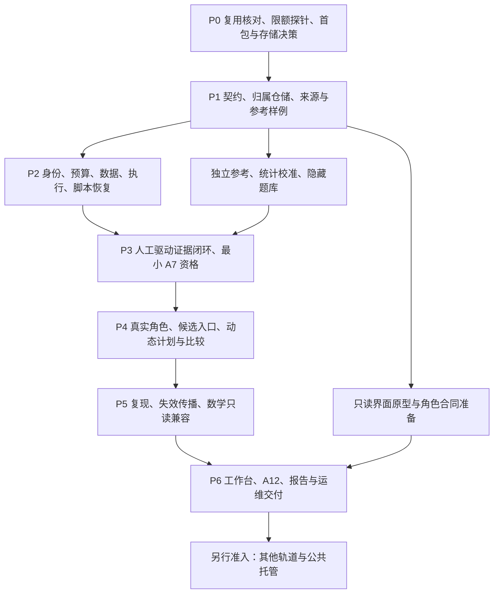
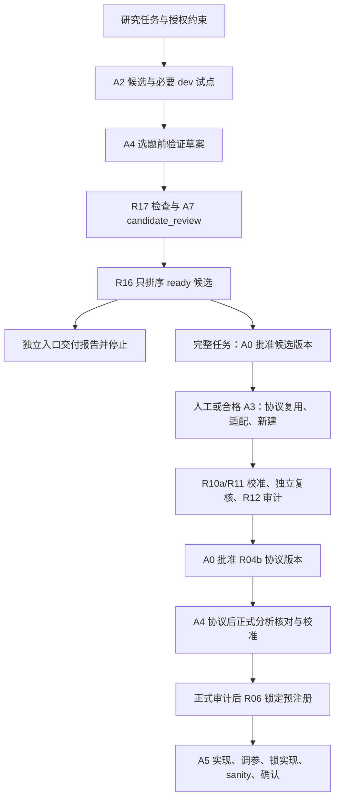
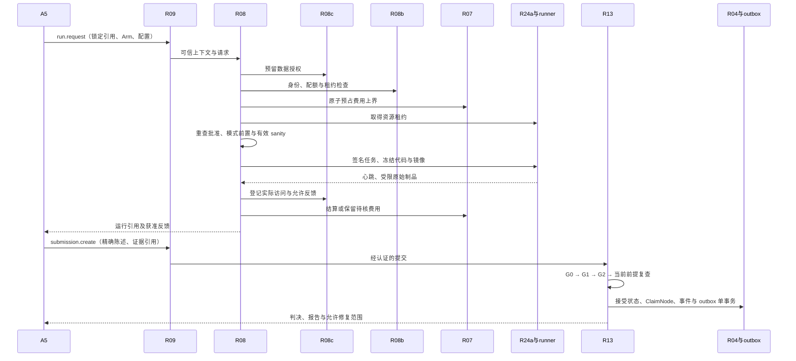

# Danus-AI 落地开发指南：模块顺序、接口衔接与验收

版本：v1.0｜日期：2026-11-05｜设计基准：大方案 v1.2、角色规格 v0.2

**用途：正式开发时的任务入口与实施索引。本文已完成开发组织细化，所述代码路径均为目标位置；不表示代码已实现、测试已通过或科研效果已获证据。**

主规范：[大方案 v1.2 最终确认稿](<./Danus-AI 科研智能体产品架构与落地执行方案 v1.2 最终确认稿.md>)；角色实施依据：[Agent 角色实现与验收规格 v0.2](<./Danus-AI Agent 角色实现与验收规格.md>)。本文沿用 30 个 R 模块、A0–A12 角色、P0–P6 阶段、CHK-01–64 和 78 个 TC 验收场景，不增加另一套产品模块或科学判定规则。

## 目录

1. [依据、边界与开发使用方式](#g1)
2. [开发依赖、部署边界与阶段出口](#g2)
3. [30 个模块的实施卡与接口对接](#g3)
4. [关键接口链、事务与失败恢复](#g4)
5. [P0–P6 开发任务包](#g5)
6. [联调、角色资格与产品验收](#g6)
7. [变更影响、待决项与实施记录](#g7)
8. [附录 A：64 项要求的开发追踪](#ga)
9. [附录 B：78 个角色及联合场景的验收索引](#gb)
10. [附录 C：基准文件与版本核对](#gc)

## 1. 依据、边界与开发使用方式

### 1.1 文档分工与冲突处理

| 资料 | 权威范围 | 开发时如何使用 |
|---|---|---|
| 大方案 v1.2 | 产品范围、科研规则、系统边界、状态、技术基线与版本验收 | 判断允许实现什么、什么条件下可开放能力 |
| 本指南 | 实施顺序、任务分解、模块接入、跨模块联调和要求追踪 | 每次选取一个任务包，定位相关模块及必读依据 |
| 角色规格 v0.2 | 七类模型角色的合同、上下文、工具、异常、交接及独立验收 | 开发角色、改变模型/提示/记忆策略时逐项执行 |
| R02 可执行契约及生成文档 | 实际 DTO、Schema、端口、错误结构和兼容版本 | P1 建立唯一类型源；调用方与提供方共用，不另手写完整 Schema |
| 实际代码、迁移、测试及报告 | 当前实现行为、已验证范围、未解决问题 | 用代码版本和运行证据说明是否符合设计，不能反过来用现有 bug 改写规范 |

本指南可细化测试分层和任务顺序，但不能扩大角色权限、减少证据门、改变统计判据或把首版改成公共 SaaS。规范与实现不一致时登记差异，暂停受影响能力的验收，修复实现或按批准后的设计变更处理。其他无依赖任务继续推进。

大方案中“待最终确认”的源文件状态保留。本次授权完成配套开发指南，不推定产品代码已经启动，也不代替具体付费调用、资源采购、科研批准和发布签字。

### 1.2 每个开发任务的固定动作

1. 选择第 5 章已有工作包；读取对应第 3 章实施卡及其标注的大方案小节。
2. 读取角色规格的相关合同和附录中的 CHK/TC；确认输入、权限、输出、停止条件、失败语义。
3. 检查前置能力的实际状态。契约已定可先对替身开发；依赖真实结果的验收等待提供方通过。
4. 在 R02 固化本次涉及的类型/端口/错误，随后实现提供方、调用方、持久化与装配。新增字段同步迁移和金样例。
5. 运行该任务适用的契约、模块及联调检查；记录实际命令、代码版本、报告和仍被阻塞的能力。
6. 更新同一追踪记录，按实际证据开放 capability manifest 中的对应 task_kind。未注册或未验收能力默认关闭。

**查阅原则：按任务读取相关规范，并保留关键约束。** 不要求每次把全部大方案放进模型上下文；也不能仅凭本指南的简写绕过引用的小节。当前批准版本、待核费用、隐藏数据暴露、根任务限额和未完成副作用必须始终可追踪。

### 1.3 首版范围固定

首版面向单名研究操作者，首先做通受控工具环境中的智能体/API 研究比较；提供完整科研任务、生成研究候选、评审已有课题三个入口。后两个入口产出候选/检查/排序材料并在选题批准前停止，不自动启动确认实验。

个人租户归属从 P1 贯穿，P2 起用两个测试租户验证隔离；这不是团队协作或公共多租户产品已经上线。数学在 P5 只接只读引用、受控状态核验与撤销同步；自主数学研究、训练/架构执行轨道、自有模型训练、完整多云采购和商业订阅支付属于后续准入范围。

生产角色使用自研薄循环，经 R08 调用合格 API 配置；DeepSeek、千问、Kimi、智普等是待测试的候选配置，不能凭厂商品牌授予资格。Codex CLI 是可选兼容入口，不列为首版依赖。模型策略和微调/RL 启用条件直接遵守大方案第 9 章，不在本指南放宽。

## 2. 开发依赖、部署边界与阶段出口

### 2.1 开发总图

箭头表示整体验收前置，不表示所有工作只能串行，也不表示运行时永远按此顺序调用 Agent。

关键路径为“契约与归属 → 可控运行 → 人工证据闭环 → 角色自动化 → 复现和交付”。独立参考与评测贯穿 P0–P6，不等产品写完再补。P1 后可并行开发文献组件、统计纯函数、协议参考和界面原型；对替身接通不能提前注册生产能力。

### 2.2 模块与进程不是一一对应

| 部署单元 | 主要职责与接入 | 不持有的权限/状态 |
|---|---|---|
| control | 领域服务、管理/工具入口、唯一业务写入、事务/outbox、批准和归属校验 | 不把科研方法代码当宿主程序运行 |
| supervisor | R08b 调度、R14 生命周期、R16 事件和恢复扫描；通过内部 API 工作 | 不直写数据库，不持模型供应商密钥 |
| model-broker | R08 提供商协议、发送许可核验、预算和用量回传 | 不授予科研批准，不跨租户回退凭证 |
| role-session | 按任务启动 A1/A2/A3/A4/A5/A7/A12；独立工作区、短期令牌 | 无数据库、宿主 shell、其他角色目录、原始密钥 |
| runner-agent / job-container | 专用执行节点上接收签名任务；可信收集与方法载荷隔离 | 方法容器不见 test 标签、云凭证、Docker socket |
| legacy-math | 隔离的数学事实/验证服务，向经验内核提供只读状态 | 经验角色不获得数学图写权限 |
| publisher | 脱敏快照上的无网络编译和制品检查 | 无签名私钥、供应商密钥及主动发布权限 |

R08b/R16 在 supervisor 中的驱动与 control 中的权威事务端口分开；同名模块不意味着进程可以直接共享数据库连接。R12/A7、R21/A12 的程序服务与模型会话也分开。装配入口负责注入端口，模型角色不导入仓储实现。

### 2.3 技术基线与工程位置

| 能力 | 已确定基线 | P0/P1 必须补齐的实际工件 |
|---|---|---|
| 后端与契约 | CPython 3.12、FastAPI/Uvicorn、Pydantic 2、Python Protocol | 精确依赖锁、Schema/OpenAPI 导出及兼容测试 |
| 身份与工具 | R09 封装官方 MCP Python SDK；REST/CLI 共用业务端口 | 服务令牌/委派、工具目录、默认拒绝策略、直接调用攻击用例 |
| 存储 | 本地 SQLite/WAL、显式短事务、CAS 制品、outbox | StorageDecision、迁移、复合归属键、恢复/并发验证 |
| 模型 | HTTPX、提供商适配器、R08 broker、自研薄循环 | 各实际配置的用量/超时/工具协议与资格记录 |
| 调度与执行 | 数据库 job/租约/fencing；Docker、SSH/SFTP、签名任务 | Linux 镜像 digest、固定 host key、资源与费用实测 |
| 检索与分析 | BM25、授权过滤、NumPy/SciPy、注册统计算子 | 来源定位、独立参考、校准报告；无强制向量库 |
| 前端与报告 | HTML/CSS/ES modules；本地 ECharts/KaTeX/markdown-it；隔离 LaTeX | 只读查询/管理动作分离、脱敏快照和编译测试 |
| 工程保障 | pytest、Hypothesis、Ruff、mypy、AST 规则、Ed25519、SBOM | 无付费 CI、故障注入、独立签名检查点与发布验证 |

默认不引入 Redis/Celery、第二套 Agent 框架或常驻 Node 服务。SQLite 是本地单控制服务基线；P0 如正式批准共享托管前置范围，应评估并锁定唯一生产后端，再统一更新部署/事务/迁移测试，不同时维护两套首版数据库。数据库置于 Linux 本地文件系统；Windows 使用 WSL2，不能把 WAL 数据库放到共享盘。

下列公共工程位置是本文的实施组织约定，P1 在仓库中落实；不新增 R 模块：`tests/contracts/`、`tests/unit/`、`tests/integration/`、`tests/security/`、`tests/recovery/`、`fixtures/`、`infra/`、`docs/implementation/`。付费模型评测由 R22 管理，参考答案目录与被测角色的 fixtures 可见范围分离。

### 2.4 阶段出口与开放范围

| 阶段 | 必须留下的可检查证据 | 通过后可进入的范围 |
|---|---|---|
| P0 | 复用/许可、资源及模型探针、参考题、首包责任、后端决定、分包估算 | 固化工程与契约；缺付费/复核资源的部分明确阻塞 |
| P1 | 可安装骨架、迁移、金样例、双租户归属、来源卡、角色/计划合同 | 对替身开发并联调基础服务，不自主付费 |
| P2 | 真实限额执行/对账、脚本恢复、权限与故障测试、容量报告 | 有相应批准的可控执行；不宣称科学证据闭环已完成 |
| P3 | 合格首包、最小 A7、统计校准、人工闭环及失败实例 | 有资格的受监督科研闭环，准备完整角色自动化 |
| P4 | task_kind 资格、动态计划/交接、24 小时连续性、正式比较记录 | 工程与能力合格范围内启用；协作优势须另满足统计判据 |
| P5 | 复现类型、传播/撤销、范围限制、恢复和数学引用演练 | 可信范围内的复现与依赖管理 |
| P6 | A12、三入口使用、签字制品、恢复报告、真实课题与成绩单 | 按实际证据交付受监督版或相应资格版本；发布仍经 A0 |

## 3. 30 个模块的实施卡与接口对接

### 3.1 共用接入规则

所有模块遵守大方案 6.1 和附录 A：请求的身份由服务解析为 TrustedRequestContext；模型只提交草稿和引用，不能填写权威状态。长任务返回 job/submission 引用，调用成功不等于业务完成。写操作检查归属、版本和幂等；普通错误不暴露跨租户对象存在性。

下面“接入”描述服务端口/数据依赖，不授权跨模块 import 实现类。所有业务模块依赖 R02；装配由 R09/`bootstrap.py` 完成。每张卡的模块验收还必须覆盖有效输入、非法输入、越权、重复副作用和故障恢复。联合验收只在实际下游完成后执行。

实施卡中的接口族来自大方案。R00、R22 未命名统一 I- 接口族，继续使用原函数名，不发明一套新公开 API。函数的具体字段由 R02 导出，本文仅固定语义、责任与接入关系。

按首次主要能力交付定位；分阶段建设以实施卡为准：

| 阶段 | 模块快速跳转 |
|---|---|
| P0 | [R00](#m-r00) |
| P1 | [R01](#m-r01) · [R02](#m-r02) · [R03](#m-r03) · [R04](#m-r04) · [R05](#m-r05) |
| P2 | [R07](#m-r07) · [R08](#m-r08) · [R08b](#m-r08b) · [R08c](#m-r08c) · [R24a](#m-r24a) · [R09](#m-r09) |
| P3 | [R04b](#m-r04b) · [R06](#m-r06) · [R10a](#m-r10a) · [R10](#m-r10) · [R11](#m-r11) · [R12](#m-r12) · [R13](#m-r13) |
| P4 | [R14](#m-r14) · [R15a](#m-r15a) · [R15b](#m-r15b) · [R15c](#m-r15c) · [R16](#m-r16) · [R17](#m-r17) |
| P5 | [R18](#m-r18) · [R19](#m-r19) |
| P6 | [R20](#m-r20) · [R21](#m-r21) · [R22](#m-r22) |

### 3.2 R00 能力、成本与环境探针

**阶段与代码：** P0 首交；P2 切正式计费；`danus_ai/probe/`。依据：大方案 6.2；角色相关项另按角色规格执行。

| 实施项 | 固定要求 |
|---|---|
| 功能与技术 | Python/HTTPX 固定小题集与算力探针；测行为、用量、失败及环境，不按模型品牌推定能力。 |
| 接入与前置 | P0 人工限额、最低资源准入、R02 草案；P2 后接 R07/R08。 |
| 提供接口/产物 | probe → ProbeReport；probe_compute → CapabilityReport，保存配置/套件/费用及版本可识别性。 |
| 下游接入方 | R02 定合同；R07 定估价；R24a 定节点；R22 定角色评测。 |
| 编码顺序 | 先做本地解析/记录试跑，再做已获小额授权的单并发外部探针；每次先登记费用上界，未知费用不释放；P2 后关闭 bootstrap 常态入口并导入旧账。 |
| 模块完成标志 | 题目与真实失败保留；报告中的估价、实测、未知版本区分；未合格审计配置明确阻塞正式用途。 |
| 跨模块完成标志 | 用真实目标节点与选定提供商核对收费、连接、释放；P2 重新验证预算代理接管；最多 3 案例不能当收益检验。 |
| 要求与测试索引 | CHK-19、22、42、61 |

### 3.3 R01 工程骨架、依赖约束与 CI

**阶段与代码：** P1 首交；全阶段持续；`danus_ai/`、`tests/`、`infra/`、`fixtures/`、`docs/`。依据：大方案 6.3；角色相关项另按角色规格执行。

| 实施项 | 固定要求 |
|---|---|
| 功能与技术 | pytest/Ruff/mypy/AST 建包边界与无付费 CI；固定上游提交和许可证。 |
| 接入与前置 | P0 复用清单、StorageDecision、依赖及运行环境决定。 |
| 提供接口/产物 | I-REPO：安装、配置、构建、CI 与依赖规则；精确锁文件、SBOM 和镜像 manifest。 |
| 下游接入方 | 全模块；R21/R22 发布与恢复使用同一版本集合。 |
| 编码顺序 | 先可安装骨架和契约测试入口，再导入约束、故障注入和依赖扫描；正式镜像绑定 digest/签名。 |
| 模块完成标志 | 故意加入 R16 导入 R17 实现、角色直写仓储等违规样例应失败；Windows/Linux 规范化哈希一致。 |
| 跨模块完成标志 | Linux 构建/容器运行与签名校验通过；CI 不含生产凭证；实际付费测试独立授权。 |
| 要求与测试索引 | CHK-21、22、33、64 |

### 3.4 R02 契约包与金样例

**阶段与代码：** P1 首交；接口变更持续；`danus_ai/contracts/`。依据：大方案 6.4；角色相关项另按角色规格执行。

| 实施项 | 固定要求 |
|---|---|
| 功能与技术 | Pydantic 2 严格类型、Protocol 与跨对象验证；唯一契约编辑源，导出 Schema/OpenAPI。 |
| 接入与前置 | P0 对象语义、R01；语义验证仅通过只读端口访问对象，不在纯类型层导入 DB/网络。 |
| 提供接口/产物 | I-SCHEMA：validate_object、canonicalize、content_id、validate_transition、scope_contains、scope_overlaps、scope_comparable；第 5.1 节全对象与消息。 |
| 下游接入方 | 全部提供方、调用方、测试及管理/UI 客户端。 |
| 编码顺序 | 先区分草稿/权威对象与 tenant/project，再固定哈希投影、状态、引用和错误；补 TaskPlan、SanityRequest/Report、ContextManifest；导出后用独立金样例核对。 |
| 模块完成标志 | 拒绝重复键、NaN、额外权限字段、跨归属引用与不合法状态；scope unknown 不默认 true；旧记录缺科学字段标 legacy_incomplete。 |
| 跨模块完成标志 | 接口字段变更同时更新 R08/R09/R13/R14/R16、迁移与调用端；契约 fixture 不自动生成自己的正确答案。 |
| 要求与测试索引 | CHK-02、09、25、27、50、53、60、64 |

### 3.5 R03 文献检索与论断卡片库

**阶段与代码：** P1 规则/人工；P2 接模型；P3 前真实验收；`danus_ai/literature/`。依据：大方案 6.5；角色相关项另按角色规格执行。

| 实施项 | 固定要求 |
|---|---|
| 功能与技术 | 来源适配、HTML/LaTeX/PDF 定位、BM25 与中英文分词；模型只提取草稿。 |
| 接入与前置 | R02/R05 与授权来源；模型提取经 R08/R09，不在 P1 新建直付 API。 |
| 提供接口/产物 | I-LIT：search、get_card、extract_draft、verify_quote、mark_source_status；版本化来源卡和短引文。 |
| 下游接入方 | R04b 选择协议组件；A2/A3/A4/A7、R17/R21 查证。 |
| 编码顺序 | 先保存来源快照/许可/定位，再规则卡片与检索；I-RUN 替身验证提取合同，P2 后接真实调用；公共文献与私有笔记分权。 |
| 模块完成标志 | 真实引文能定位原文；检索先过滤归属再排序/计数；无全文标仅摘要；不执行来源中的代码指令。 |
| 跨模块完成标志 | 人工参考集测 Recall@k 和引用支持度；实际模型提取仍须支持性核查；来源撤销影响 R05 摘要和引用检查。 |
| 要求与测试索引 | CHK-18、22、30、47、53 |

### 3.6 R04 经验论断存储

**阶段与代码：** P1 仓储；P3 受控写入；`danus_ai/claims/`。依据：大方案 6.6；角色相关项另按角色规格执行。

| 实施项 | 固定要求 |
|---|---|
| 功能与技术 | 选定数据库元数据 + CAS JSON + 证据事件；只负责保存和查询，不判统计结论。 |
| 接入与前置 | R02、P1 事务/CAS/归属底座；生产写命令须来自 R13。 |
| 提供接口/产物 | I-CLAIM：get/search/history/relations/有效状态；commit_claim/append_event 为 R13 内部端口。 |
| 下游接入方 | R13 唯一提交；R19/R20/R21 读取有效证据与关系。 |
| 编码顺序 | 先建不可变内容和可变状态/事件，再租户限定查询、requires 检环、内部受权写端口；P1 仅用可信测试夹具装载。 |
| 模块完成标志 | 同内容冲突核对原文；无跨租户哈希下载；外部作者主张和工作材料不混入经验图。 |
| 跨模块完成标志 | P3 accepted、ClaimNode、事件/outbox 单事务；重复/崩溃不生孤立已支持节点；R19 重建与历史一致。 |
| 要求与测试索引 | CHK-12、13、21、53 |

### 3.7 R04b 评测协议库

**阶段与代码：** P1 存储；P3 合格首包；P4 A3；`danus_ai/protocols/`。依据：大方案 6.7；角色相关项另按角色规格执行。

| 实施项 | 固定要求 |
|---|---|
| 功能与技术 | 版本协议库、组件包、适用性和 PCR；独立参考、测量有效性、计算校准与审批分别保存。 |
| 接入与前置 | R02/R03/R05；R10a/R11 校准、R12/A7 审计、A0 批准；P1–P3 人工建设。 |
| 提供接口/产物 | I-PROTOCOL：create_draft/submit_for_audit/approve/resolve/propose_change/supersede、check_applicability、diff_protocol；ProtocolBundle/CheckSuite。 |
| 下游接入方 | A3 复用或适配；A4/R06 锁正式分析；R08/R10a/R13 校验精确版本。 |
| 编码顺序 | 先草稿和科学字段 diff，再首包指标/主要基线/切分/正反样例/独立参考；完成校准、方法复核、审计与版本批准。 |
| 模块完成标志 | 纯文字和科学修改区分；超适用条件必须重审；缺参考或有效性依据不可授确认资格。 |
| 跨模块完成标志 | 合格首包在干净环境复算；A9 生成保管隐藏切分；协议变更使 R06、sanity、计划和摘要受影响资格失效。 |
| 要求与测试索引 | CHK-03、24、57、58、59、62 |

### 3.8 R05 研究工作材料与全局记忆

**阶段与代码：** P1 首交；P2 权限联调；P5 生命周期；`danus_ai/memory/`。依据：大方案 6.8；角色相关项另按角色规格执行。

| 实施项 | 固定要求 |
|---|---|
| 功能与技术 | SQLite 元数据/CAS 正文、BM25 过滤、JSONL 导出；存工作材料，不另建科学真值源。 |
| 接入与前置 | R02、归属仓储；R09/R08c 提供角色/族/用途与暴露限制。 |
| 提供接口/产物 | I-GM：append_work_item/new_version/search_visible/link_artifact；选择、失败和使用事件；授权可溯源片段。 |
| 下游接入方 | 全部角色、R16 策略、R20 诊断；R06 引用选择历史。 |
| 编码顺序 | 先对象/版本/访问标签，再过滤检索与摘要来源绑定；失败事实与原因假设分栏；加入撤销、删除和缓存失效。 |
| 模块完成标志 | A4 无法读同族确认反馈和 A5 工作区；无跨租户标题/数量泄漏；材料标 supported 不改变证据资格。 |
| 跨模块完成标志 | R14 恢复从领域权威重建；R19 失效传播及备份删除重放；完整候选历史可追，不只保存成功者。 |
| 要求与测试索引 | CHK-02、25、28、41、44、47、53、56 |

### 3.9 R06 预注册与统计计划

**阶段与代码：** P1 草稿存储；P3 锁定；P4 A4；`danus_ai/prereg/`。依据：大方案 6.9；角色相关项另按角色规格执行。

| 实施项 | 固定要求 |
|---|---|
| 功能与技术 | 预注册状态机、FamilyDeclaration、随机性与选择历史；A4 提交设计，程序核对并锁定。 |
| 接入与前置 | R05 当前选择/阈值/历史、R04b 批准协议、R11 校准、R12 审计；R17 候选检查经端口接入。 |
| 提供接口/产物 | I-PREREG：submit/validate/lock/get_analysis_bundle/request_revision；LockedAnalysisPlan、Arm、槽位/α 分配。 |
| 下游接入方 | A5 实现、R08 确认运行、R11 分析、R13 接受与 R18 复现。 |
| 编码顺序 | 先草稿与批准引用；再协议后跨字段核对、假设族/槽位和数据资格；在运行前记录可信锁定时间。 |
| 模块完成标志 | 无选择、协议失效、未知统计单位、缺族历史或未校准算子阻塞；阈值不能由 A4 自改。 |
| 跨模块完成标志 | 协议改动重做适用性/校准/锁定；新 family_id 不清零暴露；确认后设计改变走新设计与新数据资格路径。 |
| 要求与测试索引 | CHK-02、03、10、11、24、25、26、62 |

### 3.10 R07 预算与费用账本

**阶段与代码：** P2 首交；P6 账单汇总；`danus_ai/budget/`。依据：大方案 6.10；角色相关项另按角色规格执行。

| 实施项 | 固定要求 |
|---|---|
| 功能与技术 | 整数微货币、显式事务、多层预算、唯一用量账本；费用/预占/估价和人工时间分列。 |
| 接入与前置 | R02、归属仓储、A0 授权、R00 价格/上界；外部请求由 R08/R24a 发起。 |
| 提供接口/产物 | I-BUDGET：quote/allocate/reserve/extend_reservation/settle/release/reconcile；gate_cost_view。 |
| 下游接入方 | R08 模型/运行、R24a 资源、R16/R17 报价、R20 成本视图。 |
| 编码顺序 | 先原子余额与预占，再用量唯一键、追加调整、未知费用对账和共享成本分摊；bootstrap 账导入。 |
| 模块完成标志 | 最后余额并发最多一次成功；同账单回执不双扣；取消只释放未发生费用；BYOK 不跨租户/账户回退。 |
| 跨模块完成标志 | 真实供应商账单对平；拆分任务不重置根额度；探索保护预算不被排序挪用；统计成本取全部失败和重试。 |
| 要求与测试索引 | CHK-07、08、29、31、36、51、54 |

### 3.11 R08 实验执行器、模型调用代理与运行台账

**阶段与代码：** P2 可控运行；P3 确认完整资格；`danus_ai/execution/`。依据：大方案 6.11；角色相关项另按角色规格执行。

| 实施项 | 固定要求 |
|---|---|
| 功能与技术 | coordinator、runner client、trusted harness、collector、model broker 五组件；程序掌握执行与计量。 |
| 接入与前置 | R09 可信上下文；R08c 数据/外发许可、R08b 租约/配额、R07 预占、R24a 资源；确认加 R04b/R06/R10a。 |
| 提供接口/产物 | I-RUN run_request/run_status/cancel_run；I-LEDGER get_run/get_attempts/get_metrics；宿主 invoke_model；RunRecord/Attempt/InvocationRecord。 |
| 下游接入方 | A2/A3/A4/A5 受限模式、R14 推理、R10a/R11/R18；R13/R22 取证。 |
| 编码顺序 | 先模式前置矩阵与假节点，再真实限额 dev/校准路径；可信收集原始输出及重算指标；最后装配确认绑定与模型临时能力。 |
| 模块完成标志 | 方法自报分数不被采信；退出码 0 无制品不能成功；未知外部状态 reconciling；原始日志先受限解析。 |
| 跨模块完成标志 | 逐步故障不重复启动/计费；确认启动重查批准与 sanity；test 标签/密钥不泄漏；会话退出不杀合法长实验。 |
| 要求与测试索引 | CHK-03、06、07、09、21、30、31、32、34、48、54、60、61 |

### 3.12 R08b 持久调度与角色互斥

**阶段与代码：** P2 任务设施；P4 计划装配；`danus_ai/scheduling/`。依据：大方案 6.12；角色相关项另按角色规格执行。

| 实施项 | 固定要求 |
|---|---|
| 功能与技术 | 数据库持久 job、租约与 job 级 fencing；A8 分配 principal，外层租户/内层科研队列公平。 |
| 接入与前置 | R02 任务合同、R09 身份、R07 额度视图、Arm 约束；P4 接 R16 有效计划。 |
| 提供接口/产物 | I-SCHED：enqueue/claim/heartbeat/release/assign_identity/check_arm_quota/raise_blocker；有效任务租约。 |
| 下游接入方 | supervisor/R14、R08 执行、R16 事件编排、R20 队列查询。 |
| 编码顺序 | 先原子领取/重占及旧 token 拒绝，再互斥/Arm 配额与队列；准备依赖节点、取消和历史继承，不等待 A1 才建底座。 |
| 模块完成标志 | 双消费者不能同时持有效租约；A4/A5 同族冲突被拒；所有调参含失败计入；普通任务不能指定任意 principal。 |
| 跨模块完成标志 | 运行取消竞态/迟到结果/饥饿演练；R16 新计划不能重置根预算、修复计数、族与暴露；容量未经测量并发为 1。 |
| 要求与测试索引 | CHK-05、21、29、31、42、51、52、55 |

### 3.13 R08c 数据守门与暴露台账

**阶段与代码：** P2 首交；P5 删除恢复联动；`danus_ai/data/`。依据：大方案 6.13；角色相关项另按角色规格执行。

| 实施项 | 固定要求 |
|---|---|
| 功能与技术 | 数据快照/许可、split manifest、授权、发送许可与暴露台账；A9 可信生成保管隐藏切分。 |
| 接入与前置 | R02 归属/用途合同，R04b 切分规则、R06 槽位；R09 身份和批准。 |
| 提供接口/产物 | I-DATA：register_snapshot/authorize_run/consume_exposure/build_mount_manifest/revoke_grant/get_exposure_report；authorize_send 与 SendPermit。 |
| 下游接入方 | R08/runner 挂载反馈、broker 外发、R05 检索、R22 评测隔离。 |
| 编码顺序 | 先数据准入与公开/隐藏视图，再授权预留/实际消耗、外发许可、撤销；人工读取/导出和记忆检索也计暴露。 |
| 模块完成标志 | 路径穿越、符号链接、异常日志、猜 ID 不可旁路；分类未知/地域不符拒绝外发；正常授权不过度拦截。 |
| 跨模块完成标志 | 排队未接触可释放预留，已暴露不得回滚；新项目/计划/族不恢复资格；备份恢复重放删除与撤销。 |
| 要求与测试索引 | CHK-06、11、25、30、44、53、56、58 |

### 3.14 R24a 最小算力接入

**阶段与代码：** P2 首交；真实节点验收；`danus_ai/compute/`。依据：大方案 6.14；角色相关项另按角色规格执行。

| 实施项 | 固定要求 |
|---|---|
| 功能与技术 | 已登记资源池 + SSH runner-agent；固定 host key、签名任务、镜像 digest 和隔离清理。 |
| 接入与前置 | R00 能力/价格、R02 资源合同、R07 最大负债、R08b 有效任务与租户配额。 |
| 提供接口/产物 | I-COMPUTE：quote/acquire_lease/inspect/release_lease/lock_hardware；资源租约与费用/停止状态。 |
| 下游接入方 | R08 执行器、R18 规模验证、R22 运维；完整多云采购留给后续 R24。 |
| 编码顺序 | 先本地/已有远程实例接入，再实际回传/断连/释放；缺供应商自动停费能力时用封顶预付或人工值守。 |
| 模块完成标志 | 硬件/镜像失配拒绝；不提供任意远程 shell；租约结束不自动宣称已停云费用；签名/digest 失败不启动。 |
| 跨模块完成标志 | 真实平台连接到对账完整演练；节点掉线按本地期限止损；互不信任租户用专属 VM 或经验证强隔离，回收检查残留。 |
| 要求与测试索引 | CHK-07、08、21、22、33、55 |

### 3.15 R09 角色网关、管理入口与装配

**阶段与代码：** P2 身份/管理；后续逐能力注册；`danus_ai/gateway/`、`bootstrap.py`。依据：大方案 6.15；角色相关项另按角色规格执行。

| 实施项 | 固定要求 |
|---|---|
| 功能与技术 | MCP 兼容层、FastAPI 管理 REST、CLI 共用领域端口；认证/委派/对象授权与装配。 |
| 接入与前置 | R02、归属与角色策略；各模块端口按阶段注入。 |
| 提供接口/产物 | I-GATEWAY：统一 envelope、工具目录及管理动作；可信上下文与 trace；不另做统计/预算算法。 |
| 下游接入方 | 全部角色工具、用户审批/UI、内部 supervisor/broker/runner 通道。 |
| 编码顺序 | 先认证和默认拒绝，再对象授权/幂等/管理签名，最后分阶段注册真实已验收端口；模型目录不开放仓储写方法。 |
| 模块完成标志 | 直接 HTTP、stdio、伪造环境角色、任意项目路径均不能提升权限；内部调用也验证委派；A2 不能 submission.create。 |
| 跨模块完成标志 | A0 批准绑定摘要；所有远程回执认证；模型字段不能替换 tenant；未实现/替身接口不进入生产目录。 |
| 要求与测试索引 | CHK-01、04、12、30、32、35、48、53 |

### 3.16 R10a 健全性检查器

**阶段与代码：** P3 首交；P1 准备样例；`danus_ai/gates/sanity/`。依据：大方案 6.16；角色相关项另按角色规格执行。

| 实施项 | 固定要求 |
|---|---|
| 功能与技术 | 确定性检查引擎，按通用/协议专属/轨道专属组织；只用合成/dev 校准数据。 |
| 接入与前置 | R04b 套件和独立预期，R02 SanityRequest/Report，R08 受控执行、R08c 授权。 |
| 提供接口/产物 | I-SANITY run_suite → SanityJobRef；resolve_report(ctx, report_ref, expected_binding_ref) → 当前资格视图。 |
| 下游接入方 | R08 确认前检查、R13 提交、A3/A5 校准与修复、R22 缺陷评测。 |
| 编码顺序 | 先逐项状态及适用规则，再解析/映射/边界/重复关系/计量；接首包终态/基线/评分器反例；绑定协议/套件/数据/代码/依赖/配置/profile。 |
| 模块完成标志 | pass/defect/error/not_applicable/not_covered 分清；必需项 error/缺口不授资格；合法重复试验不被当重复数据删除。 |
| 跨模块完成标志 | 代码/套件/协议变化后旧报告 stale；exploration_lite 不升格 confirmation_full；sanity 自身不递归要求先通过 sanity。 |
| 要求与测试索引 | CHK-03、09、57、58、60、62 |

### 3.17 R10 G0 确定性预检

**阶段与代码：** P3 首交；`danus_ai/gates/g0/`。依据：大方案 6.17；角色相关项另按角色规格执行。

| 实施项 | 固定要求 |
|---|---|
| 功能与技术 | 确定性 G0 校验：完整引用、锁定版本、全量尝试、来源、scope 可判定项和可信指标复核。 |
| 接入与前置 | R02、R08 台账/原始输出、R06 锁定计划、R10a 报告、R08c 暴露、R07/R08b 公平性记录。 |
| 提供接口/产物 | I-G0 check(submission_id) → G0Report；确定拒绝或待补证原因。 |
| 下游接入方 | R13 串联证据门；R22 校准固定提交的处置。 |
| 编码顺序 | 按授权→版本/时间→运行资格→sanity→全量 Arm/种子→暴露→原始输出/有效单位顺序解析，报告引用服务端重建。 |
| 模块完成标志 | 删不利种子、假数字、非法 test、伪来源、重复计独立样本被拦；语义未知不能默认通过。 |
| 跨模块完成标志 | 共享 ValidationProfile 校验实现；R12 不可覆盖硬拒绝；有限白名单允许年份/型号，不一刀切禁止裸数字。 |
| 要求与测试索引 | CHK-09、11、12、25、60 |

### 3.18 R11 G1 统计与结论措辞

**阶段与代码：** P1 校准框架；P3 注册与 G1；`danus_ai/stats/`。依据：大方案 6.18；角色相关项另按角色规格执行。

| 实施项 | 固定要求 |
|---|---|
| 功能与技术 | NumPy/SciPy 受信算子、纯分析合同、独立参考校准；统计结果与允许措辞由程序输出。 |
| 接入与前置 | R06 锁定设计、R08 可信输入 manifest、R04b 测量单位与切分；R02 类型。 |
| 提供接口/产物 | I-STATS analyze/calibrate/allowed_wording；AnalysisOutput/StatsReport；成本与产出联合算子。 |
| 下游接入方 | R06 授分析资格；R13 G1；R18 复现；R22 比较统计。 |
| 编码顺序 | 先独立手算/参考分布，再效应/区间/配对聚类/多重性算子；A4 仅选已注册算子及输入变换；新方法单独校准。 |
| 模块完成标志 | 零/非零效应、覆盖、少簇、伪独立种子、缺失与零产出均有预期；不以一次随机零效应永不显著作为测试。 |
| 跨模块完成标志 | R13 仅允许精确支持的陈述；有限否定不等于 p 不显著；成本含全部失败并联合推断，适用条件失败不判通过。 |
| 要求与测试索引 | CHK-10、11、26、37、43、57、58 |

### 3.19 R12 G2 方法学审计

**阶段与代码：** P3 最小 A7；P4 扩展任务资格；`danus_ai/audit/`。依据：大方案 6.19；角色相关项另按角色规格执行。

| 实施项 | 固定要求 |
|---|---|
| 功能与技术 | 程序创建冷启动审计包，R14/R08 调用具体合格 A7；按候选/协议/预注册/提交使用不同合同。 |
| 接入与前置 | R02、R03/R04b/R06/R08/R11 的授权材料；模型谱系、AuditProfile、R07/R08 费用。 |
| 提供接口/产物 | I-AUDIT audit_protocol/audit_prereg/audit_candidate/audit_submission；AuditReport + GateExecution。 |
| 下游接入方 | R04b/R06 审核、R17 候选检查、R13 G2、R22 独立评测。 |
| 编码顺序 | 先确定性包构建和 profile 校验，再受测 A7 适配、报告引用验证与费用记录；P3 不依赖完整 R16。 |
| 模块完成标志 | blocking_issue/needs_evidence/no_blocking_issue_found 与 error 区分；A7 无执行代码/写图权限；不合格回退拒绝。 |
| 跨模块完成标志 | 独立缺陷/合规包测拦截与误拒；正式审计满足谱系要求；需运行新检查交 A6 隔离执行再建包。 |
| 要求与测试索引 | CHK-05、12、23、36、45、46、57；TC-A7-01–06 |

### 3.20 R13 提交门与证据事务

**阶段与代码：** P3 首交；P5 事件联动；`danus_ai/submission/`。依据：大方案 6.20；角色相关项另按角色规格执行。

| 实施项 | 固定要求 |
|---|---|
| 功能与技术 | 确定性提交状态机与唯一经验写入业务入口；G0→G1→G2 后原子接受。 |
| 接入与前置 | R02、R04 内部仓储、R06/R08/R10a、R10/R11/R12、有效前提与归属。 |
| 提供接口/产物 | I-SUBMIT submit/status；内部 apply_evidence_event(claim_id,event,expected_version)；EvidenceReport、accepted/claim_id 或完整拒绝/未决报告。 |
| 下游接入方 | A5 通过 R09 提交；R18/R19 提出事件；R20/R21 读取。 |
| 编码顺序 | 先 received 和 attempt，再门的执行/故障轨迹，最后当前版本复查与 ClaimNode/事件/outbox 同事务；不把模型结论反序列化成支持状态。 |
| 模块完成标志 | 重复提交不双建/双扣；任一门未完成、未知资格或预算不足不接受；首次未决保留报告不冒充 supported。 |
| 跨模块完成标志 | 任意步骤崩溃可恢复；A2 伪装 payload 仍拒绝；R19 传播事件走本入口，历史不删除。 |
| 要求与测试索引 | CHK-10、12、13、21、31、39、60 |

### 3.21 R14 Agent 角色运行时：执行、状态保存与暂停恢复

**阶段与代码：** P2 脚本循环；P4 真实角色；`danus_ai/runtime/`。依据：大方案 6.21；角色相关项另按角色规格执行。

| 实施项 | 固定要求 |
|---|---|
| 功能与技术 | 自研薄循环、角色适配、轮次持久化、工作区、挂起恢复和上下文构建；不是常驻无限模型线程。 |
| 接入与前置 | R02 任务/动作合同、R08b 租约、R09 工具、R05/R03/领域授权视图、R08 模型/运行。 |
| 提供接口/产物 | I-LOOP start_role/step/pause/resume/terminate/snapshot；执行快照、ContextManifest、交接与停止原因。 |
| 下游接入方 | A1–A5/A7/A12 的角色适配器；supervisor 启停；R22 验恢复和能力。 |
| 编码顺序 | P2 先固定动作脚本与故障回放；P4 按 role+task_kind+ModelProfile 锁上下文/输出预留，接真实结构化动作；每轮先查待核副作用。 |
| 模块完成标志 | 暂停/恢复不重启已有运行；拒绝未注册动作；计数和根额度不重置；关键约束装不下阻塞，旧摘要不作权威。 |
| 跨模块完成标志 | 分别完成 TC-COM/TC-MEM 与真实角色评测；A7 冷启动隔离；默认 10 决策轮/5 连败/4 小时激活时长引用配置，挂起不算激活。 |
| 要求与测试索引 | CHK-05、21、45、46、47、48、61；TC-COM-01–10、TC-MEM-01–04 |

### 3.22 R15a 协议作者运行合同

**阶段与代码：** P1 合同；P3 人工同合同；P4 A3；`danus_ai/roles/protocol_author/`。依据：大方案 6.22；角色相关项另按角色规格执行。

| 实施项 | 固定要求 |
|---|---|
| 功能与技术 | A3 合同/提示/上下文/校验器；合格复用、受限适配、新协议建设分任务资格。 |
| 接入与前置 | R03 来源、R04b 包与适用性、R08 dev 校准、R10a/R11 参考检查、R12/R14。 |
| 提供接口/产物 | 协议草稿、组件/容差依据、科学字段 diff、已知答案及校准记录；交 R04b/A7/A0。 |
| 下游接入方 | A4 正式分析，R04b 协议库及 R10a 套件；隐藏数据交 A9 独立生成保管。 |
| 编码顺序 | 先测模板复用，再适配，最后新建；能力不足可只开放已合格路径；建立八类角色交付物。 |
| 模块完成标志 | 达不到参考容差记录缺口，不能降标准；作者 principal 不兼任关联族 A2/A4/A5，不批准自身协议。 |
| 跨模块完成标志 | 干净环境复算、测量有效性复核、A7/A0 批准；没有独立参考不能借多个模型赞同通过。 |
| 要求与测试索引 | CHK-05、24、45、57、58、59、62；TC-A3-01–05、TC-PROTO-01–06 |

### 3.23 R15b 分析设计者运行合同

**阶段与代码：** P1 合同；P3 人工校准；P4 A4；`danus_ai/roles/analyst/`。依据：大方案 6.23；角色相关项另按角色规格执行。

| 实施项 | 固定要求 |
|---|---|
| 功能与技术 | A4 分选题前验证草案与协议后的正式分析；提示/上下文/工具/校验分别配置。 |
| 接入与前置 | R03/R05 授权材料、R04b 当前批准协议、R06、R11 算子、R12/R14。 |
| 提供接口/产物 | 验证草案；含 estimand/Arm/单位/阈值引用/样本/停止/族与随机性计划的正式设计及分析 bundle。 |
| 下游接入方 | R17 检查草案；R06 锁定；A5 只读正式设计；R11 执行。 |
| 编码顺序 | 先草案交接，再批准协议后的方向/量纲/切分/单位/缺失/停止核对，合成/dev 校准与审计后锁定。 |
| 模块完成标志 | 挡弱对照、伪独立单位、阈值偷改与未注册统计；A4 看不到 A5 私有实现或同族确认反馈。 |
| 跨模块完成标志 | 协议科学改动使分析重新核对；确认后修订走正式变更及数据资格，不能让失败记忆泄漏结果。 |
| 要求与测试索引 | CHK-05、10、11、25、26、43、44、45、58、62；TC-A4-01–06 |

### 3.24 R15c 探索者与方法实现者运行合同

**阶段与代码：** P1 合同；P4 A2/A5 各自资格；`danus_ai/roles/explorer/`、`danus_ai/roles/implementer/`。依据：大方案 6.24；角色相关项另按角色规格执行。

| 实施项 | 固定要求 |
|---|---|
| 功能与技术 | 共享模块编号、不同 principal/工作区/工具。A2 探索；A5 正式实现；不共享私有上下文。 |
| 接入与前置 | A2 接 R03/R05、获准 dev/R14；A5 加批准选择/R04b/R06、R08/R10a/R13；经 R09。 |
| 提供接口/产物 | A2 候选/探索报告/选择与失败记录；A5 可信 Git 版本、配置、运行引用、ClaimSubmission 草稿。 |
| 下游接入方 | A2→A4/R17；A5→R13，再由 R18/R19 处理后续。 |
| 编码顺序 | 分别实现候选路径和实现路径；A5 从批准方案重建并独立核验方法，dev/val 公平调参后锁实现、sanity、确认、提交。 |
| 模块完成标志 | A2 无提交工具且直接 HTTP/仓储路径也拒绝；A5 无分析修改/直接付费权；真实 commit 由服务核验。 |
| 跨模块完成标志 | 两条路径各做端到端，不要求每项用户任务都运行两者；修 bug 重做 sanity，新代码/种子新 run；暴露历史保留。 |
| 要求与测试索引 | CHK-04、06、09、28、44、45、48；TC-A2-01–05、TC-A5-01–06 |

### 3.25 R16 主编排与研究策略

**阶段与代码：** P1 计划合同；P2 设施；P4 策略装配；`danus_ai/orchestration/`。依据：大方案 6.25；角色相关项另按角色规格执行。

| 实施项 | 固定要求 |
|---|---|
| 功能与技术 | 确定性事件驱动 + 必要时 A1 策略会话；结构化计划校验、原子激活和研究排序。 |
| 接入与前置 | R02/R05、R08b/R14、R07 估价；经 R09 端口请求 R17/R18，不导入其实现。 |
| 提供接口/产物 | I-STRATEGY 原操作及 propose_plan/validate_plan/activate_plan/revise_plan/get_plan_state；PlanRevision、排序理由与受控任务。 |
| 下游接入方 | R08b 执行合法节点；A0 选题/边界批准；R20 显示当前计划与阻塞。 |
| 编码顺序 | 先确定性事件处理，再只对 ready 候选排序；实现 DAG 校验/CAS 激活/旧节点处置，最后装配 A1 提案与并行重排。 |
| 模块完成标志 | 环、未知 task_kind、越权、无资格/无依据引用拒绝；重复事件不双派；A1 不启动科研运行/写代码/提交论断。 |
| 跨模块完成标志 | 计划并发修订只一版生效；根预算/暴露不重置；确认期科学改变回正式变更；无新事件不按定时器重复耗模型。 |
| 要求与测试索引 | CHK-01、28、29、35、38、41、45、50、51、52；TC-A1-01–05、TC-PLAN-01–06 |

### 3.26 R17 新颖性、可检验性与可行性检查

**阶段与代码：** P4 首交；P1 合同；`danus_ai/ideation/`。依据：大方案 6.26；角色相关项另按角色规格执行。

| 实施项 | 固定要求 |
|---|---|
| 功能与技术 | 确定性材料检查 + candidate_review 的 A7；判断是否具备交 A0 选题的条件。 |
| 接入与前置 | R03/R05 来源与候选、A4 草案、R07 估价、必要 dev 试点/R08、R12 审核。 |
| 提供接口/产物 | I-IDEAGATE check(candidate_version) → 作业/IdeationReport；ready/needs_revision/blocked 和逐项依据。 |
| 下游接入方 | R16 仅排序 ready；R09 A0 选择；R06 校验候选/报告/批准一致。 |
| 编码顺序 | 引用核对→相关工作/差异→区分性或可测对照→数据许可→估价→必要试点→A7，报告绑定精确候选版本。 |
| 模块完成标志 | 无来源/不可测/缺数据或预算路径不能 ready；费用 estimate 不写成 effect；未证实全球新颖。 |
| 跨模块完成标志 | 三个入口复用同实现；候选变化旧检查不适用于新版本；无候选正常结束；正式分析另走正式审计。 |
| 要求与测试索引 | CHK-01、02、18、23、35、38、43 |

### 3.27 R18 独立复现与规模验证

**阶段与代码：** P5 首交；`danus_ai/replication/`。依据：大方案 6.27；角色相关项另按角色规格执行。

| 实施项 | 固定要求 |
|---|---|
| 功能与技术 | A10 程序计划执行器，按预先锁定的复现目标和资源规模调用原证据链。 |
| 接入与前置 | 原论断/R06 计划、R08/R08c/R24a、R10a/R11/R13；需要新样本则先具备合法数据。 |
| 提供接口/产物 | I-REPLICATE request_replication/scale_ladder/get_report；新运行证据、复现类型和范围事件。 |
| 下游接入方 | R19 传播，R20/R21 显示限制，R22 验证真实重复/新样本区别。 |
| 编码顺序 | 先 clean checkout 同任务新随机性，再适用新样本和规模点；独立重新实现另记类型，不以重跑冒充。 |
| 模块完成标志 | 固定种子、新随机性、新数据不混淆；环境漂移不当科学反证；缺资源记 replication_pending。 |
| 跨模块完成标志 | 按预注册兼容/精度标准而非一律再显著；失败经 R13 追加降级或新范围节点，不改旧 scope 哈希。 |
| 要求与测试索引 | CHK-13、14、26、39 |

### 3.28 R19 证据传播、矛盾与时效

**阶段与代码：** P5 首交；P1 定事件语义；`danus_ai/evidence/`。依据：大方案 6.28；角色相关项另按角色规格执行。

| 实施项 | 固定要求 |
|---|---|
| 功能与技术 | 依赖图投影、有效状态、可比性、矛盾、复审计和数学引用同步；事件交 R13 写入。 |
| 接入与前置 | R04 证据/事件、R02 scope 三值关系、R18 新证据、R04b/R06 版本、隔离数学状态。 |
| 提供接口/产物 | I-PROPAGATE effective_status/affected_descendants/review_contradiction/sync_math_refs；enqueue/triage/resolve_reaudit。 |
| 下游接入方 | R16 限制下游任务；R05 摘要失效；R20/R21 更新引用和发布资格。 |
| 编码顺序 | 先 requires 传播和幂等消费，再可比性/矛盾分诊、截止动作、数学 freshness；跨组件版本失效接入同一事件链。 |
| 模块完成标志 | 撤销只传播真实依赖，不误撤销纯比较关系；unknown 不判矛盾；时效过期不制造反证。 |
| 跨模块完成标志 | 前提失效立即限制使用，不等复审计完成；新批准不自动修复旧暴露；缓存可从日志重建，数学失联停止强保证。 |
| 要求与测试索引 | CHK-13、15、27、39、47、56、62 |

### 3.29 R20 工作台与进展报告

**阶段与代码：** P2 最小查询；P6 完整工作台；`danus_ai/observability/`。依据：大方案 6.29；角色相关项另按角色规格执行。

| 实施项 | 固定要求 |
|---|---|
| 功能与技术 | 本地静态页面/ES modules；受控查询与事件游标轮询；管理动作转 R09。 |
| 接入与前置 | 各领域只读视图、R07 唯一费用账、R19 有效状态、R09 管理 API；进展写作调用已合格 A12。 |
| 提供接口/产物 | I-OBS：项目/候选/运行/证据/预算/审批、事件游标、脱敏报告；漏斗与关口成本视图。 |
| 下游接入方 | 用户/A0 查看与操作；R22 产品效用与运维；发布链复用快照。 |
| 编码顺序 | P2 先真实运行/预算/阻塞页，P4 接候选/计划/人工等待，P6 完整三入口；页面不直接更新 DB。 |
| 模块完成标志 | 分别显示预占/实际、工程/科学、机器/人工等待；任务百分比不是发现进度；缓存/下载仍校验归属。 |
| 跨模块完成标志 | 费用视图包含失败/重审并对平，重连不丢事件；自动报告必须已有相应 A12 资格，不能等 P6 追认。 |
| 要求与测试索引 | CHK-14、32、35、36、41、49、53 |

### 3.30 R21 报告、论文与制品发布流水线

**阶段与代码：** P5 快照准备；P6 A12/交付；`danus_ai/publishing/`。依据：大方案 6.30；角色相关项另按角色规格执行。

| 实施项 | 固定要求 |
|---|---|
| 功能与技术 | 冻结证据快照→A12 草稿→程序表图/宏→引用数字范围审计→隔离编译→ReleaseManifest。 |
| 接入与前置 | R04/R19 有效证据、R08/R11 运行分析、R03 引文、R09 A0 签字、R14/R08 合格 A12。 |
| 提供接口/产物 | I-PAPER build_snapshot/draft/reference_audit/overclaim_audit/compile/build_bundle/request_signature；可下载制品包。 |
| 下游接入方 | A0 核对签字；A11 发布执行；R22 抽查重算；首版允许用户自行发布。 |
| 编码顺序 | 先授权快照与公开编号映射，再写作角色/数字宏/泄漏检查，最后无网络无 shell escape 编译及签名绑定。 |
| 模块完成标志 | 虚假/不支持引用、数字错配、范围夸大和密钥/路径泄漏被拦；正常年份型号不过度拦；改稿后旧签名失效。 |
| 跨模块完成标志 | 撤销证据后旧快照不继续获发布资格；授权内可重跑、SBOM/digest/许可完整；完成任务不等于自动发布。 |
| 要求与测试索引 | CHK-20、33、35、49；TC-A12-01–05、TC-JOINT-07/08 |

### 3.31 R22 系统评测与运维验收

**阶段与代码：** P0 起持续；P6 汇总；`danus_ai/evaluation/`、`danus_ai/ops/`。依据：大方案 6.31；角色相关项另按角色规格执行。

| 实施项 | 固定要求 |
|---|---|
| 功能与技术 | 独立 evaluator、五类评测、逐角色/联合用例、健康与恢复；隐藏参考独立身份和目录。 |
| 接入与前置 | R02 评测合同、R04b 协议、R07 成本、R08 真实执行及全模块版本/证据；不依赖产品自报正确率。 |
| 提供接口/产物 | evaluate_package/run_comparison/run_rediscovery/build_scorecard/doctor/recover_check；效用、排序、可验证性及联合功效评测。 |
| 下游接入方 | P0–P6 阶段验收、ModelProfile/RoleQualification、A0 能力启用与版本发布。 |
| 编码顺序 | 先冻结题库/参考/分母，P1 格式与计分，P3 试跑，P4 正式角色和协作，P5 恢复/复核，P6 汇总；各 campaign 单独批准预算。 |
| 模块完成标志 | 系统超时/失败保留主分母；evaluator 故障按事前规则配对处理；零产出成本不判通过；所有指标从逐题记录复算。 |
| 跨模块完成标志 | 真实模型任务与脚本测试分开；a/b/c 不以生产 b 合规门预判 a/c；公共托管及未开发轨道不凭测试租户宣称上线。 |
| 要求与测试索引 | CHK-16、17、18、19、21、22、37、38、40、42、45、46、55、56、63、64 |

## 4. 关键接口链、事务与失败恢复

### 4.1 接口开发与装配顺序

| 顺序 | 提供方先交付 | 调用方随后交付 | 接通证据 |
|---|---|---|---|
| 契约 | R02 DTO/Protocol、错误、正反 fixture | 各模块类型适配与契约测试 | 同一 fixture 双端通过；非法字段双端拒绝 |
| 领域 | 提供方应用服务、仓储事务及权限 | 调用方仅经注入端口请求 | 无跨层具体 import、无角色仓储写权 |
| 传输 | R09 认证、envelope、对象授权、序列化 | MCP/REST/CLI 客户端 | 直接调用不能绕过业务检查 |
| 异步 | R08b 任务租约、状态、幂等与 outbox | R14/R08 等领取、回传及恢复 | 重投递/重占/迟到回执不重复副作用 |
| 能力启用 | R22 提供测试及资格证据 | 控制服务按批准配置注册工具/task_kind | 只开放与被测版本和任务范围匹配的能力 |

端口契约应记录操作用途、可信上下文、可编辑 payload、返回类型、异步状态查询、前置版本、授权、副作用、错误及安全重试条件。不能只写一个函数名称就算接口交付。OpenAPI/MCP 的字段由 R02 导出；HTTP 与 MCP 不各写一套授权逻辑。

### 4.2 三入口、选题与正式设计链

完整任务入口按以下链路装配；生成候选入口从 A2 开始，评审已有课题入口将用户课题保存为候选版本后复用相同检查。两种独立入口在交付检查/排序报告后完成，不继续选题批准或确认运行。

接入点固定为：A4 草案之后调用 R17，R17 返回当前候选版本的 ready 后才能参与 R16 排序；A0 选择绑定该候选版本。选题前草案不等于正式分析，批准协议形成后必须核对测量方向、单位、切分、比较公平性、缺失与停止规则，再锁预注册。修改候选或科学设计时保留旧记录并重新检查受影响资格。

P3 的人工操作者通过同一管理/领域入口提供工件，不能直改数据库伪造批准状态。A0 是产品/科研批准责任，独立方法复核和 A7 资格不能由 A0 点击按钮代替。四个人工关口继续按大方案 2.4：选题、协议、价值、发布；预算授权沿用同一管理体系，不另建计划审批源。

### 4.3 角色推理与工具调用链

1. R08b 分配任务 principal/租约，R14 校验当前计划、批准及待核运行；外部状态未决先对账。
2. R14 经授权视图读取 R03/R05/领域对象，形成 ContextManifest；按实测容量预留输出，摘要不能代替当前权威状态。
3. R08c 核验用途、接收方、地域、数据分类和实际负载，生成 SendPermit；broker 使用前再核验。
4. R08 模型代理通过 R07 预占后调用已合格模型配置，写 InvocationRecord/用量；密钥只在 broker。
5. 模型返回结构化动作或草稿；R02 校验形状，R09 校验身份、归属、用途和状态，领域服务检查业务条件后执行。
6. 工具结果、幂等键、运行引用、计数与停止原因持久化；有异步工作则挂起，等待事件唤醒。模型宣称完成仍须工件和状态校验。

角色推理生成 InvocationRecord，不要求每次思考都有科研预注册。实验中的模型请求使用绑定 run_id 的临时能力，归入实验费用；同一调用不能再次归入角色推理。工具响应中的论文、代码、日志和网页均是数据，不能覆盖控制指令。

### 4.4 一次确认运行与提交的完整联调

图中的成功路径有明确分支：任一步前置不满足，停止后续副作用；已预占但未发生的费用可补偿，已发生的计费/测试暴露不能回滚。G0 确定拒绝后不为了形式完整继续付费审计；G1 未支持目标陈述不强迫生成支持结论。所有失败、未决及审计错误保留完整记录。

P2 先用真实 dev/校准模式验证执行基础，确认资格检查在 P3 联调；不能为让 P2 演示运行而跳过确认前置。sanity 和 analysis_calibration 有自身模式条件，不递归要求自己的通过报告或尚未形成的正式预注册。

### 4.5 动态计划、取消与恢复

R16 消费项目事件，先由确定性规则判断下一步；需要研究选择时通过 R08b/R14 运行 A1。A1 提交 TaskPlan 草稿，不能直接开角色实例。可信校验器核对 DAG、输入/输出合同、task_kind 资格、租户/用途、科学阶段、互斥、预算可行性及停止条件。

控制服务以 `expected_active_revision` 原子激活计划，并在同一事务产生对应 job/outbox 变更；R08b 领取时重查依赖和资格。估价不是预算预占，计划激活不是科研批准，领取租约也不等于数据/模型调用已经获得运行授权。

| 情形 | 必须采取的动作 | 不能采取的动作 |
|---|---|---|
| 两个计划同时替换当前版 | 仅一个 CAS 成功，另一方返回 PLAN_VERSION_CONFLICT | 静默覆盖、合并两个不兼容版本 |
| 旧节点尚未领取 | 撤销其排队资格，保存版本历史 | 删除节点来源、费用及选择历史 |
| 旧节点已运行 | 逐个说明继续/请求取消，等待状态与费用核对 | 一写 cancelled 就释放全部预算 |
| 迟到结果仍来自合法执行 | 保存在原计划；新计划复用前再验版本/权限/资格 | 自动挪入新节点当新鲜证据 |
| 旧实例租约失效 | 拒绝其直接写入；受信收集器对账留存事实 | 允许旧 token 修改现行状态 |
| 拆分、合并、换会话 | 继承根预算、计数、族和暴露引用 | 为每个子任务重置额度或隐藏资格 |
| 确认中要求改指标或对照 | 交正式设计变更和相应批准/新数据资格 | 将科学变化描述成普通重排 |

探索期可在既有授权范围内动态组合检索、试点和评审；确认期只允许合法工程调度。固定 30 分钟检查、4 小时复核是活跃项目的兜底，不在无新信息时强制模型调用。

### 4.6 协议变更、证据失效与发布

R04b 保存变更请求和 diff → 检查科学影响与适用条件 → 重做受影响独立参考/校准/审计/批准 → A4 重做协议后分析核对 → R06 形成新锁定设计 → R10a 为新绑定重测 → R08 启动前重查。

R19 将影响传播到计划依赖、摘要/缓存、论断当前使用资格和发布快照；写证据状态通过 R13。旧记录保留，不把全部历史实验静默改成新协议。纯文字澄清由差异检查证明未改科学语义，不能靠提交者自称“只是文字”跳过审核。

发布时 R21 冻结当前有效且授权的快照，A12 只写草稿；程序绑定数字、核验引用与范围、隔离编译，生成 manifest。A0 对具体 manifest 签字后才能执行发布连接器；首版交付可下载包无需自动外发。签字后内容变化使签名资格失效；后续证据撤销触发当前引用/发布状态检查，不重写既往签署历史。

### 4.7 必须实现的事务与补偿边界

| 操作 | 本地原子边界 | 外部或后续处理 | 故障注入位置 |
|---|---|---|---|
| CAS 制品入库 | 暂存校验/哈希/原子移动后，事务写元数据引用 | 无引用制品延迟清理 | 文件已落盘、事务尚未提交 |
| 预算预占与调用意图 | 可用额度检查、预占、资源请求记录同事务 | worker 发外部请求；未知结果查账，不盲重试 | 本地提交后、外部已执行但未回执 |
| job 领取/回传 | 领取递增 fencing；写状态时同事务核验 token/租约 | 旧节点命令拒绝，已发生费用对账 | 过期重占后旧回执到达 |
| 接受经验论断 | accepted、ClaimNode、EvidenceEvent、outbox 同事务 | R19/R20 至少一次消费并幂等更新 | 提交成功但消费者未收到通知 |
| 激活计划 | 预期版本检查、激活版、job/outbox 变化同事务 | 运行中旧节点执行取消/继续及对账 | 两修订竞争、取消与启动竞争 |
| 取消运行 | 先记录取消意图及任务状态 | 确认远端停止、收集部分制品、核对费用 | 取消超时而远端仍运行 |
| 恢复系统 | 校验数据库、制品、版本与签名、归属映射 | 重放删除/撤销，核对云资源/账单后开放 | 恢复旧备份时外部已发生新支出 |

不把网络调用放在长数据库事务中，也不承诺外部服务“恰好执行一次”。队列至少一次投递，以幂等、fencing、查询与对账实现目标不变式。提供商不支持幂等且执行状态未知时，暂停自动重试。

### 4.8 错误处理与跨模块约束

错误名称沿用大方案附录 A；R02 固化后统一导出。`retryable` 只说明同一操作能否安全重试，不许可追加预算或改研究设计。

| 错误组 | 立即处理 | 恢复依据 |
|---|---|---|
| AUTH_DENIED / OBJECT_ACCESS_DENIED / CREDENTIAL_SCOPE_MISMATCH | 无副作用拒绝、脱敏记录 | 合法重新认证/委派，不由模型换身份 |
| VERSION_MISMATCH / PLAN_VERSION_CONFLICT / CONTEXT_STALE | 停止使用旧快照 | 重读当前授权版本，重新校验 |
| BUDGET_EXCEEDED / COST_PENDING_RECONCILIATION | 停新负债；未知费用保留 | A0 有效额度或可信对账结果 |
| SANITY_STALE / SANITY_ERROR / SANITY_INCOMPLETE | 不授确认资格 | 新绑定重测、修复检查或补齐覆盖 |
| AUDIT_UNAVAILABLE / ANALYSIS_UNSUPPORTED / PROTOCOL_REFERENCE_MISSING | 报告错误/缺依据；不默认通过 | 具备资格的审计、分析或独立参考 |
| LEASE_LOST / ARTIFACT_INCOMPLETE | 拒绝旧写入或保留收集状态 | 当前租约与受信收集器核查 |
| MODEL_ACTION_INVALID / CONTEXT_INSUFFICIENT | 原限额内修复、合法拆分或阻塞 | 合同合格动作及容纳关键约束的上下文 |

所有链路都传递 tenant/project、任务/计划版本、来源引用和 trace。缓存、索引、事件和日志同样执行归属过滤；公共内容显式准入。实际花费、有效科学证据、角色完成状态分别由自己的权威服务维护，摘要和看板不得另造一套事实。

## 5. P0–P6 开发任务包

### 5.1 任务包的读法

本章沿用大方案 11.2–11.10 的全部工作包编号。表内前置是工作包层面的硬依赖，具体模块按第 3 章接入；阶段出口以第 2.4 节和大方案第 11 章共同验收。分工责任由 P0 登记具名人员，本表不虚填负责人和工期。

工程实施、方法/统计复核、部署安全、A0 产品批准四类责任分别记录。一人可以兼工程工作，但自审不能充当独立方法复核。每项任务记录主动工程工时、机器时间、复核/审批时间、费用和外部等待；P0 实测后形成乐观/常规/保守估算，不预设全项目完成日期。

### 5.2 P0：固定实施范围与可行输入

| 工作包 | 前置 | 具体动作与交付 | 完成/阻塞判断 |
|---|---|---|---|
| P0-1 上游核对 | 大方案 3.4，实际源码可访问 | 固定 Danus 提交/许可；列原 worker/verifier/author/CLI/SDK 入口和复用测试；交 reuse_manifest | 逐项标受控迁移/隔离保留/关闭；不把源码存在算已测通过 |
| P0-2 对象与金样例草案 | 现有科学规则 | 明确草稿/批准/运行/论断/事件语义、哈希字段、分母；准备正面/有限否定/未决/拒绝/恢复样例 | 独立预期可说明；不靠待测系统生成金标 |
| P0-3 模型/资源/成本探针 | 最低资源准入；外部调用须小额授权 | 本地模拟先行；R00 单并发探针；交 capability/resource_admission 与成本报告 | 实际配置可识别、收费可追；缺付费条件仅保留本地结果和报价 |
| P0-4 首批任务与参考 | P0-2，具名方法复核责任 | 定受控工具/API 首包场景、主要比较基线、dev 与隐藏规则；独立手算/参考实现 | 测量目标和参考依据成立；缺复核不授确认资格 |
| P0-5 评测设计 | 首批任务、费用估计 | 五类评测分开；a/b/c、再发现、角色、效用的试跑与正式设计；敏感性样本预算 | 不凭三例试跑宣称功效/成本达标；正式 campaign 尚需独立批准 |
| P0-6 实施基线锁定 | P0-1/2 与已有探针/参考证据 | StorageDecision、个人租户模型、七角色 task_kind/资格计划、首包建设/复核责任、全部分包估算 | 本轮唯一后端和范围明确；缺项列责任/关闭时点，只阻塞依赖项 |

首先推进 P0-1、P0-2，以及 P0-6 中无需付费证据的责任/范围盘点；随后按授权进行探针。P0 的最多 10 个工作日是启动执行窗口，不是完整项目工期承诺。初始限额脚本不需要先实现 P2/P3 平台，但要保存全部调用、费用和隐藏参考隔离记录。

### 5.3 P1：契约、存储与参考基础

| 工作包 | 前置 | 具体动作与交付 | 本包完成证据 |
|---|---|---|---|
| P1-1 R01 骨架/CI | P0-1、环境基线 | 建包/测试目录、锁依赖、无付费 CI、AST 边界 | 干净安装与静态检查；违规导入反例失败 |
| P1-2 R02 契约 | P0-2、P0-6 归属语义 | 第 5.1 节对象、状态/哈希、租户/委派、TaskPlan、Sanity、ContextManifest、角色输出合同；导出 Schema | 金样例/错误/跨字段测试，跨系统哈希一致 |
| P1-3 仓储/CAS、R04/R05 | 后端锁定，P1-2 相应契约 | 迁移、复合归属外键、事务/outbox、材料版本/访问、只读论断查询、旧数据显式认领 | 两租户同哈希/ID 隔离；事务失败不留孤立成功状态 |
| P1-4 R03 来源与检索 | P1-2/3 | 来源快照/许可/定位、人工或规则卡片、BM25、模型提取替身合同 | 引文准确定位、过滤先于排序；实际模型提取留到 P2/P3 |
| P1-5 R04b/R06 草稿与审批存储 | P1-2/3，首包参考 | 协议/适用性/diff、选择决定、分析草案、族/阈值历史；人工首包组件 | 版本绑定和迁移可验；可信内部夹具不伪装生产审批入口 |
| P1-6 R22 评测格式 | P0-5、P1-2 | 冻结案例定义、真值 manifest、逐题记录、排除与费用格式；参考/缺陷/争议分开 | 评分器独立答案隔离；可从记录计算描述指标 |

本阶段可并行准备 R11 独立参考与纯函数、角色合同和界面原型；P1-3 不要求所有未来对象已写业务服务，但本阶段使用的契约和迁移必须一致。普通角色不获得实验用直接 DB 入口。P1 不绕过尚未建成的 R07/R08 开真实模型提取路径。

### 5.4 P2：权限、费用、数据与可恢复执行

| 工作包 | 前置 | 具体动作与交付 | 本包完成证据 |
|---|---|---|---|
| P2-1 R09 身份与管理 | P1 合同/归属/存储 | 账户/个人租户、A0 入口、委派令牌、工具注册、对象授权、签名核验、trace | 伪身份/直 HTTP/跨租户/猜 ID 拒绝；管理和模型工具分离 |
| P2-2 R07 预算 | P1 事务、P2-1 授权上下文 | 多层预占/结算/对账、整数金额、账户归属、bootstrap 导入 | 并发最后余额、重复回执、取消/未知费用测试 |
| P2-3 R08b 调度 | P1 任务合同、P2-1；接额度视图 | 原子领取/fencing/互斥、Arm 配额、两级公平、计划节点依赖和取消设施 | 双消费者、旧 token、饥饿/额度冲突、根历史继承 |
| P2-4 R08c 数据 | P1 DataPolicy/切分合同、P2-1 | 挂载/反馈权限、授权预留与实际暴露、发送许可、撤销 | 标签/日志/导出/记忆侧漏测试；合法外发不过度阻断 |
| P2-5 R24a 节点 | P0 资源准入、P2-2/3 | 已有本地/远程资源池、签名任务、固定 host key、资源租约和停止计费核对 | 真实连接→运行→回传→释放/账单；无法停费不声称已停 |
| P2-6 R08 执行/模型代理 | P2-1–5 的相应端口可用 | 模式校验、trusted harness/collector、临时模型能力、限额真实 dev/校准运行；迁移旧模型入口 | 原始制品与账单完整，杀进程/断连不双启动双扣；A5 不见标签/密钥 |
| P2-7 R14 脚本循环 | P2-3/6、R05 授权视图 | 固定动作脚本驱动申请、挂起、恢复、暂停、交接；ContextManifest 基础与最小运行/预算页 | 无模型测试证明执行不变式；不是角色科研能力资格 |

底座可先对明确契约的假节点开发，真实联调必须使用同一路由。初始并发为 1；在 4 vCPU/8 GB 起点上测真实负载、争用/延迟/内存/磁盘后，才按容量报告决定是否启用并发 3。控制面与未经审核的方法代码执行面隔离，双测试租户不能共享未经清理的私有工件。

阶段退出必须有一次真实限额执行、用量/账单核对和中断恢复；外部账户或节点未就绪时保留本地通过项，真实能力保持阻塞，不将阶段标为全面验收通过。

### 5.5 P3：人工驱动科学闭环

| 工作包 | 前置 | 具体动作与交付 | 本包完成证据 |
|---|---|---|---|
| P3-1 R10a | 首包套件/参考、P2 受控运行 | 通用/协议专属检查、精确绑定、逐项状态、exploration_lite/confirmation_full | 已知错误拦截及合法边界不误拒；error/缺覆盖不授资格 |
| P3-2 R10 | R08 台账、R06 设计、P3-1 | 服务端重建提交引用、全量尝试、公平/暴露/数字来源检查 | 挑种子、假数字、非法数据路径等固定包拒绝 |
| P3-3 R11 | P1 独立参考、首包设计 | 注册效应/区间/多重性算子、单位和随机性、联合成本分析 | 独立参考/分布校准、零产出与少簇退化处理 |
| P3-4 R12 | P2 broker/薄循环可用、独立参考与合格审计配置 | 最小 A7 profile、冷启动包、审计报告、错误和费用 | 真实缺陷/合规包评测；谱系不符拒绝；故障不默认通过 |
| P3-5 R13 | P3-1–4、R04 内部仓储、合格首包/锁定预注册 | 人工安排协议→分析→执行→证据门→原子接受 | 正面、有限否定、未决、拒绝、恢复各一条可追实例 |
| P3-6 R22 缺陷试跑 | P1-6、P3-2–5 | 配对参考/缺陷/争议包、隐藏真值和逐类型结果 | 缺陷真实生效；误放/误拒/指定缺陷检出分开，失败不删 |
| P3-7 再发现基线 | R03 真实提取验收、P0 评测设计 | 排除目标/近重复泄漏的背景与语料、直接提问基线、盲评量表 | 试跑可用；训练截止未知不声称无污染 |
| P3-8 协作原型 | P2 受控循环、P3 科学/评测基础 | 最小真实模型 a/b/c、隔离工作区、费用和配对差异，更新正式样本预算 | 原型不依赖完整 R16；不把脚本预置答案算 Agent 性能 |

P3 内先完成独立参考/分析校准与必要检查，再完成首包方法复核、A7 审计、A0 批准和预注册锁定，最后做正式人工闭环。校准模式不以正式批准作为循环前提；正式确认必须等资格齐备。此时 A3 自动化尚未完成，首包由具名人工建设者按同一合同交付。

人工闭环仍须具备可核验的候选版本、验证草案、候选检查和 A0 选择决定。由人工组织材料与最小受控审核路径，按 R02 合同保存并由 R06 验证；不依赖 P4 的自动生成/排序界面，但也不因完整 R17 尚未装配而免除选题前置。必需检查端口或审核资格未落实时，该实例只能算开发演练，不能作为正式闭环通过证据。

P3 原型可用已受控的最小真实角色适配，不等于 P4 的全部角色资格通过。缺合格 A7 时可做开发演练，但不能标为正式审计或确认能力通过。真实 R03 模型提取在本阶段闭环使用前完成验收。

### 5.6 P4：角色自动化、三个入口与动态编排

| 工作包 | 前置 | 具体动作与交付 | 本包完成证据 |
|---|---|---|---|
| P4-1 R14 真实宿主 | P2 脚本恢复、P3 受控调用 | 合格模型适配、上下文输入/输出预留、动作与工具响应、无进展停止 | TC-COM/TC-MEM；实际容量/超时/摘要策略冻结 |
| P4-2 R15a/b/c 与 A7 联调 | P3 首包/分析资格，P4-1 | A2 候选、A3 三路径、A4 两任务、A5 实现与提交；各八类交付物及独立资格 | 逐角色用例、主/回退配置分别验收；任务能力不互相冒充 |
| P4-3 R17 | A4 草案、R03/R07、A7 candidate_review | 三入口共用的材料/新颖性/可检验性/可行性检查 | 同候选版本同检查；无候选合法返回；ready 不代表已证实 |
| P4-4 R16/A1 | P2 任务设施、P4-1/3、A1 合同 | ready 排序、事件驱动、TaskPlan 校验/激活/修订、取消/并行/重排 | TC-A1/TC-PLAN；竞争计划与迟到结果一致、根预算继承 |
| P4-5 三入口与完整流程 | P4-2–4、R09 管理 | 主流程及两个独立入口复用实现；用户停止/恢复、四关口衔接 | 选题前停止、人工批准版本绑定、负面/无候选不造发现 |
| P4-6 正式协作与选题评测 | 冻结版本/留出/样本方法、独立预算 | a/b/c 比较、再发现、完整候选池盲评；24 小时已知答案连续运行 | 工程连续性与统计收益分别报告；未达判据不宣称组合优越 |

逐角色接入顺序以其合同为准：可先独立验证 A2/A3/A4/A5，再完整装配候选/执行链；A1 不需要等所有角色同时启用，计划只能调用当时合格的 task_kind。发布写作 A12 尚未完成时使用确定性进展模板；若提前启用模型写作，必须先验该窄任务。

权限红线失败应关闭受影响自动能力；统计证据不足则保持受监督验证版，允许获批诊断和工程完善，不降低正式判据。24 小时连续运行只验证恢复和稳定性，不证明科研效果。

### 5.7 P5：复现、范围与失效传播

| 工作包 | 前置 | 具体动作与交付 | 本包完成证据 |
|---|---|---|---|
| P5-1 R18 复现 | 有效原证据、锁定复现计划与资源 | clean checkout；新随机性和合法新样本分别执行 | 复现类型、数据/环境条件及兼容标准准确 |
| P5-2 规模验证 | 有跨规模主张、预算和事前尺度计划 | 原规模外适用预定点，保持各点 sanity/分析资格 | 缺资源标待定；无该主张明确不适用，不虚构规模结论 |
| P5-3 R19 传播 | R04/R13 事件、P5-1/2 | requires 图、三值可比性、复审计分诊/截止动作、摘要/计划/快照失效 | 前提撤销立即限用；重放幂等、恢复不复活删除资料 |
| P5-4 数学只读兼容 | 隔离数学服务、模型入口受控 | theorem_ref、验证方式/版本、新鲜度及撤销同步 | informal_reviewed 与 formal_checked 不混；失联限制引用 |
| P5-5 价值关口演练 | 当前证据快照、复现/范围报告 | A0 判断已得结果及下一步投入；准备报告证据链 | 价值判断不改科学结论；无足够写作价值不强迫继续花钱 |

P5 不把数学扩展 R33/R34 作为首版必交付。独立复现由 A10 程序服务执行，不另建一个可自由改变设计的复现模型角色。

### 5.8 P6：工作台、成果和产品交付

| 工作包 | 前置 | 具体动作与交付 | 本包完成证据 |
|---|---|---|---|
| P6-1 R20 完整页面 | 真实领域查询、P4 三入口、P5 当前状态 | 项目/候选/计划/运行/证据/预算/审批、故障下一步和人工等待 | 用户独立使用三入口；无跨租户泄漏、无页面直写 |
| P6-2 R21/A12 | 有效授权快照、A12 任务资格 | 脱敏报告/论文、结果宏、引用与范围审计、隔离编译/签名包 | TC-A12、撤销快照/改稿失签、正常数字不误拦 |
| P6-3 R22 回归与恢复 | 所有必需模块、独立检查点 | 全量适用 CHK/TC、恢复/撤销/密钥事故、账单核对与可验证性抽查 | 实测 RPO/RTO、恢复后外部状态对账；无已知红线失败 |
| P6-4 真实课题试运行 | 对应协议/角色/额度合格，A0 监督 | 单真实问题完整记录，产品效用 d2、质量/时间/人工投入 | 允许负面或未决；无成果不制造支持论断 |
| P6-5 发布包与成绩单 | 上述报告、受限数据授权内复核路径 | 安装/操作说明、代码/依赖/镜像/数据映射、SBOM、能力清单、签名和成绩单 | 用户签字具体版本后交付；未实测能力保持关闭 |

正式对外科研收益宣称必须满足相应评测；工程交付完成与协作收益达标分别记录。公共个人多租户托管另做大方案 12.5 的认证/TLS/强隔离/容量/生命周期/运营验收，不因两个测试租户通过而自动上线。

### 5.9 W-EVAL 持续工作流

| 工作包 | 阶段 | 交付与依赖 |
|---|---|---|
| W-EVAL-1 题库与真值 | P0–P1 | 首包独立参考、缺陷机制、盲化和争议规则；答案隔离 |
| W-EVAL-2 统计与成本资格 | P1–P3 | 独立参考、覆盖/错误率、费用—产出联合功效与退化条件 |
| W-EVAL-3 门与协作对照 | P3 试跑、P4 正式 | 固定提交评测和配对 a/b/c；设计、冻结版本及费用另批 |
| W-EVAL-4 选题与产品效用 | P3 基线、P4 试点、P6 汇总 | 完整候选池盲评、d2 真实工作流、人工与机器时间 |
| W-EVAL-5 可验证性与运维 | P5 预演、P6 验收 | 授权内重算、独立复核、双租户/上下文/恢复 |
| W-EVAL-6 版本回归 | 每次相关变更/发布 | 影响分析、逐角色主/回退资格、旧成绩失效范围 |

每个 campaign 启动前填实际负责人、冻结设计、独立性、样本/停止规则、资金和人工上限。常规月度预算不等于正式大样本评测已获足够投入。

## 6. 联调、角色资格与产品验收

### 6.1 六层验收各自证明什么

| 层次 | 输入与执行方式 | 通过所需证据 | 不可替代的下一层 |
|---|---|---|---|
| 契约 | 独立正反样例、跨字段/归属/哈希 | 类型/导出一致，非法状态不能构造 | 不能证明实际事务和权限实现正确 |
| 模块 | 真实服务与所选数据库，外部资源可用可控替身 | 正常、错误、越权、重复、崩溃均满足不变式 | 不能证明多个进程和真实供应商接通 |
| 跨模块工程 | 实际 control/supervisor/broker/runner；故障注入 | 身份/费用/暴露/事件/制品在真实链路一致 | 不能证明模型的科研理解和产物质量 |
| 真实角色 | 冻结独立任务集、实际主/回退模型及合同 | 逐角色、逐 task_kind 的质量、错误、成本与限制 | 不能证明组合系统优于单工作者 |
| 科学与产品评测 | 已知真值任务、参考/缺陷包、盲评、外部工作流 | 大方案第 10 章对应判据和完整逐题证据 | 不能泛化到未测试轨道或所有用户 |
| 发布与运维 | 真实制品、签名、安装、备份与恢复 | 用户可操作、受限数据可依法授权复核、费用和状态可恢复 | 不自动授予公网托管或后续轨道资格 |

这些层次是测试组织方式，不替换大方案已有状态或科学强度等级。模块通过、阶段通过、角色资格和科研效应四种结论分开记录。

### 6.2 最小纵向验收切片

| 切片 | 时间 | 必须经过的真实路径 | 正常分支与反例 |
|---|---|---|---|
| 归属与工件 | P1 | R02→仓储/CAS→R03/R05→受权查询 | 两租户同哈希、旧数据未认领、过期摘要 |
| 可控执行 | P2 | R09→R08c/R08b/R07→R08/R24a→记录/费用→R14 恢复 | dev 成功；断连、未知费用、旧 token、用户暂停 |
| 人工科学闭环 | P3 | 合格协议→正式分析/锁定→实现/sanity→确认→G0/G1/G2→R13/R04 | 改善、有限否定、未决、拒绝与错误恢复 |
| 选题与动态计划 | P4 | 三入口→A2/A4/R17→R16/A0；合法计划→R08b/R14 | 无候选、候选改版、环、重规划、预算保护 |
| 复现与失效 | P5 | R18→原运行/门→R13→R19→计划/记忆/快照 | 新种子/新样本、环境变化、前提撤销、数学源失联 |
| 成果与恢复 | P6 | 当前证据→A12/R21→检查/编译→A0 签字→下载包；备份恢复 | 改稿失签、敏感信息、删除重放、外部云账单待核 |

切片使用同一份引用链验证模块真正接通；每个切片保留任务、调用、运行、预算、暴露、门和制品的 trace。付费能力须已有具体授权，已授权范围内由程序判断运行资格，不额外为每次调用设置重复人工关口。

### 6.3 七类 Agent 的交付与准入

每类角色交付：任务合同、版本化角色配置、提示模板、上下文构建器、草稿校验器、异常/交接处理、独立评测包、资格记录。共同底座不复制到七套框架；业务差异在各角色模块实现。所有角色先通过适用通用红线，再做自身能力评测。

| 角色 | 必须拆开的任务资格 | 主要责任模块 | 首次真实启用条件 |
|---|---|---|---|
| A1 | 研究策略、候选排序、计划提案/修订 | R16/R14 | P4：合法空间内提案，程序校验/执行；无候选和重复事件正确处理 |
| A2 | 文献探索、候选生成、获准 dev 试点 | R15c/R03/R05 | P4：引用和可检验性评测；无提交经验论断权限 |
| A3 | 协议复用、受限适配、新协议建设 | R15a/R04b | P4：适用性/独立参考/校准/审批链；可只启用已合格路径 |
| A4 | 选题前草案、协议后的正式分析 | R15b/R06/R11 | P4：草案资格不授正式锁定权；分析校准与授权输入正确 |
| A5 | 方法实现、调试、锁定运行、提交 | R15c/R08/R13 | P4：方法语义、可信版本、失败保留及设计隔离通过 |
| A7 | 候选、协议、预注册、经验提交审计 | R12/R14 | P3 最小 profile 先验；正式审计与 candidate_review 独立性条件不同 |
| A12 | 进展报告、成果报告/论文写作 | R21/R20 | P6 正式链；若提前启用进展写作，先验其窄任务 |

A0 是人，A6/A8/A9/A10/A11 是程序职责，不需要为它们创建通用大模型角色。按需启动角色实例并持久保存状态，不要求七个模型会话长期常驻，也不要求每个用户入口调用所有角色。

角色资格必须绑定 role/task_kind、代码/合同/提示/上下文/工具版本、ModelProfile、评测集和适用范围。回退配置另验；换供应商或底座时重查审计独立性。模型 API 无明确快照时记录限制，不能虚构完全可复现。

### 6.4 科学指标的实现边界

本指南不重写完整统计方法；以下是编码时必须保留的区分，精确计算和假设见大方案 8.2–8.4、10.2–10.6。

| 对象 | 主指标/判据 | 实现不能省略的内容 |
|---|---|---|
| 固定提交的证据门 | 误放行率、误拒率、指定缺陷检出率分别算 | 原命题固定；收窄后新论断不算原命题通过；按包聚类 |
| 端到端固定命题 | FPR=假题被确认/全部预分配假题；Recall=真题被确认/全部预分配真题 | 超时、执行失败、证据不足保留主分母；1−Recall 不统称科学误判 |
| b 对 a 的正式比较 | U95(FPR差)<−0.02；L95(Recall差)>−0.05；U95(单位有效产出成本比)≤1.5 | 三条件同时成立；阈值在留出前锁定，不能看到失败后放宽；非劣容许量不是零 |
| 成本推断 | 全部费用与独立核验有效产出联合分析 | 零产出不删，费用与产出共同进入区间；上界/独立簇条件失败不得判通过 |
| G2 初始发布设计目标 | 缺陷检出单侧 95% 下界≥0.80，误拒上界≤0.10 | 按缺陷类报告，样本不足如实标明；这些数值不套到 A2/A12 |
| 选题/再发现 | 核心思路覆盖、可检验性、独立质量及完整池排序 | 排除目标/近重复；参考相似度不证明新颖、正确或有价值 |
| 产品效用 d2 | 配对真实工作流的质量、人工投入、历时、返工 | 不削弱通用 Agent/研究者基线；学习效应、全部失败和预算保留 |

只有评测器自身故障、任务交付故障或错误真值等符合事前规则时，才配对作废/重测；不能选择性删除某方案不擅长的题。a/b/c 在独立命名空间用共同评价器，不以“a/c 缺少 b 的生产程序”预先判它们失败；评测接受不写生产论断图。

DiscoveryWorld 如接入，任务成功与解释评分分别保留，解释评分不能一律称为确定性真值；“完成但解释低分”不能代替 FPR。训练/架构方向的再发现题只测选题，不代表相关执行轨道已上线。动态规划收益也不能由 a/b/c 分权比较自动推出。

### 6.5 一份验收报告应包含什么

验收记录至少包括：要求/场景编号、被测代码提交与依赖/镜像、合同和配置版本、输入/参考集版本及权限、执行命令或 campaign 引用、预期与实际、逐项结果、费用及人工分钟、失败分类、未覆盖范围和审批/启用决定。真实数据或凭证不得放进公开测试报告。

用例结果可以记录 pass/fail/error/blocked/not_applicable；不适用须有合同依据，不能代替“尚未写测试”。这些是测试执行结果，不与 SanityReport 的五种逐项状态混写。总体资格必须解析必需集合，不能用平均分掩盖关键权限失败。

普通 CI 默认离线、无付费、无生产密钥，运行静态检查、契约、模块、故障与合成统计回归。真实 API、节点、GPU、长时运行和正式留出评测按已批准 job/campaign 执行。P1 建立实际入口后，把真实命令写入记录；本指南不提供尚不存在的一键测试命令。

### 6.6 发布检查

发布版本同时绑定大方案、角色规格、本指南、代码契约、ModelProfile/RoleQualification、协议包、镜像与测试报告。必需 CHK/TC 有可追踪结果；被阻塞的能力在界面与 capability manifest 中关闭。产品可以交付诚实的受监督验证版，不能把“P6 文档齐全”写成已证明协作优势。

恢复目标沿用 RPO≤24 小时、RTO≤2 小时，实际达成情况由演练报告给出。备份恢复必须同时核对租户、删除/撤销、有效租约、未结算调用和外部云资源。签名和 SBOM 证明来源/版本可核对，不保证不存在全部漏洞。

## 7. 变更影响、待决项与实施记录

### 7.1 变更影响矩阵

每次修改先定位本表，再检查模块卡和 CHK/TC。只更新调用方或只更新字段表不算完成；迁移、提供方、返回值、错误、缓存和失效规则在同一交付中核对。

| 变更内容 | 必须联动的位置 | 最小验证范围 |
|---|---|---|
| DTO/哈希/状态字段 | R02、仓储迁移、全部调用者/提供方、Schema/OpenAPI、fixture、导入导出 | 契约兼容、旧记录、签名/摘要、跨字段与状态转换 |
| 个人租户/认证/委派 | R09、仓储/CAS、R03/R05 检索缓存、事件/日志、R08/资源与恢复 | TC-TEN、权限旁路、同哈希/ID/幂等键、删除恢复 |
| 预算/计费/凭证 | R07、R08 broker、R24a、R08b 配额、R20/R22 成本 | 并发预占、重复结算、未知费用、BYOK、共享成本对平 |
| 任务计划/调度 | R02/R16、R08b/R14、R08 取消、R05/R20 投影 | TC-PLAN、租约/fencing、CAS、迟到结果、根额度和暴露继承 |
| 模型/提示/工具协议 | R00/R08、角色适配/R14、R09 工具、R22 资格 | 受影响 task_kind 的主/回退能力、格式、费用、独立性和联合流程 |
| 上下文/摘要/检索 | R14、各角色构建器、R05/R03、R08c、资格记录 | TC-MEM、关键约束保留、注入/语义污染、授权/撤销及恢复 |
| 协议/指标/基线/切分 | R04b/A3、R10a/R11、A4/R06、R08/R13、R19、R21 | 独立参考、有效性、TC-PROTO、旧报告 stale、批准与新数据资格 |
| 统计方法/阈值/族 | R06/R11、A4、R08c、R13/R19、R22 | 校准、多重性、错误率/覆盖、关联历史、措辞和原批准有效性 |
| 论断/复现/依赖状态 | R04/R13/R18/R19、R05/R16、R20/R21 | TC-JOINT-07、有效依赖传播、范围、快照/签名资格 |
| 报告模板/数字宏 | R21/A12、R20、R03、发布检查 | TC-A12、数字/引用/遗漏/范围/泄漏、编译与签名 |
| 数据库/部署/执行隔离 | StorageDecision、仓储/事务、租约、R24a、备份/密钥、infra | 并发/唯一键/迁移/回滚、隔离攻击、容量、RPO/RTO 与账单恢复 |
| 评测器/题库/评分规则 | R22、参考/盲评、统计注册、campaign、成绩单 | 独立参考、配对/分母、费用—产出、旧结果重算/失效范围 |

模型更新先旁路评测；活动科研任务是否切换由其锁定条件决定。版本回滚不能恢复已暴露数据的隐藏资格，也不能让旧代码无检查地写入新数据库语义。

### 7.2 实施前待决项与最迟关闭点

| 待决项 | 决策责任与依据 | 最迟关闭 | 未关闭时的处理 |
|---|---|---|---|
| 实际人员、独立方法/统计复核与时间投入 | A0 登记具名责任、能力和可投入时间 | P0-6；相应科学评测启动前 | 可做本地工程；不把自审作独立复核 |
| 本轮唯一生产后端与部署范围 | 实施负责人评估，A0 确认 StorageDecision | P1-3 迁移实现前 | 不同时开发两套生产仓储 |
| 首包场景/主要基线/切分与独立参考 | 协议建设者、方法复核、A0 | P0 定范围；P3 正式确认前完整资格 | 不凭模型草案开放确认 |
| 精确包版本/镜像/上游入口迁移 | 工程与部署负责人，安装/许可/测试证据 | P1 安装；对应真实入口启用前 | 未迁移模型入口关闭，不走直付旁路 |
| 模型主/回退、审计谱系与资源价格 | R00 探针、R22 任务资格、数据准入与成本，A0 配置启用 | P3 最小 A7；各 task_kind 启用前 | 无合格回退则阻塞，不跨账户切换 |
| 实际上下文容量/输出预留/分片/摘要、超时/退避 | 实施与评测负责人，真实任务长度和恢复/遗漏试验 | 真实调用前有安全限额；P4 角色留出前冻结 | 不使用无限默认值，不删关键约束 |
| 角色质量阈值、样本/量表及统计方法 | 独立参考、风险和功效/精度、费用；A0 批准 | 最终留出解封前 | 保持受监督验证范围，不填统一成功率 |
| 计划派生上限、租户/全局容量和队列参数 | 工程容量实测、积压与费用诊断 | P2 并发升级前；P4 动态计划启用前 | 并发保持 1，未知派生上限不放开 |
| 实际 campaign 资金、人工投入与停止规则 | 评测负责人提交设计和完整成本，A0 批准 | 各正式评测启动前 | 只完成获准试点，不降低正式判据 |
| 保留/删除、签名密钥及备份位置 | A0、数据/部署负责人，许可和恢复测试 | 对应数据入库/外发/发布前 | 不对未知用途外发，不虚构已备份 |

本表是决策队列，不表示设计可以任意变化。已经确定的权限、科学流程和接口语义按基准执行；只能由实际证据确定的运行参数才留待相应阶段关闭。每项有责任类型，P0 将其落实到具名人员；没有实际投入前不虚填人名、日期或测试结果。

### 7.3 一份追踪记录贯穿开发

在实际代码仓库中维护 `docs/implementation/traceability` 对应的机器可读记录及其生成视图，文件格式在 P1 固化。该位置是目标约定，本轮未创建产品仓库或填入实现证据。附录 A/B 提供初始要求索引；实施记录引用它们，不另抄完整规则。

| 字段组 | 必填内容 |
|---|---|
| 身份与范围 | 原工作包编号、R 模块、CHK/TC、task_kind、适用范围及基准文档摘要 |
| 实施位置 | 实际仓库/提交、文件或符号位置、DTO/接口/迁移版本 |
| 依赖 | 提供方、消费者、必需能力与当前缺项、替身/真实接入区分 |
| 三维状态 | decision_status、implementation_status、evidence_status，取值沿用大方案 5.3 |
| 验证 | 实际命令/campaign、输入/参考集版本、逐项报告及 pass/fail/error/blocked/不适用依据 |
| 资源与责任 | 具名负责人/复核人、费用/人工上限、真实使用量与等待 |
| 变更与处置 | 旧新版本、影响集合、关闭/回滚范围、下一动作及关闭条件 |

一个工作包“完成”至少需要实际代码与交付物存在、对应必需测试有结果、接口调用双方一致、关键缺项处理明确。模块存在、JSON 合法、单次演示成功均不能代替这些证据。科学效果未评测或证据不足时，工程状态可以如实前进，能力清单及对外承诺必须保持对应限制。

### 7.4 每次交接与阶段结束的检查

交接写明：已完成工件及版本、已发生/待核副作用、未完成运行、当前预算/租约、有效批准、暴露引用、阻塞原因和下一动作。不得只交一段自然语言“进度总结”。

阶段结束时检查：本阶段任务包覆盖、调用与返回类型、全部必需 CHK/TC、尚未关闭决策、代码/文档/模型资格版本，以及产品实际开放能力。测试报告留原始失败；修复后新报告引用旧报告，不能删掉不利记录。

后续修订优先修改唯一权威定义，再同步其消费者和本指南；对 v1.2 的科学/产品规则有实质改变时，明确提出新版本及影响，不能只在开发笔记中改写。仅增加实际代码位置与测试证据属于执行追踪，不需要再复制一份大方案。

## 附录 A：64 项要求的开发追踪

下表“通过要求”和“责任模块”摘自大方案附录 E；新增阶段定位用于实施组织。箭头表示从基础测试到完整集成，不表示前一阶段已满足全部要求。每行在实际开发中追加代码、测试和报告引用；本文初始状态统一为待实现/待执行。

| 编号 | 通过要求（基准原义） | 责任模块/依据 | 开发及完整验收阶段 | 当前状态 |
|---|---|---|---|---|
| CHK-01 | 三个用户入口复用同一候选实现，独立调用在选题前停止 | R09/R16/R17 | P4 | 待实现/待执行 |
| CHK-02 | A0 的选择绑定候选版本，重大修改使批准失效 | R02/R05/R06 | P1→P4 | 待实现/待执行 |
| CHK-03 | 未批准协议、未锁定预注册不能启动确认运行 | R04b/R06/R08 | P3 | 待实现/待执行 |
| CHK-04 | 角色环境变量、猜 ID、直接调用均不能提升权限 | R09 | P2 | 待实现/待执行 |
| CHK-05 | A4 与 A5 互斥，A3 不参与关联族，A7 满足谱系要求 | R08b/R12/R14 | P2→P4 | 待实现/待执行 |
| CHK-06 | test 标签、隐藏评测答案和密钥不进入模型工作区 | R08/R08c/R22 | P2→P3 | 待实现/待执行 |
| CHK-07 | 每笔费用有唯一归集；失败和重试全部入账 | R07/R08/R24a | P2 | 待实现/待执行 |
| CHK-08 | 云资源释放与停止计费分别核对，未知费用保留 | R07/R24a/R22 | P2→P6 | 待实现/待执行 |
| CHK-09 | 提交不能伪造数值来源，G0 从可信原始输出复核 | R02/R08/R10 | P3 | 待实现/待执行 |
| CHK-10 | 显著性、实际意义、有限否定和证据不足区分 | R06/R11/R13 | P3 | 待实现/待执行 |
| CHK-11 | 序贯尝试和多重比较规则在首次确认前锁定 | R06/R08c/R11 | P3 | 待实现/待执行 |
| CHK-12 | A7 无法覆盖硬拒绝或独立写入论断 | R09/R12/R13 | P3 | 待实现/待执行 |
| CHK-13 | 首次入图及后续事件都经过 R13 校验 | R04/R13/R18/R19 | P3→P5 | 待实现/待执行 |
| CHK-14 | 新种子、新数据、独立实现复现分别标记 | R18/R20/R21 | P5 | 待实现/待执行 |
| CHK-15 | 数学非形式审核不被映射为形式证明或经验 replicated | 数学适配/R19 | P5 | 待实现/待执行 |
| CHK-16 | 系统失败保留在评测主分母，例外配对处理 | R22 | P1→P4 | 待实现/待执行 |
| CHK-17 | b 的成功判据有差值界限、非劣界限和成本界限 | R22/R04b | P3→P4 | 待实现/待执行 |
| CHK-18 | 再发现评分不保证新颖/真实/有价值 | R17/R22 | P3→P4 | 待实现/待执行 |
| CHK-19 | 模型替换通过旁路与回退，权限与证据门不改变 | R00/R09/R22 | P0→P4 | 待实现/待执行 |
| CHK-20 | 发布数字、引用、范围与实际证据一致，签字绑定最终制品 | R21/A0 | P6 | 待实现/待执行 |
| CHK-21 | 控制服务、会话和远程节点中断后可恢复且不重复副作用 | R07/R08/R14/R22 | P2→P6 | 待实现/待执行 |
| CHK-22 | 无实测能力和无许可资源不会被当成已上线能力 | R00/R22/准入管理 | P0→P6 | 待实现/待执行 |
| CHK-23 | candidate 审核可以同源冷启动，正式审核不满足独立性被阻止 | R12/R17 | P3→P4 | 待实现/待执行 |
| CHK-24 | 模板不适用和科学字段修改不能只走文字差异审核 | R04b/R06 | P3 | 待实现/待执行 |
| CHK-25 | 问题阈值、族声明、选择历史冲突或缺失阻止锁定 | R05/R06/R08c | P1→P3 | 待实现/待执行 |
| CHK-26 | 固定种子结果不被推广为新随机性期望；确定性任务可显式不适用 | R02/R11/R18 | P3→P5 | 待实现/待执行 |
| CHK-27 | 两个独立样本可比；未知映射不自动判矛盾 | R02/R19 | P1→P5 | 待实现/待执行 |
| CHK-28 | 失败记录分开事实和原因；未支持的原因不能成为科学前提 | R05/R16 | P1→P4 | 待实现/待执行 |
| CHK-29 | 探索配额不被 A1 挪用；任务排队不长期饥饿 | R07/R08b | P2→P4 | 待实现/待执行 |
| CHK-30 | 外发按数据/用途/接收方授权，未知或过期拒绝，合法内容不过度拦截 | R08c/R08/R09 | P2 | 待实现/待执行 |
| CHK-31 | 旧 fencing token、重复结算、outbox 重放和崩溃组合不破坏不变式 | R07/R08b/R08 | P2→P3 | 待实现/待执行 |
| CHK-32 | trace 连通任务、调用、运行、用量、关口；明文密钥不入日志 | R08/R09/R20 | P2→P6 | 待实现/待执行 |
| CHK-33 | 关键事件与独立签名检查点可核对；篡改 manifest 或镜像被发现 | R01/R21/R22 | P1→P6 | 待实现/待执行 |
| CHK-34 | 密钥撤销阻止新请求，未结费用仍可对账 | R08/R22 | P2→P6 | 待实现/待执行 |
| CHK-35 | 任务完成不自动发布，无候选是正常结果，撤回状态可追踪 | R16/R21 | P4→P6 | 待实现/待执行 |
| CHK-36 | 关口视图与 R07 对平，包含拒绝/失败/重审且无重复费用 | R07/R20 | P2→P6 | 待实现/待执行 |
| CHK-37 | 联合费用—产出模拟、零产出和费用越界不产生伪造的成本通过 | R11/R22 | P3→P4 | 待实现/待执行 |
| CHK-38 | 完整候选池盲评、基线排序和选择性观测标记具备 | R16/R22 | P4 | 待实现/待执行 |
| CHK-39 | 复审计先限制已失效前提的使用，再跟踪下一步与预算 | R19/R13 | P5 | 待实现/待执行 |
| CHK-40 | d2 产品效用和可验证性抽查均可复算，并明示独立性层级 | R22 | P5→P6 | 待实现/待执行 |
| CHK-41 | 设计批准、工程实现、效果证据三维状态不互相冒充 | R05/R20 | P1→P6 | 待实现/待执行 |
| CHK-42 | P2 容量实测决定并发，参数诊断开销在批准预算内 | R00/R07/R22 | P2→P6 | 待实现/待执行 |
| CHK-43 | 机制候选有适用区分设计，无法区分不自动生成学习成果 | R15b/R17/R11 | P3→P4 | 待实现/待执行 |
| CHK-44 | A4 的失败记忆和历史摘要查询不能读到当前隐藏确认反馈 | R05/R08c/R09 | P2→P4 | 待实现/待执行 |
| CHK-45 | 七类角色合同、配置、上下文、校验、异常、测试齐备 | R14/R15/R12/R16/R21；TC-COM 与逐角色用例 | P1→P6 | 待实现/待执行 |
| CHK-46 | 角色主/回退资格按 task_kind 和绑定版本分别记录 | R08/R22；TC-COM-08、角色规格 6.4 | P3→P6 | 待实现/待执行 |
| CHK-47 | 关键上下文保留、授权先过滤、摘要/缓存失效正确 | R05/R14；TC-MEM-01–04 | P2→P5 | 待实现/待执行 |
| CHK-48 | 结构化动作、未知外部副作用、交接和恢复不重置额度 | R09/R14；TC-COM-03/06/10 | P2→P4 | 待实现/待执行 |
| CHK-49 | A12 证据忠实与版本发布边界 | R20/R21；TC-A12、TC-JOINT | P6 | 待实现/待执行 |
| CHK-50 | 任务图无环、引用合同及 task_kind 合格 | R02/R16；TC-PLAN-01/02 | P1→P4 | 待实现/待执行 |
| CHK-51 | 拆分并行及重排不越权、不重置根预算和暴露 | R07/R08b/R16；TC-PLAN-03 | P2→P4 | 待实现/待执行 |
| CHK-52 | 计划替换、取消、迟到产物与租约恢复一致 | R08/R08b/R16；TC-PLAN-04/05/06 | P2→P4 | 待实现/待执行 |
| CHK-53 | 双租户读写、引用、检索、缓存和下载隔离 | R02/R03/R04/R05/R09；TC-TEN-01/02 | P1→P6 | 待实现/待执行 |
| CHK-54 | 密钥归属、BYOK/平台账户和费用不串用 | R07/R08；TC-TEN-03 | P2 | 待实现/待执行 |
| CHK-55 | 双层调度公平、强执行隔离及资源清理 | R08b/R24a；TC-TEN-04 | P2→P6 | 待实现/待执行 |
| CHK-56 | 租户备份恢复、删除与旧数据显式认领 | R05/R08c/运维；TC-TEN-05/06 | P1→P6 | 待实现/待执行 |
| CHK-57 | 测量有效性与计算正确性分别验收 | R04b/R10a/R11/R12；TC-PROTO-01/02 | P3 | 待实现/待执行 |
| CHK-58 | 检查/主要/消融基线及泛化切分不混用 | R04b/R15a/R15b；TC-PROTO-03/04 | P3→P4 | 待实现/待执行 |
| CHK-59 | 首包独立参考、具名复核及三类 A3 路径有依据 | R04b/R15a；TC-PROTO-05/06 | P0→P4 | 待实现/待执行 |
| CHK-60 | R10a 三类套件、逐项状态、精确绑定与 stale 拒绝 | R02/R08/R10a/R13；TC-PROTO-02、TC-MEM-02 | P1→P3 | 待实现/待执行 |
| CHK-61 | 生产 API 适配不依赖 GPT/CLI，旧模型入口全部受控 | R00/R08/R14；TC-COM-08 与入口清单 | P0→P4 | 待实现/待执行 |
| CHK-62 | 协议后分析核对和科学变更传播完整 | R04b/R06/R15b/R19；TC-PROTO-06、TC-JOINT | P3→P5 | 待实现/待执行 |
| CHK-63 | 开发阶段、工时、实际角色资格与启用条件一致 | P0–P6；角色规格第 7–8 章 | P0→P6 | 待实现/待执行 |
| CHK-64 | 跨文档版本、43 项落实及 caller/callee 契约一致 | 全模块；落实对照、版本清单与文档 QA | P1→P6 | 待实现/待执行 |

## 附录 B：78 个角色及联合场景的验收索引

编号与场景名称来自角色规格第 3–5 章，**预期结果以该规格同编号原文为准**。本表是导航，不另行缩减用例断言。场景可能包含工程和真实模型两部分，前一部分通过不能代替后一部分。当前全部为待执行，实际开发按第 7.3 节记录证据。

| 场景编号 | 输入/触发场景 | 执行阶段 |
|---|---|---|
| TC-COM-01 | 有效任务与完整授权材料 | P2 底座；P3/P4/P6 对启用角色复验 |
| TC-COM-02 | 伪造角色、跨项目 ID、直接调用隐藏工具 | P2 底座；P3/P4/P6 对启用角色复验 |
| TC-COM-03 | 请求发出后进程崩溃、租约重占、旧回执到达 | P2 底座；P3/P4/P6 对启用角色复验 |
| TC-COM-04 | 重复字段、额外权限字段、虚构引用或哈希 | P2 底座；P3/P4/P6 对启用角色复验 |
| TC-COM-05 | 超长材料、旧摘要、已撤销批准 | P2 底座；P3/P4/P6 对启用角色复验 |
| TC-COM-06 | 持续无进展、预算耗尽、用户暂停 | P2 底座；P3/P4/P6 对启用角色复验 |
| TC-COM-07 | 文献/代码/日志含越权指令和语义诱导 | P2 底座；P3/P4/P6 对启用角色复验 |
| TC-COM-08 | 主模型故障、回退破坏审计独立性 | P2 底座；P3/P4/P6 对启用角色复验 |
| TC-COM-09 | 查询失败记忆、跨族摘要与其他角色工作区 | P2 底座；P3/P4/P6 对启用角色复验 |
| TC-COM-10 | 模型宣布“成功”，但产物缺失或证据不足 | P2 底座；P3/P4/P6 对启用角色复验 |
| TC-A1-01 | 全部候选未通过检查 | P4 |
| TC-A1-02 | 预算不足或前置批准过期 | P4 |
| TC-A1-03 | 两次收到相同完成事件 | P4 |
| TC-A1-04 | PCR 伪装成文字修改但改变指标 | P4 |
| TC-A1-05 | 冻结候选池与独立盲评 | P4 |
| TC-A2-01 | 真实来源少于默认相关工作数量 | P4 |
| TC-A2-02 | 文献题名真实但不支持所述主张 | P4 |
| TC-A2-03 | 候选只是改写已有方法、预测不可检验 | P4 |
| TC-A2-04 | 试点超时或结果不利 | P4 |
| TC-A2-05 | 请求 val/test 或直接提交经验论断 | P4 |
| TC-A3-01 | 干净环境、已知答案和标准基线 | P4；P3 验人工首包组件 |
| TC-A3-02 | 错指标、标签置换、空输出与合法边界输入 | P4；P3 验人工首包组件 |
| TC-A3-03 | 当前数据不满足模板条件 | P4；P3 验人工首包组件 |
| TC-A3-04 | 作者申请批准自己或兼任关联族实现 | P4；P3 验人工首包组件 |
| TC-A3-05 | 未达参考结果，要求降低容差 | P4；P3 验人工首包组件 |
| TC-A4-01 | 草案任务缺少选题批准 | P4；P3 验分析基础 |
| TC-A4-02 | 重复样本、同源簇、伪独立种子 | P4；P3 验分析基础 |
| TC-A4-03 | 弱对照、机制主张无区分性预测 | P4；P3 验分析基础 |
| TC-A4-04 | 请求降低批准阈值、事后换主指标 | P4；P3 验分析基础 |
| TC-A4-05 | 合成已知效应、零效应、缺失与异常数据 | P4；P3 验分析基础 |
| TC-A4-06 | 通过失败记忆读取同族确认反馈 | P4；P3 验分析基础 |
| TC-A5-01 | 已知方法与独立参考输入输出 | P4 |
| TC-A5-02 | 伪造指标、commit 或减少基线预算 | P4 |
| TC-A5-03 | 请求读标签、改分析脚本或直接付费 | P4 |
| TC-A5-04 | 修复后复用旧 sanity、代码/种子变化 | P4 |
| TC-A5-05 | 不利结果、确认反馈后要求继续选参 | P4 |
| TC-A5-06 | 实验仍运行但角色会话到限 | P4 |
| TC-A7-01 | 单缺陷包：挑种子、泄漏、范围夸大等 | P3 最小 profile；P4 联调 |
| TC-A7-02 | 表面可疑但合规包、诚实不确定报告 | P3 最小 profile；P4 联调 |
| TC-A7-03 | 缺材料、超时、非法报告 | P3 最小 profile；P4 联调 |
| TC-A7-04 | 正式审计配置与作者谱系不合格 | P3 最小 profile；P4 联调 |
| TC-A7-05 | 请求执行代码、改工件或直接支持论断 | P3 最小 profile；P4 联调 |
| TC-A7-06 | 被测者强烈自辩、文内注入和伪造证据引用 | P3 最小 profile；P4 联调 |
| TC-A12-01 | 正面、负面和未决结果混合快照 | P6；提前启用窄任务则提前验 |
| TC-A12-02 | 数字错配、虚假引用、真实但不支持的引用 | P6；提前启用窄任务则提前验 |
| TC-A12-03 | 单数据集性能被写为因果或普遍规律 | P6；提前启用窄任务则提前验 |
| TC-A12-04 | 内部路径、凭证与正常年份/型号数字混合 | P6；提前启用窄任务则提前验 |
| TC-A12-05 | 快照撤销、签字后改稿或模型自称已发布 | P6；提前启用窄任务则提前验 |
| TC-JOINT-01 | 正常候选到报告完整流程 | P4 基础；P5/P6 完整链 |
| TC-JOINT-02 | 候选修改、旧审核与批准尚存 | P4 基础；P5/P6 完整链 |
| TC-JOINT-03 | A3 身份冲突、A4/A5 工作区误挂载 | P4 基础；P5/P6 完整链 |
| TC-JOINT-04 | A7 发现设计缺陷时确认反馈已暴露 | P4 基础；P5/P6 完整链 |
| TC-JOINT-05 | 并发事件、控制服务重启、长实验等待 | P4 基础；P5/P6 完整链 |
| TC-JOINT-06 | 没有候选、预算耗尽、负结果 | P4 基础；P5/P6 完整链 |
| TC-JOINT-07 | 论断降级/撤销后仍有旧写作快照 | P4 基础；P5/P6 完整链 |
| TC-JOINT-08 | 模型、提示或工具版本切换 | P4 基础；P5/P6 完整链 |
| TC-PLAN-01 | 合法检索拆分、并行候选检查和顺序依赖 | P2 设施；P4 真实编排 |
| TC-PLAN-02 | 有环、未知 task_kind、虚构引用、越权分派 | P2 设施；P4 真实编排 |
| TC-PLAN-03 | 拆分/合并或重开会话试图重置预算、修复或 test 暴露 | P2 设施；P4 真实编排 |
| TC-PLAN-04 | 两个修订同时替换当前计划 | P2 设施；P4 真实编排 |
| TC-PLAN-05 | 取消与外部启动竞态、迟到输出、未知费用 | P2 设施；P4 真实编排 |
| TC-PLAN-06 | 租约重占后旧实例写入，确认期建议改主指标 | P2 设施；P4 真实编排 |
| TC-TEN-01 | 两租户相同内容哈希/ID/幂等键 | P1/P2 基础；P5/P6 恢复 |
| TC-TEN-02 | 搜索标题/计数、缓存、日志、下载和事件旁路 | P1/P2 基础；P5/P6 恢复 |
| TC-TEN-03 | 跨租户 credential_ref、BYOK 故障回退平台密钥 | P1/P2 基础；P5/P6 恢复 |
| TC-TEN-04 | 租户争抢资源、长包、节点残留 | P1/P2 基础；P5/P6 恢复 |
| TC-TEN-05 | 备份恢复含其他租户对象或已删除资料 | P1/P2 基础；P5/P6 恢复 |
| TC-TEN-06 | 旧单人记录无 owner、伪造平台身份代 A0 | P1/P2 基础；P5/P6 恢复 |
| TC-PROTO-01 | 计分算得正确但不能测研究问题 | P3 首包；P4 A3；P5 传播 |
| TC-PROTO-02 | 计分漏洞/标签错位/合法重复试验，suite error 或未覆盖 | P3 首包；P4 A3；P5 传播 |
| TC-PROTO-03 | 用无信息或未校准弱基线证明方法优势 | P3 首包；P4 A3；P5 传播 |
| TC-PROTO-04 | 按行随机切分同源实体/模板或混淆种子与独立样本 | P3 首包；P4 A3；P5 传播 |
| TC-PROTO-05 | 有合格模板、超条件模板、完全新任务三种输入 | P3 首包；P4 A3；P5 传播 |
| TC-PROTO-06 | A3 协议更新后沿用旧 A4 分析或旧 sanity | P3 首包；P4 A3；P5 传播 |
| TC-MEM-01 | 上下文超限、输出预留不足，重要停止规则在长历史中 | P2 脚本；P4 模型；P5 失效 |
| TC-MEM-02 | 协议撤销、授权变更或摘要引用版本过期 | P2 脚本；P4 模型；P5 失效 |
| TC-MEM-03 | 文献/代码/日志注入指令，跨角色/族/租户检索 | P2 脚本；P4 模型；P5 失效 |
| TC-MEM-04 | 删除来源后查询/恢复，失败记忆宣称方法无效 | P2 脚本；P4 模型；P5 失效 |

## 附录 C：基准文件与版本核对

本指南与以下实际文件绑定。源文件改变后，先核对变化范围，再更新实施卡、接口链、追踪项和本表；不能仅修改版本号后沿用旧测试结论。大方案、角色规格及既有 v1.2 文档包本次未改写。

| 基准版本 | 文件 | SHA-256 |
|---|---|---|
| v1.2 | [Danus-AI 科研智能体产品架构与落地执行方案 v1.2 最终确认稿.md](<./Danus-AI 科研智能体产品架构与落地执行方案 v1.2 最终确认稿.md>) | `298b17bcabd4e7c5f8ec14c3babbb94c0cce0905139c5b5ebe8d8fa4ff0f384e` |
| v0.2 | [Danus-AI Agent 角色实现与验收规格.md](<./Danus-AI Agent 角色实现与验收规格.md>) | `addf685203531d221ac5bd6739848bb04887be186ec9454cf707bc5a4b93bdfe` |

本文借鉴模块化开发指南的组织方式，接口、角色、阶段和科学规则均以以上 Danus-AI 基准为准。本文没有将视频产品的 F 编号、技术栈、商业化阶段或全部线性门槛引入本项目。

实际开发起点为 P0-1/P0-2/P0-6 的源码、对象、责任与范围核对，随后推进有前置条件的本地工程。尚无实际仓库提交、付费运行、模型资格或产品通过记录，不填写虚构完成日期。
